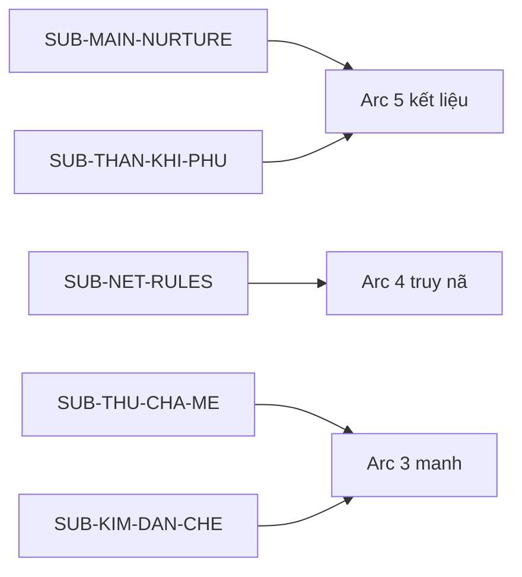

# Arc master outline — Thần Khí (Tier 1 Macro)

> **Task:** `T-plot-project` · **Owner:** plot-architect · 2026-10-08  
> **Spine:** [`../00-story-spine.md`](../00-story-spine.md) · **Beat chi tiết arc:** tạo ở **A2** (`NN-arcN-beats.md`) sau approve macro.

---

## §0 — Tóm tắt ràng buộc Core + world

- Theme epic neo **Foundation `01`**: **Vô tình ↔ Hữu tình**, **Nhân–Quả**, **Cường giả vi tôn** — thể hiện qua nghề sát, nuôi trẻ, và Kim Đan toà trấn.
- **CHAR-001** bắt đầu **Trúc Cơ hậu kỳ**, **tiên lộ đoạn**; combat bằng **kho binh khí** và phù, không vượt cấp vô lý.
- Vùng mở **`REG-CUOC-AN-SAT`**, hub **trấn rèn MC**; mạng sát thủ (**CHAR-003**) và ba thành **Kim Đan toà trấn** ràng buộc lợi ích.
- **Endgame khóa brief:** MC quỳ, **CHAR-002** kết liệu, **tầm phù xa**, thần hồn MC hồi — không đổi khi không có chỉ thị user.
- Thù cha mẹ MC chỉ là **subplot manh** (**SUB-THU-CHA-ME**), không thay main plot nuôi–trả nghiệp.
- Span **~15–25 năm** in-world; **CHAR-002** từ 2–3 tuổi đến trưởng thành.
- Tone **Tru Tiên xám**, POV third limited **CHAR-001**; không tiếng Anh trong prose.

---

## §A1 — Master Story Grid (Macro)

### A1a — Chuỗi sự kiện (theo arc)

| Arc | Band chương *(ước)* | Mục tiêu MC (Logic) | Xung đột chính | Kết quả / trạng thái cuối arc |
| --- | --- | --- | --- | --- |
| **1 — Nhiệm vụ & máu lạnh** | 1–18 | Hoàn thành hợp đồng rừng **sạch tay** và **sống sót** về trấn | Yêu thú, mục tiêu tháo chạy, **đứa trẻ còn sống** | Vợ chồng chết; MC **giữ trẻ**; mang về **bí mật**; mạng **ghi nhận bất thường** |
| **2 — Lò rèn & nuôi ẩn** | 19–35 | **Nuôi sống** CHAR-002 tại trấn mà **không lộ** nghề sát | Trấn lão, chi phí, **CHAR-003** hỏi vụ rừng, nghiệp tăng | CHAR-002 **ổn định** sống chui; MC **mất một phần** uy tín ngầm; quy tắc Vô tình **nứt** |
| **3 — Manh & di chuyển** | 36–55 | **Mua tin** ai thuê giết gia đình rừng; **bảo vệ** manh thù cha mẹ | Thành Đông hắc thị, phe tranh slot, **săn lộ danh** bắt đầu | Biết **một tầng** thuê sát; manh thù cha mẹ **một dấu vết**; buộc **rời trấn** hoặc đổi danh |
| **4 — Truy nã & trả nghiệp** | 56–78 | **Sống** dưới truy nã và **dạy** CHAR-002 **không** biến thành quái vật vô lý | Mạng trừng phạt, Kim Đan gián tiếp, CHAR-002 **biết** nguồn gốc máu | CHAR-002 **trưởng thành**; quan hệ **vỡ**; MC **trọng thương** tích lũy; nghiệp **gần đòi** |
| **5 — Đòn kết liệu** | 79–100 | **Không** có mục tiêu thắng — chỉ **chống** đến khi quả đến | CHAR-002 **ra tay**; MC **không còn** bài tẩy che hết nghiệp | MC **quỳ**, bị **kết liệu**; **phù xa** nơi khác; **thần hồn hồi** — epic chấm |

### A1b — Ma trận tuyến nhân vật (arc × nhân vật)

| Nhân vật | Arc 1 | Arc 2 | Arc 3 | Arc 4 | Arc 5 |
| --- | --- | --- | --- | --- | --- |
| **CHAR-001 (MC)** | Thực thi nhiệm vụ rồi **phá luật** giữ trẻ | Che giấu và **nuôi** | Điều tra **thuê sát** | **Truy nã**; dạy và **dối** | **Nhận quả**; quỳ trước đòn kết liệu |
| **CHAR-002 (đứa trẻ)** | **Nạn nhân** còn sống; phụ thuộc | Học **im lặng** và **sống** | **Hỏi** nguồn gốc; manh huyết mạch | **Biết** MC là sát thủ; nội tâm **tách** | **Ra tay** kết liệu MC theo quả đã gieo |
| **CHAR-003 (mạng)** | Giao **nhiệm vụ rừng** | **Cảnh báo** sai quy cách nghề | **Bán tin** có giá | **Kích hoạt** truy nã / săn thưởng | **Không** cứu MC — luật mạng |
| **Kim Đan toà trấn** | **Ẩn** sau khế thành | Thu phí **gián tiếp** | **Can thiệp** nếu lộ chiến công khai | **Đe doạ** Nguyên Anh logic | **Không** xuất hiện cứu kết |
| **Thù cha mẹ (SUB)** | — | Manh **phụ** qua vật | **Một tên** hoặc **một phe** gợi | **Không** resolve epic | Treo hoặc **echo** trong phù xa |

### A1c — Pacing / Tension Chart (Macro)

| Arc | Tension 1–10 | Nhịp | Rủi ro pacing |
| --- | --- | --- | --- |
| 1 | 7 → 9 | Căng nhanh · **hạ nhẹ** cuối (trẻ ngủ) | Giữ trẻ quá **sớm** mà chưa **sát** đủ xám |
| 2 | 4 → 6 | Tích lũy · **hữu tình** xen kẽ | Nuôi trẻ **dài** không xung đột nghề |
| 3 | 6 → 8 | Điều tra · **mở** không gian thành | Info dump hắc thị |
| 4 | 7 → 9 | Truy nã · **cảm xúc** leo | Power creep thoát truy nã |
| 5 | 9 → 10 → **hạ** (phù xa) | Climax · **cut** mát | Kéo dài van xin hoặc **hòa** sai endgame |

Sparkline macro: `▃▅▃▅▇▅▃▁` *(hạ cuối = phù xa / hồi hồn, không “vui”)*

---

## §B1 — Plot Line & Foreshadow Tracker (Macro)

### B1a — Subplot Map

| Subplot ID | Loại | Mở (arc/ch) | Cao điểm | Đóng / treo | Giao với Main Plot tại |
| --- | --- | --- | --- | --- | --- |
| **SUB-MAIN-NURTURE** | Nhân–Quả | Arc 1 · ch ~15 | Arc 4 | **Payoff Arc 5** (kết liệu) | Nuôi → dạy → **đòi nợ** |
| **SUB-NET-RULES** | Phe / kinh tế | Arc 1 · ch ~3 | Arc 4 | Arc 4 (truy nã) | CHAR-003 · **săn lộ danh** |
| **SUB-THU-CHA-ME** | Bí mật | Arc 2 · manh | Arc 3 | **Treo** hoặc partial Arc 4 | Manh qua **CHAR-002** / thuê sát |
| **SUB-THAN-KHI-PHU** | Bí mật / đạo | Arc 2 · ch ~25 | Arc 5 | **Payoff** phù xa | Title hook **Thần Khí** |
| **SUB-KIM-DAN-CHE** | Phe | Arc 3 | Arc 4 | Treo series | Luật **không chiến** công khai |

### B1b — Foreshadow Matrix (tóm epic)

| FS-ID | Manh mối (what) | Plant *(arc · ch band)* | Payoff *(arc · ch band)* | Trạng thái | Ghi chú Logic |
| --- | --- | --- | --- | --- | --- |
| **FS-001** | Đứa trẻ **không** ngẫu nhiên trên đường tháo chạy | Arc 1 · 10–15 | Arc 3–4 | open | Liên **thuê sát** |
| **FS-002** | MC **không giết** trẻ dù “sạch nghề” | Arc 1 · ~15 | Arc 5 | open | Hữu tình **sealed** |
| **FS-003** | **Tầm phù** xa (không giải thích sớm) | Arc 2 · 25–30 | Arc 5 · 95–100 | open | **D5 brief** — Thần Khí? |
| **FS-004** | Binh khí **mất món** sau trận lớn | Arc 2 · 20+ | Arc 4–5 | open | Giá **bài tẩy** |
| **FS-005** | Manh **gia tu ẩn** cha mẹ MC | Arc 2 · flashback | Arc 3 · partial | open | **Không** lái main |
| **FS-006** | **Nguyên Anh** nhắc qua khế (không lộ mặt) | Arc 3 | Arc 4 | open | Đe doạ **không tay** |

---

## §C1 — Causality & Relationship (Macro)

### C1a — Logic timeline (liên arc)

| Mốc | Arc | Nhân (A) → Hành (B) → Hậu quả (C) |
| --- | --- | --- |
| T1 | 1 | Thuê sát gia đình → MC giết vợ chồng → **Trẻ sống** |
| T2 | 1 | MC **giữ trẻ** → Vi phạm Vô tình nghề → Mạng **ghi nợ** + nghiệp **tăng** |
| T3 | 2 | Nuôi ẩn → Trẻ **gắn** MC → MC **không** cắt tình được |
| T4 | 3 | Điều tra thuê sát → Lộ **một tầng** phe → **Truy nã** tăng |
| T5 | 4 | Trẻ **biết** MC sát cha mẹ nạn nhân → Quan hệ **vỡ** → Chuẩn bị **kết liệu** |
| T6 | 5 | Nghiệp + nợ nuôi → CHAR-002 **ra tay** → MC chết thân · **hồn hồi** qua phù |

### C1b — Conflict matrix (lớp × arc)

| Lớp xung đột | Arc 1 | Arc 2 | Arc 3 | Arc 4 | Arc 5 |
| --- | --- | --- | --- | --- | --- |
| **Nội tâm** | Một phút **mềm** | Kiềm **tình** vs nghề | Lòng **điều tra** vs an toàn trẻ | **Biết** sẽ mất | **Nhận** quả |
| **Phe / thế lực** | Mục tiêu tháo chạy | Trấn · mạng | Thành · hắc thị | **Săn thưởng** | CHAR-002 **đứng một mình** |
| **Môi trường / tu luyện** | Rừng yêu thú | Lò rèn | Ải thành | Trốn **đa trấn** | Địa điểm kết **trống vắng** |
| **Quan hệ CHAR-002** | Cứu **mạng** | **Nuôi** | **Hỏi** | **Hận / nợ** | **Kết liệu** |

---

## §D1 — Beat Sheet (Epic milestones)

**Cấu trúc:** 3 hồi epic rút gọn (Ordinary / Confrontation / Resolution) + **bi kịch Nhân–Quả**.

| Milestone | Arc / band ch | Logic (câu đầy đủ) |
| --- | --- | --- |
| **Opening / Ordinary world** | Arc 1 · 1–5 | MC **thợ rèn** và **sát thủ** đêm; thế giới **Vô tình** ổn định dưới luật mạng và Kim Đan. |
| **Inciting Incident (epic)** | Arc 1 · ~6–8 | CHAR-003 giao **nhiệm vụ rừng** giết vợ chồng tháo chạy. |
| **Plot Point 1** | Arc 1 · ~15 | MC **giữ CHAR-002** sau khi hoàn thành giết; **Hữu tình** phá epic status quo. |
| **Midpoint (epic)** | Arc 3 · ~45 | MC biết **ai thuê** (một tầng) và **manh** thù cha mẹ; **không** thể ở yên trấn. |
| **Plot Point 2 / All is lost** | Arc 4 · ~70 | CHAR-002 **biết** MC là kẻ giết cha mẹ mình; truy nã **bức** MC vào góc. |
| **Climax (epic)** | Arc 5 · ~90–98 | MC **trọng thương**, **quỳ**; CHAR-002 **chĩa kiếm** kết liệu. |
| **Resolution / Denouement** | Arc 5 · ~99–100 | **Tia phù xa** nơi khác; **thần hồn MC hồi** — ý **Thần Khí** mở, không khui hết. |

---

## §E1 — Narrative Rules & Constraints (Macro)

| Rule ID | Nguồn | Nội dung | Phạm vi |
| --- | --- | --- | --- |
| **NR-001** | Brief | **Không** power creep · **không** vật trời rơi giải cứt | Toàn epic |
| **NR-002** | Brief | **Endgame locked** — quỳ, kết liệu, phù xa, hồn hồi | Arc 5 |
| **NR-003** | MC profile | **Bài tẩy = kho binh khí** — **mất món**, tiêu hao | Combat |
| **NR-004** | MC profile | **Không lạm sát** ngoài hợp đồng — uy tín nghề | Hành vi MC |
| **NR-005** | Brief | Thù cha mẹ **phụ** — không chiếm >30% beat arc bất kỳ | Subplot |
| **NR-006** | World | Kim Đan **toà trấn** không đánh công khai giữa thành | Phe |

**Red Flags / Plot holes dự báo:**

| RF-ID | Mô tả rủi ro | Kích hoạt khi | Cách né / xử lý |
| --- | --- | --- | --- |
| **RF-001** | Trẻ **quá sớm** biết tu / quá mạnh | Arc 2–3 | Giữ **phàm / chậm**; kết liệu bằng **tình thế + võ** |
| **RF-002** | MC **lên Kim Đan** không giá | Arc 3–4 | Chỉ **sát ngưỡng** hoặc Kim Đan **tẩy nghiệp tạm** `[CP]` |
| **RF-003** | **Hòa** sau kết liệu | Arc 5 | **Cấm** hồi sinh ngay tại chỗ — chỉ **hồn** + phù **xa** |
| **RF-004** | Thuê sát **vô lý** | Arc 3 | FS-001 **huyết mạch / khế** gia đình nạn nhân |

---

## Arc 1 — Nhiệm vụ & máu lạnh *(ch 1–18)*

| Hạng mục | Nội dung |
| --- | --- |
| **Arc goal** | Reader thấy **Vô tình** nghề sát và **một nhịp** Hữu tình **phá** luật đó qua **CHAR-002**. |
| **Stakes** | MC **sống** nhiệm vụ; sau mốc giữ trẻ — **mạng lưới** và **nghiệp** là nợ. |
| **Inciting → Mid → Lost → Climax → Hệ quả** | Giao nhiệm vụ → rừng → giết vợ chồng → **trẻ còn** → giữ → về trấn **che** → CHAR-003 **hỏi** → arc kết **bí mật** nặng. |
| **Cliff → Arc 2** | Trẻ **sống trong lò rèn**; MC **nghe** tin truy nã **chưa** nhưng **nghiệp** đau. |
| **Cấm arc** | Không **giết trẻ** “để sạch”; không **flashback** dài thù cha mẹ. |

**§Đại cục arc:** Micro **`arc-01-rung-nhiem-vu`** (A2) · region [`reg-cuoc-an-sat`](../world/geo/region/reg-cuoc-an-sat.geojson).

**§Đại cục arc (bổ sung):**

- **Bản đồ:** **TC-TK-001** · **TC-TK-002** — micro [`arc-01-tran-ren-mc`](../world/geo/micro/arc-01-tran-ren-mc.geojson) · [`arc-01-rung-nhiem-vu`](../world/geo/micro/arc-01-rung-nhiem-vu.geojson); index [`02-tieu-cuc-index.md`](../world/02-tieu-cuc-index.md).
- **Chính trị:** Mạng **chưa** truy nã; trấn **chưa** biết trẻ; Kim Đan **không** xuất.
- **Kinh tế arc:** Một nhiệm vụ **~80–200 hạt**; **mất** 2–4 món binh khí **tính vào giá** nghề.
- **Roadmap MC:** **Thành công arc** = giữ trẻ sống + MC sống + **che** được tạm; **thất bại** = lộ trẻ / chết rừng / giết trẻ.

**Beat sheet:** [`01-arc1-beats.md`](01-arc1-beats.md) · *`T-plot-arc-1` 2026-10-08*

---

## Arc 2 — Lò rèn & nuôi ẩn *(ch 19–35)*

| Hạng mục | Nội dung |
| --- | --- |
| **Arc goal** | **Nuôi sống** **Hứa Thời** tại **Thiết Ngọc Trấn** trong **căng thẳng** trấn–mạng–nghiệp; reader thấy **Hữu tình** có **giá hàng ngày** mà **không** hòa giải **Vô tình** nghề. |
| **Stakes** | **Lộ trẻ** tại **Thiết Hành Khẩu** / **Giao Kính Đinh** = truy nã sớm; **lộ nghề** = mất lò; mỗi **nhiệm vụ đêm** = **Sát Nghiệp +1** và **FS-004** cạn kho. |
| **Inciting → Mid → Lost → Climax → Hệ quả** | **Inciting:** **Thâm Liên** **hỏi vụ rừng** *(báo bổ sung)* — **uy tín Vô Danh** **hạ thêm**. **Rising:** **phí trấn** · **Nhật Cung** nuôi · **FS-005** một cảnh · **FS-003** tại **Mật Phù Khố** · **một đêm** nhiệm vụ **ép**. **Mid:** **FS-001 deepen** — hành trang **không** khớp thuê phàm. **Climax arc:** MC **dạy Vô tình** trong khi **gắn** trẻ *(FS-002 nurture)*. **Hệ quả:** **Hứa Thời** **ổn phàm** · MC **túi cạn** · mạng **nghi** · **manh đủ** buộc **Arc 3** **mua tin thành**. |
| **Cliff → Arc 3** | **Hộp đồ / manh FS-001** **không** khớp thuê sát phàm thuần — **Tô Thiết Minh** **phải** **rời hub trấn** *(hoặc đi Đông Hải)* **mua tin**; **chưa** săn thưởng công khai. |
| **Cấm arc** | Trẻ **không** thiên tài sát / **không** biết MC giết phụ huynh; **không** truy nã săn thưởng; **FS-005** **chỉ một cảnh**; **FS-003** **không** giải **Thần Khí** sớm. |

**§Đại cục arc:**

- **Bản đồ:** Micro **`TC-TK-001`** mở rộng — [`geo/micro/arc-01-tran-ren-mc.geojson`](../world/geo/micro/arc-01-tran-ren-mc.geojson) · index [`02-tieu-cuc-index.md`](../world/02-tieu-cuc-index.md) § Arc 2 · **TC-TK-002** read-only **U Lâm**.
- **Chính trị:** **Trần Thiết Ngọc** thu phí · **Trương Hạnh Giáp** **Đông Huan Tuần** · **Thâm Liên** **hạ uy tín** / **hỏi rừng** · **Kim Đan Bắc** **chỉ** echo **FS-006**.
- **Kinh tế arc:** **~30 hạt/tháng** trấn + **10–25 hạt/tháng** nuôi ẩn + **mua tin** cuối arc **50–150 hạt** *(ước)*; nhiệm vụ đêm **thù lao thấp** sau uy tín hạ.
- **Roadmap MC:** **Thành công arc** = trẻ **sống chui** + lò **còn** + **manh FS-001** đủ **Arc 3**; **thất bại** = lộ trẻ / truy nã sớm / resolve thuê sát tại trấn.
- **Neo:** [`01-region-active.md`](../world/01-region-active.md) §8 · roster [`arc-2-roster.md`](../characters/arc-2-roster.md).

**§A2–§E2 (Logic):** **10 beat** · ch **19–35** — chi tiết **§A2–§E2**, beat timeline, Logic keeper tiểu cục trong file beats *(không gộp vào master)*.

| Artifact | Tóm Arc 2 |
| --- | --- |
| **§A2** | Grid **10 beat** · tension **4→8** · cast **CHAR-001–003, 007–009** |
| **§B2** | **FS-001** nurture · **FS-002** nurture · **FS-003** plant ch 29–30 · **FS-004** · **FS-005** ch 28 · **SUB-MAIN-NURTURE** engine |
| **§C2** | Nuôi → **Liên hỏi rừng** → nhiệm vụ đêm → **manh** → **cliff thành** |
| **§D2** | 3-act: setup nuôi → inciting **hỏi rừng** → midpoint **FS-001** → hook **Arc 3** |
| **§E2** | RF-001 · NR-005 · **không** truy nã công khai · **không** power creep |

**Beat sheet:** [`02-arc2-beats.md`](02-arc2-beats.md) · **`T-plot-arc-2`** 2026-10-08

---

## Arc 3 — Manh & di chuyển *(ch 36–55)*

| Hạng mục | Nội dung |
| --- | --- |
| **Arc goal** | MC **mua** và **trả giá** để biết **tầng thuê sát**; mở **thành** và **SUB-THU-CHA-ME**. |
| **Stakes** | **Kim Đan** can thiệp nếu đấu công khai; CHAR-002 **bị** nhắm nếu lộ. |
| **Hệ quả cuối arc** | **Rời** hub trấn cũ; **danh** mới; truy nã **có giá** trên đầu. |
| **Cliff → Arc 4** | **Săn lộ danh** kích hoạt; CHAR-002 **nghe** một phần sự thật. |
| **Cấm arc** | Resolve **hết** thù cha mẹ. |

**Beat sheet:** *(A2)* `03-arc3-beats.md` — pending.

---

## Arc 4 — Truy nã & trả nghiệp *(ch 56–78)*

| Hạng mục | Nội dung |
| --- | --- |
| **Arc goal** | **Trả nghiệp** leo — quan hệ MC–CHAR-002 **vỡ** có nhân; MC **cạn** kho binh khí. |
| **Stakes** | **Chết** trước Arc 5 = fail epic tone; CHAR-002 **không** còn tin MC. |
| **Hệ quả cuối arc** | MC **trọng thương**; CHAR-002 **quyết** (logic kết liệu); **phù** sẵn sàng **xa**. |
| **Cliff → Arc 5** | **Một địa điểm** hẹn / **bẫy** — không thoát **cảm xúc**. |
| **Cấm arc** | MC **thắng** mạng bằng Kim Đan một mình. |

**Beat sheet:** *(A2)* `04-arc4-beats.md` — pending.

---

## Arc 5 — Đòn kết liệu *(ch 79–100)*

| Hạng mục | Nội dung |
| --- | --- |
| **Arc goal** | **Payoff** FS-002, FS-003, SUB-MAIN — **bi kịch** đúng brief. |
| **Stakes** | **Thân** MC; **linh hồn** có **cơ hội** hồi qua **Thần Khí** (phù). |
| **Climax** | Quỳ · kiếm · **song song** phù xa · hồn hồi. |
| **Cấm arc** | **Hòa**; **hồi sinh** tại chỗ; đứa trẻ **hoàn lương** ngay. |

**Beat sheet:** *(A2)* `05-arc5-beats.md` — pending.

---

*Thần Khí — arc master v1 · **`T-plot-project` approved** 2026-10-08.*
