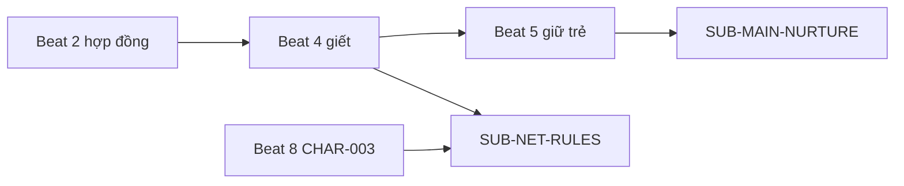
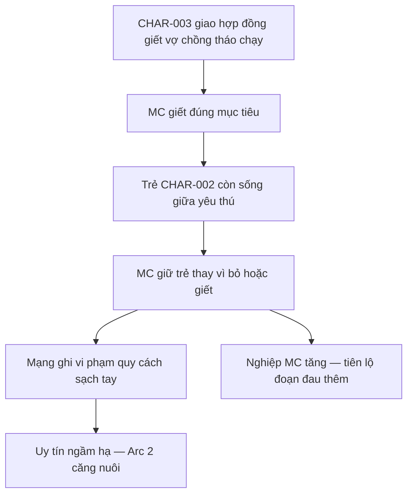

# Arc 1 — Nhiệm vụ & máu lạnh — Beat sheet (Logic)

> **Neo:** [`00-arc-master-outline.md`](00-arc-master-outline.md) · [`../00-story-spine.md`](../00-story-spine.md) · [`../world/01-region-active.md`](../world/01-region-active.md) · [`../characters/00-mc-profile.md`](../characters/00-mc-profile.md)  
> **Band chương *(ước)*:** **ch.1–18**  
> **POV:** Third limited **CHAR-001**  
> **Task:** `T-plot-arc-1` · 2026-10-08

---

## Ràng buộc tiểu cục (Arc 1)

| Tiểu cục | Không gian canon | Phe / kinh tế tóm |
| --- | --- | --- |
| **TC-TK-001** | **`LOC-TWN-MC-FORGE`** — lò rèn ban ngày · xưởng ngầm *(logic)* | Trấn lão thu **~30 hạt/tháng** im lặng; MC uy tín thợ; **CHAR-003** liên lạc qua kênh ngầm |
| **TC-TK-002** | **`LOC-FOREST-MISSION`** — **`ROUTE-NIGHT-HUNT`** · rừng nội địa Tây | Nhiệm vụ **~80–200 hạt** band; mục tiêu **Trúc Cơ sơ** tháo chạy + **phàm nhân** (vợ chồng + trẻ) |

**Combat Arc 1:** MC **Trúc Cơ hậu kỳ**; **kho binh khí** tiêu hao **có giới hạn** (2–4 món lớn / đêm lớn); **không** solo Kim Đan · **không** tăng cảnh giới payoff.

---

## §A2 — Master Story Grid (Arc)

### A2a — Chuỗi sự kiện (beat/chương)

| Beat # | Band ch | Mục tiêu nhân vật (chính) | Xung đột | Kết quả beat |
| --- | --- | --- | --- | --- |
| **1** | 1–2 | CHAR-001 **duy trì** vỏ thợ rèn và **sẵn sàng** nhận việc đêm | Trấn soi · nghiệp âm thầm đau khi nhớ lần trước | Reader neo **Vô tình** nghề · lò **đáng tin** |
| **2** | 3–4 | CHAR-001 **nhận** hợp đồng rừng từ **CHAR-003** | Hợp đồng **sạch tay** — cả trẻ nếu lỡ mắt | MC **cam kết** giết vợ chồng tháo chạy · **chưa** biết có trẻ |
| **3** | 5–6 | CHAR-001 **tới** rừng · **soi** mục tiêu | Yêu thú · mục tiêu **có Trúc Cơ sơ** bảo vệ | MC **chọn** thời điểm · **tốn** một món binh khí trinh sát |
| **4** | 7–9 | CHAR-001 **hoàn thành** giết vợ chồng **đúng nhiệm vụ** | Trúc Cơ sơ **ngã** trước khi gọi viện | Vợ chồng **chết** · hiện trường **theo quy cách nghề** |
| **5** | 10–11 | CHAR-001 **quyết** giữ hay bỏ **CHAR-002** | Trẻ **2–3 tuổi** sống · yêu thú **đến gần** | MC **giữ trẻ** — **FS-002** plant |
| **6** | 12–13 | CHAR-001 **đưa trẻ về** trấn **không lộ** | Nghiệp **tăng** · thiếu **thuốc / lương** trẻ | Trẻ **ẩn** trong xưởng · MC **mất ngủ** |
| **7** | 14–15 | CHAR-001 **đối phó** trấn và **chuẩn bị** lời khai | Trấn lão **hỏi** tiếng ồn / khách lạ | MC **mua thời gian** bằng tiền / uy tín thợ |
| **8** | 16–17 | CHAR-001 **đối diện** CHAR-003 về **sai quy cách** | Mạng **ghi** “có người sống sót không báo” | Uy tín ngầm **hạ một bậc** · **nghiệp** rõ hơn |
| **9** | 18 | CHAR-001 **chấp nhận** nợ và **nuôi** bí mật | **FS-001** mầm — trẻ **không** giống tầng thuê sát phàm | Cliff: trẻ **ở lò** · Arc 2 **nuôi ẩn** |

### A2b — Ma trận cast arc

| Nhân vật | Vào arc | Trong arc | Ra arc |
| --- | --- | --- | --- |
| **CHAR-001** | Thợ rèn · sát thủ **đủ kỷ luật** | Nhiệm vụ rừng → **giữ trẻ** | **Che giấu** · **mệt** · nghiệp **nặng hơn** |
| **CHAR-002** | — | **Nạn nhân** còn sống · **câm / khóc ngắn** | **Phụ thuộc** MC · **chưa** biết MC là sát thủ |
| **CHAR-003** | Giao nhiệm vụ | **Theo dõi** kết quả · **hỏi** bất thường | **Nghi** MC · **chưa** truy nã công khai |
| **Vợ chồng nạn nhân** | Mục tiêu hợp đồng | **Chết** giữa rừng | — |
| **Trấn lão / hàng xóm** | Nền | **Nghe** · **nhìn** lò rèn | **Chưa** biết trẻ |

### A2c — Tension Chart (Arc)

| Beat # / khối ch | Tension 1–10 | Ghi chú |
| --- | --- | --- |
| 1–2 | 3–4 | Nền · **mát** |
| 3–4 | 5–6 | Hợp đồng · di chuyển |
| 5–7 | 8–9 | Giết · **cao** |
| 8–9 | 9 → 7 | Quyết giữ trẻ · **hạ nhẹ** về trấn |
| 10–18 | 6–8 | Che · **CHAR-003** · nghiệp |

Sparkline arc 1: `▃▅▇█▇▅▆▇`

---

## §B2 — Plot & Foreshadow (Arc)

### B2a — Subplot giao nhau arc

| Subplot ID | Trong Arc 1 |
| --- | --- |
| **SUB-MAIN-NURTURE** | **Mở** tại beat 5 — giữ trẻ |
| **SUB-NET-RULES** | Hợp đồng beat 2 · **vi phạm** beat 8 |
| **SUB-THAN-KHI-PHU** | — *(Arc 2 plant FS-003)* |
| **SUB-THU-CHA-ME** | — *(không flashback dài)* |

### B2b — Foreshadow Matrix (arc)

| FS-ID | Manh mối | Plant (arc · ch) | Payoff (deferred) | Trạng thái |
| --- | --- | --- | --- | --- |
| **FS-001** | Trẻ / hành trang **không khớp** thuê sát phàm thuần | Beat 9 · ~18 | Arc 3 | partial plant |
| **FS-002** | MC **không giết** trẻ dù “sạch nghề” | Beat 5 · ~10–11 | Arc 5 | open |
| **FS-004** | Binh khí **mất / gãy** sau rừng | Beat 3–4 | Arc 4–5 | open |
| **FS-006** | Khế **Kim Đan** nhắc qua tin đồn trấn *(một câu)* | Beat 7 · ~14 | Arc 3 | open |

---

## §C2 — Causality & Relationship (Arc)

### C2a — Flowchart nhân–quả (arc)

### C2b — Ma trận quan hệ (đầu → cuối arc)

| Cặp / phe | Đầu arc | Biến cố then chốt | Cuối arc |
| --- | --- | --- | --- |
| **CHAR-001 ↔ CHAR-003** | **Hợp đồng** ngang hàng | MC **che** survivor | **Nghi** · **chưa** săn |
| **CHAR-001 ↔ CHAR-002** | — | MC **cứu mạng** | **Nuôi / giấu** — trẻ **sợ** hoặc **bám** |
| **CHAR-001 ↔ trấn** | **Thuê** im lặng | Tiếng trẻ / khách | **Mua** thời gian |
| **CHAR-001 ↔ nghiệp** | Nền **đau** | Mỗi lần ra tay *(arc)* + **Hữu tình** | **Nặng hơn** — reader thấy **giá** |

---

## §D2 — Beat Sheet (Arc)

| Mốc 3-act | Beat # / band ch | Nội dung Logic |
| --- | --- | --- |
| **Setup (Ordinary)** | 1–2 · ch 1–2 | Lò rèn **sống được**; đêm **một nhịp**; nghề **Vô tình** ổn. |
| **Inciting (arc)** | 2 · ch 3–4 | **CHAR-003** giao **nhiệm vụ rừng** — giết vợ chồng **Trúc Cơ sơ** tháo chạy. |
| **Rising** | 3–4 · ch 5–9 | Trinh sát · **binh khí** · giết **không lạm sát** người ngoài. |
| **Midpoint** | 5 · ch 10–11 | **CHAR-002 sống** — MC **giữ** — epic **đổi quy luật**. |
| **Complications** | 6–7 · ch 12–15 | Về trấn · **ẩn trẻ** · **nghiệp** · trấn **hỏi**. |
| **Climax (arc)** | 8 · ch 16–17 | **CHAR-003** **đối chất** — MC **không** lộ trẻ nhưng **lộ** sai nghề. |
| **Resolution → hook** | 9 · ch 18 | Trẻ **ở lò**; **FS-001**; **nghiệp** — sang **Arc 2 nuôi**. |

---

## Beat timeline

| # | Beat | Ch band | Vai trò 3-act | FS |
| --- | --- | --- | --- | --- |
| 1 | Lò rèn · nghề đêm | 1–2 | Setup | — |
| 2 | Hợp đồng rừng | 3–4 | Inciting | — |
| 3 | Tiếp cận rừng | 5–6 | Rising | FS-004 mầm |
| 4 | Giết vợ chồng | 7–9 | Rising | — |
| 5 | Giữ trẻ | 10–11 | Midpoint | **FS-002** |
| 6 | Về trấn ẩn | 12–13 | Complication | — |
| 7 | Trấn hỏi | 14–15 | Complication | FS-006 mầm |
| 8 | CHAR-003 đối chất | 16–17 | Climax arc | SUB-NET |
| 9 | Nợ nuôi · cliff | 18 | Resolution | **FS-001** |

---

## §E2 — Narrative Rules (Arc)

| Cấm / ranh giới arc | Lý do (Logic/world) |
| --- | --- |
| **Không** giết CHAR-002 để “sạch” | Phá epic pivot · FS-002 |
| **Không** flashback dài thù cha mẹ | Brief **NR-005** |
| **Không** MC flex Kim Đan / vật trời rơi | **NR-001** |
| **Không** CHAR-002 nói thoại triết lý / tu sớm | RF-001 |
| **Không** lạm sát dân rừng ngoài hợp đồng | MC profile **NR-004** |
| Collateral **có chủ đích** chỉ nếu **hợp đồng** nói — arc này **không** |

---

## Logic keeper — tiểu cục

### Beat 1–2 — Lò rèn · vỏ *(TC-TK-001)*

- **Không gian:** **`LOC-TWN-MC-FORGE`** — lò ngoài · xưởng trong *(ẩn)*.
- **Phe & âm mưu:** Trấn **cần** thuế; mạng **cần** im lặng — chưa xung đột mở.
- **Kinh tế cục:** Thu **binh khí phàm ~5–15 hạt**; MC **đủ** sống · **mua** được tin nhỏ.
- **Mục tiêu MC cục:** Không lộ sát khí ban ngày.
- **Thành công =** reader tin **hai mặt** · **Thất bại =** mở đầu như phim sát thủ một chiều.
- **Ràng buộc Power/world:** MC **Trúc Cơ hậu kỳ** — không đánh demo full kho binh khí.

---

### Beat 3–4 — Rừng · hợp đồng *(TC-TK-002)*

- **Không gian:** **`LOC-FOREST-MISSION`** · **`ROUTE-NIGHT-HUNT`**.
- **Phe & âm mưu:** Không biết **ai thuê** — chỉ **CHAR-003** trung gian.
- **Kinh tế cục:** Thù lao **~80–200 hạt** sau báo cáo **sạch**.
- **Mục tiêu MC cục:** Giết vợ chồng · **Trúc Cơ sơ** trước · **một nhịp**.
- **Thành công =** đúng mục tiêu · **Thất bại =** MC chết / lộ danh sớm.
- **Ràng buộc Power/world:** Mục tiêu **Trúc Cơ sơ**; MC dùng **2–3 món** binh khí **tiêu hao** — **FS-004**.

---

### Beat 5 — Giữ trẻ *(TC-TK-002)*

- **Không gian:** Cạnh thi thể · yêu thú **đến**.
- **Phe & âm mưu:** Không có phe cứu.
- **Kinh tế cục:** Mang trẻ = **chi phí** ẩn · **mất** thời gian báo cáo.
- **Mục tiêu MC cục:** **Một phút** — giữ **mạng** trẻ.
- **Thành công =** trẻ **sống** · **Thất bại =** giết / bỏ — **cấm retcon**.
- **Ràng buộc Power/world:** Trẻ **phàm** · MC **có thể** dùng **một món** cản yêu thú **rồi** đi — không trận dài.

---

### Beat 8 — CHAR-003 *(TC-TK-001)*

- **Không gian:** Gặp **gián tiếp** — phù / hộp / quán biên trấn.
- **Phe & âm mưu:** Mạng **cần** “không survivor”.
- **Kinh tế cục:** Uy tín = **nhiệm vụ tiếp** + **giá tin**.
- **Mục tiêu MC cục:** **Không** lộ trẻ · **nhận** hạ uy tín.
- **Thành công =** sống · **nghi** · **Thất bại =** lộ trẻ ngay arc 1.
- **Ràng buộc Power/world:** CHAR-003 **không** combat MC ở arc 1.

---

*Thần Khí — Arc 1 beats v1 · **`T-plot-arc-1` approved** 2026-10-08.*
