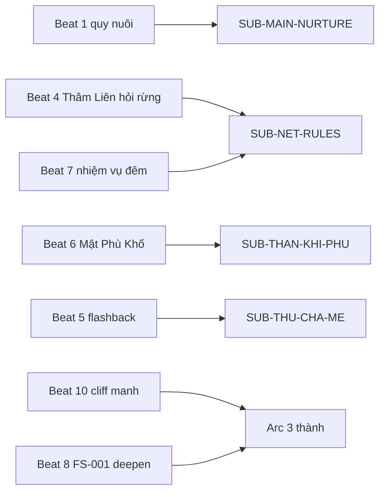
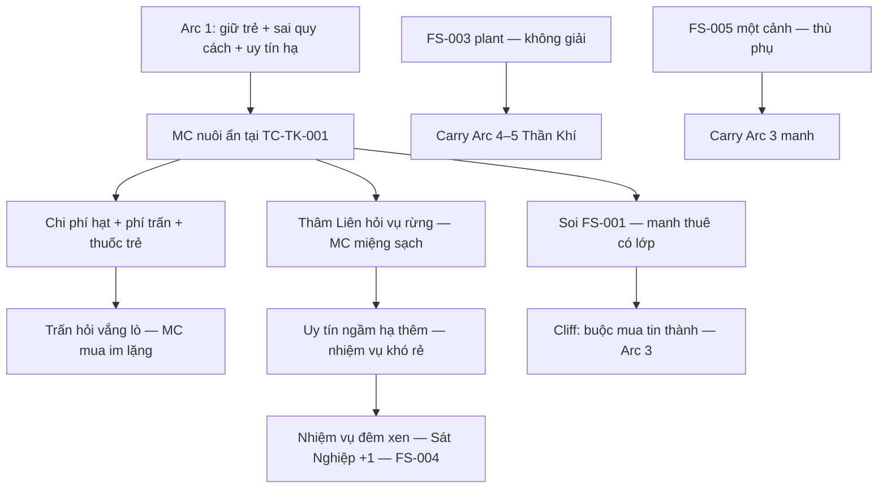

# Arc 2 — Lò rèn & nuôi ẩn — Beat sheet (Logic)

> **Neo:** [`00-arc-master-outline.md`](00-arc-master-outline.md) · [`../00-story-spine.md`](../00-story-spine.md) · [`../characters/arc-2-roster.md`](../characters/arc-2-roster.md) · [`../world/01-region-active.md`](../world/01-region-active.md) §8 · [`../world/02-tieu-cuc-index.md`](../world/02-tieu-cuc-index.md) § Arc 2 · [`../foreshadowing/00-foreshadow-ledger.md`](../foreshadowing/00-foreshadow-ledger.md)  
> **Continuity:** [`../../interface/chapters/chapter-18-no-nuoi.md`](../../interface/chapters/chapter-18-no-nuoi.md) · spine ch.18  
> **Band chương *(ước)*:** **ch.19–35**  
> **POV:** Third limited **CHAR-001 (Tô Thiết Minh)**  
> **Task:** `T-plot-arc-2` · 2026-10-08

---
## Ràng buộc tiểu cục (Arc 2)

| Tiểu cục | Không gian canon | Phe / kinh tế tóm |
| --- | --- | --- |
| **TC-TK-001** *(mở rộng)* | Hub **`LOC-TWN-MC-FORGE`** — **Thiết Ngọc Trấn** · nuôi tại **`LOC-FORGE-CHILD-NICHE`** · **`LOC-FORGE-PHU-VAULT`** *(FS-003)* | Trấn lão **~30 hạt/tháng** · **Nhật Cung Đạo** cung lương · **Thảo Đầu Đàn** thuốc phàm · mạng tại **`LOC-NET-MEET-INN`** |
| **TC-TK-002** *(read-only)* | **`LOC-FOREST-MISSION`** · **U Lâm** — nhắc / flashback / lời khai | Không mở geo mới; **CHAR-003** soi **chuỗi rừng** |

**Combat Arc 2:** MC vẫn **Trúc Cơ hậu kỳ**; **một** nhiệm vụ đêm xen *(beat 7)* — **không** solo Kim Đan · **không** tăng cảnh giới payoff · **FS-004** tiêu hao thêm **một món** band hợp lý.

**Continuity đầu arc:** *(sau ch.18)* **Hứa Thời** tại **`LOC-FORGE-CHILD-NICHE`** · MC **chấp nhận** nợ nuôi · **uy tín ngầm hạ một bậc** · **miệng sạch đóng** · **ba đêm** mạng **3/3** · **Thâm Liên** **nghi** · **chuỗi hở** · túi **mỏng** · **FS-001** mầm *(túi vải · hạt gỗ · giấy gấp · chỉ đỏ)* trong **hòm chứng**.

---

## §A2 — Master Story Grid (Arc)

### A2a — Chuỗi sự kiện (beat/chương)

| Beat # | Band ch | Mục tiêu nhân vật (chính) | Xung đột | Kết quả beat |
| --- | --- | --- | --- | --- |
| **1** | 19–20 | **Tô Thiết Minh** **duy trì** nhịp **Thiết lão** ban ngày và **quy nuôi** tại hầm mà **không** báo **sạch** mạng | **Hết hạn** logic **ba đêm** · **Sát Nghiệp** se khi cho **bánh** · **giấc** MC **cắt** | **Quy im** *(búa · phù · vách Tây)* **lặp** · **chuỗi vẫn hở** · reader thấy **chi phí hàng ngày** **SUB-MAIN-NURTURE** |
| **2** | 21–22 | **Tô Thiết Minh** **trả** nốt **phí im lặng** và **đối** **Trần Thiết Ngọc** về **vắng lò** / tin **U Lâm** | Trấn lão **hỏi** quặng · **mệt** · **rằm** · **không** được vào hầm | MC **mua thời gian** bằng **hạt** + lời **phàm** · **FS-006** echo **khế Kim Đan Bắc** — **không** giải |
| **3** | 23–24 | **Tô Thiết Minh** **mua** lương và thuốc phàm qua **Nhật Cung Đạo** mà **không** lộ **Hứa Thời** | **Trương Hạnh Giáp** tuần **Đông Huan** · mắt chợ · **RF-001** sát **Thiết Hành Khẩu** | Trẻ **khỏe phàm** hơn · MC **tốn** thêm **10–25 hạt/tháng** ẩn · **uy tín thợ** giữ **lò** |
| **4** | 25–27 | **Tô Thiết Minh** **đối diện** **Thâm Liên** — **báo bổ sung** / **hỏi vụ rừng** *(CHAR-003 forest inquiry)* | Mạng soi **quy cách** · **hành lý nặng** · **miệng sạch** vs **sót mạng** | MC **khai** rừng **đủ để sống** · **không** lộ trẻ · **uy tín hạ thêm** · việc mới **khó / rẻ** |
| **5** | 28 | **Tô Thiết Minh** **nhớ** **một cảnh** gia tu ẩn cha mẹ bị lộ — **không** lái cốt | Nội tâm **thù phụ** vs **nợ nuôi** hiện tại | **FS-005** plant **một cảnh** · MC **cắt** flashback · **không** resolve thù |
| **6** | 29–30 | **Tô Thiết Minh** **cất** / **phát hiện** vật **phù lạ** trong **Mật Phù Khố** | Vật **không** khớp đồ mạng · **không** được hỏi trấn | **FS-003** plant — **tầm phù** / khắc **lạ** · MC **khóa** kho · **không** giải **Thần Khí** |
| **7** | 31–32 | **Tô Thiết Minh** **nhận** nhiệm vụ đêm **ép** *(thù lao thấp)* để **giữ** miệng sạch và **trả** nợ hạt | **Vắng lò** ban ngày · **Sát Nghiệp +1** · combat **tiêu binh khí** | Nhiệm vụ **xong** **sạch mục tiêu** · **FS-004** **mất thêm một món** · trấn **hỏi** vắng *(echo beat 2)* |
| **8** | 33–34 | **Tô Thiết Minh** **soi sâu** hành trang **Hứa Thời** và **nghe** đồn **Giao Kính Đinh** | **FS-001** **dấu ấn** / **chỉ đỏ** / **giấy gấp** **không** khớp thuê phàm · hàng xóm **đoán** | **FS-001 nurture** — MC **ghi** manh · **mua** một tin **rẻ** *(Đông Hải / khế)* **chưa** đủ đi **thành** |
| **9** | 35 *(nửa đầu)* | **Tô Thiết Minh** **dạy** **kỷ luật Vô tình** cho trẻ trong khi **tự** **mềm** *(FS-002 nurture)* | MC **muốn** cắt tình · trẻ **bám** **an toàn** | **Quan hệ gắn** sâu hơn · MC **hiểu** **heal sai** = **tăng nghiệp** nếu **giả vờ** không thương |
| **10** | 35 *(nửa cuối)* | **Tô Thiết Minh** **đối chiếu** **hộp đồ** / manh **FS-001** với **án U Lâm** — quyết **phải** **mua tin** **thành** | Manh **đủ nặng** · **túi** **cạn** · **mạng** **không** cứu | **Cliff Arc 3:** thuê sát **có lớp** · **rời trấn** hoặc **đi Đông Hải** **logic** — **chưa** truy nã săn thưởng |

### A2b — Ma trận cast arc

| Nhân vật | Vào arc | Trong arc | Ra arc |
| --- | --- | --- | --- |
| **CHAR-001 (Tô Thiết Minh)** | **Mệt** · **nợ đôi** mạng+nuôi · uy tín **Vô Danh** **hạ một bậc** | Che · nuôi · **mua im lặng** · **một đêm** nhiệm vụ · soi **FS-001** | **Trúc Cơ hậu kỳ** · uy tín **hạ thêm** · **quyết** **Arc 3** đi **thành** |
| **CHAR-002 (Hứa Thời)** | **~2–3 tuổi** · **phàm** · **gian ẩn** only | **Im** · **ăn/uống** · học **quy** · **gắn** MC | **Khỏe phàm** · **vẫn phàm** · **chưa** hỏi nguồn gốc · **manh FS-001** **nặng hơn** |
| **CHAR-003 (Thâm Liên)** | **Nghi** · **chuỗi hở** | **Hỏi vụ rừng** · **hạ uy tín** · **ép** giá · **không** truy nã công khai | **Không** tin MC **sạch** · **sẵn sàng** **bán tin** **Arc 3** |
| **CHAR-007 (Trần Thiết Ngọc)** | **Nợ** **~13 hạt** phí *(30−17)* | **Thu** · **hỏi** vắng · **nhắc** khế Kim Đan | Trấn **tạm yên** · **vẫn** **không** biết trẻ |
| **CHAR-008 (Trương Hạnh Giáp)** | Tuần **Đông Huan** | **Nghe** · **soi** lò **im** | **Chưa** lộ trẻ · **áp lực** tiếp **Arc 3** |
| **CHAR-009 (Phan Thảo Phu)** | — | Bán **thuốc phàm** · **không** hỏi sâu | Chi phí **cố định** trong **túi mỏng** |
| **Kim Đan toà trấn** | **Ẩn** | **FS-006** echo qua trấn lão | **Không** lộ mặt · **đe** gián tiếp |

### A2c — Tension Chart (Arc)

| Beat # / khối ch | Tension 1–10 | Ghi chú |
| --- | --- | --- |
| 1–2 | 4–5 | **Tích lũy** · nuôi · phí trấn |
| 3–4 | 5–6 | Chợ · **Thâm Liên** |
| 5 | 5 | **Hạ** flashback **một cảnh** |
| 6 | 6 | **FS-003** · **bí** |
| 7 | 7–8 | **Đêm** nhiệm vụ · nghiệp |
| 8–9 | 6–7 | Manh · **dạy** trẻ |
| 10 | 7–8 | **Cliff** Arc 3 — **không** climax Kim Đan |

Sparkline arc 2: `▃▄▅▃▅▆▇▅▆▇` *(macro arc 2: 4→6 — hữu tình xen · không flat cao >3 beat)*

---

## §B2 — Plot & Foreshadow (Arc)

### B2a — Subplot giao nhau arc

| Subplot ID | Trong Arc 2 |
| --- | --- |
| **SUB-MAIN-NURTURE** | **Engine** beat 1–3 · 9 — chi phí · **gắn** trẻ |
| **SUB-NET-RULES** | Beat 4 · 7 · 10 — **uy tín hạ** · **hỏi rừng** · **chuỗi** |
| **SUB-THAN-KHI-PHU** | Beat 6 — **FS-003** plant |
| **SUB-THU-CHA-ME** | Beat 5 — **FS-005** **một cảnh** only |
| **SUB-KIM-DAN-CHE** | Beat 2 echo — **không** đánh công khai |

### B2b — Foreshadow Matrix (arc)

| FS-ID | Manh mối | Plant / nurture (arc · ch band) | Payoff (deferred) | Trạng thái |
| --- | --- | --- | --- | --- |
| **FS-001** | Hành trang **Hứa Thời** **không** khớp thuê phàm | **Nurture** beat 8 · ch 33–34 · *(mầm ch.18)* | Arc 3+ | partial |
| **FS-002** | MC **giữ** trẻ · dạy **Vô tình** vs **tình** | **Nurture** beat 9 · ch 35 | Arc 5 | open |
| **FS-003** | **Tầm phù** / vật **lạ** **Mật Phù Khố** | **Plant** beat 6 · ch **29–30** | Arc 5 | open |
| **FS-004** | **Mất / cạn** món kho binh khí | **Nurture** beat 7 · ch 31–32 · *(mầm Arc 1)* | Arc 4–5 | open |
| **FS-005** | Gia tu ẩn **cha mẹ MC** bị lộ | **Plant** beat 5 · ch **28** **một cảnh** | Arc 3 partial | open |
| **FS-006** | **Kim Đan** **khế** trấn | **Echo** beat 2 · ch 21–22 | Arc 3 | open |

---

## §C2 — Causality & Relationship (Arc)

### C2a — Flowchart nhân–quả (arc)

### C2b — Ma trận quan hệ (đầu → cuối arc)

| Cặp / phe | Đầu arc | Biến cố then chốt | Cuối arc |
| --- | --- | --- | --- |
| **CHAR-001 ↔ CHAR-002** | **Nuôi** · **quy im** | MC **dạy** kỷ luật · trẻ **bám** | **Gắn** · MC **sợ** quả **Nhân–Quả** |
| **CHAR-001 ↔ CHAR-003** | **Nghi** · **hạ một bậc** | **Hỏi rừng** beat 4 · **ép** giá beat 7 | **Không** tin · **không** truy nã **công khai** |
| **CHAR-001 ↔ CHAR-007** | **Nợ phí** | **Thu** rằm · **hỏi** U Lâm | **Tạm yên** · **không** biết trẻ |
| **CHAR-001 ↔ trấn / tuần** | **Che** lò | **Đông Huan** · **Giao Kính Đinh** đồn | **RF-001** **chưa** vỡ |
| **CHAR-001 ↔ nghiệp** | **Sát Nghiệp se** | **Nuôi** + **một đêm** sát | **Nặng hơn** · **không** tu lại bình thường |

---

## §D2 — Beat Sheet (Arc)

| Mốc 3-act | Beat # / band ch | Nội dung Logic |
| --- | --- | --- |
| **Setup (Ordinary mới)** | 1–3 · ch 19–24 | **Nhịp lò + hầm** · **phí trấn** · **cung nuôi** — reader thấy **Hữu tình có giá hàng ngày**. |
| **Inciting (arc)** | 4 · ch 25–27 | **Thâm Liên** **hỏi vụ rừng** — mạng **siết** **SUB-NET-RULES** mà **chưa** săn. |
| **Rising / complications** | 5–7 · ch 28–32 | **FS-005** một cảnh · **FS-003** plant · **nhiệm vụ đêm** + **FS-004**. |
| **Midpoint / turn** | 8 · ch 33–34 | **FS-001 deepen** — thuê sát **không** phàm thuần · **tin** **mua** được **một mảnh**. |
| **Climax (arc)** | 9 · ch 35 *(đầu)* | **Dạy Vô tình** vs **tình thật** — **FS-002 nurture** · **nứt kỷ luật** MC. |
| **Resolution → hook Arc 3** | 10 · ch 35 *(cuối)* | **Hộp đồ / manh** **buộc** **đi thành** — **interlude** ngắn trước **di chuyển** Arc 3. |

---

## Beat timeline

| # | Beat | Ch band | Vai trò 3-act | FS / Subplot |
| --- | --- | --- | --- | --- |
| 1 | Quy nuôi · chuỗi hở | 19–20 | Setup | SUB-MAIN · SUB-NET echo |
| 2 | Trấn lão · phí rằm | 21–22 | Setup | FS-006 echo |
| 3 | Nhật Cung · Thảo Đầu | 23–24 | Setup | SUB-MAIN · RF-001 |
| 4 | Thâm Liên hỏi rừng | 25–27 | Inciting arc | SUB-NET · CHAR-003 |
| 5 | Flashback cha mẹ | 28 | Rising | **FS-005** |
| 6 | Mật Phù Khố | 29–30 | Rising | **FS-003** |
| 7 | Nhiệm vụ đêm | 31–32 | Rising | **FS-004** · SUB-NET |
| 8 | FS-001 deepen | 33–34 | Midpoint | **FS-001** |
| 9 | Dạy trẻ · nứt Vô tình | 35 *(đầu)* | Climax arc | **FS-002** nurture |
| 10 | Cliff thành | 35 *(cuối)* | Hook Arc 3 | FS-001 · SUB-MAIN |

---

## §E2 — Narrative Rules (Arc)

| Cấm / ranh giới arc | Lý do (Logic/world) |
| --- | --- |
| **CHAR-002** **không** biết MC giết phụ huynh | Payoff **Arc 4** · roster §8 |
| **Không** truy nã **săn thưởng** công khai | **Arc 4** band · mạng chỉ **hạ uy tín** / **nghi** |
| **Không** trẻ **thiên tài sát** / **mở linh căn** sớm | **RF-001** |
| **Không** **CHAR-002** **sân lò** / **Thiết Hành Khẩu** trừ **sự cố** có hậu quả plot | **02-tieu-cuc-index** · continuity |
| **FS-005** **chỉ một cảnh** flashback | **NR-005** thù cha mẹ **phụ** |
| **FS-003** **không** giải **Thần Khí** on-page | Ledger · **D5 brief** |
| **Không** MC **lên Kim Đan** · **không** vật trời rơi | **NR-001** |
| **Thâm Liên** **không** combat MC arc 2 | Giống Arc 1 · phe **lợi ích** |
| **Không** resolve **ai thuê** đầy đủ | **Arc 3** — cliff chỉ **đủ** **đi thành** |

---

## Logic keeper — tiểu cục

### Beat 1–2 — Gian ẩn · trấn lão *(TC-TK-001)*

- **Không gian:** **`LOC-FORGE-CHILD-NICHE`** · **`LOC-FORGE-WORKSHOP-HIDDEN`** · **`LOC-TRANN-ELDER-YARD`** · **`LOC-TWN-MC-FORGE`** sân lò.
- **Phe & âm mưu:** Trấn **cần** phí · mạng **chưa** truy nã · **Thâm Liên** **chờ** báo bổ sung.
- **Kinh tế cục:** **~30 hạt/tháng** trấn · **nuôi** **+10–25 hạt** ẩn · túi **mỏng** sau **ba mươi + sáu đao**.
- **Mục tiêu MC cục:** **Quy im** + **trả rằm** **không** lộ hầm.
- **Thành công =** trẻ **ổn** · trấn **chưa** biết · **Thất bại =** lộ trẻ / **Trần Thiết Ngọc** ** vào hầm**.
- **Ràng buộc Power/world:** **Không** Kim Đan on-page · nghiệp **se** khi **Hữu tình** hành động.

---

### Beat 3 — Nhật Cung · chợ *(TC-TK-001)*

- **Không gian:** **`ROUTE-TWN-SUPPLY-FORGE`** · **`LOC-TWN-GRAIN-DEPOT`** · **`LOC-TWN-HERB-STALL`** · **`LOC-TWN-MARKET-HEAD`** *(Thiết Hành Khẩu — MC **không** mang trẻ)* · **`ROUTE-TWN-PATROL-EAST`**.
- **Phe & âm mưu:** **Trương Hạnh Giáp** **nghe** lò · hàng xóm **đoán** tại **`LOC-TWN-WELL-CROSS`** *(echo beat 8)*.
- **Kinh tế cục:** **Phan Thảo Phu** **5–15 hạt** / lần · bánh **Trấn Lương Khố**.
- **Mục tiêu MC cục:** **Cung** nuôi **một mình** ra phố.
- **Thành công =** **RF-001** pass · **Thất bại =** trẻ **lộ** chợ.
- **Ràng buộc Power/world:** MC **phàm hóa** mua sắm · **không** dùng linh quang.

---

### Beat 4 — Thâm Liên · hỏi rừng *(TC-TK-001 + echo TC-TK-002)*

- **Không gian:** **`LOC-NET-MEET-INN`** *(Giới Liên Trạm)* hoặc **hầm phù** — **không** mặt bắt buộc.
- **Phe & âm mưu:** Mạng **khép** **U Lâm — Hứa · Lục — kết?** · soi **sót** · **hành lý**.
- **Kinh tế cục:** Uy tín **Vô Danh** **hạ thêm một bậc logic** · thù lao **band thấp hơn** · **tin mua đắt**.
- **Mục tiêu MC cục:** **Khai rừng** **không** lộ trẻ · **không** báo **sạch** nếu **chưa** chọn *(có thể vẫn hoãn)*.
- **Thành công =** sống · **Liên** **nghi** · **Thất bại =** lộ trẻ / **CHAR-003** **kích truy nã sớm** *(cấm)*.
- **Ràng buộc Power/world:** **Forest inquiry** = **quy cách** · **chuỗi** · **U Lâm** — **không** hỏi «trẻ» thẳng nếu **miệng sạch**.

---

### Beat 5 — Flashback gia tu *(TC-TK-001 nội · LOC-TK-CLAN-SHELL-A logic)*

- **Không gian:** **Một cảnh** — tu viện / trang viện **ẩn** *(Tây · gần **LOC-TK-CLAN-SHELL-A**)* — **không** rời trấn MC on-page dài.
- **Phe & âm mưu:** **Kẻ thù** tìm ra cha mẹ — **không** gắn tên phe resolve.
- **Kinh tế cục:** **Không** combat · **không** loot.
- **Mục tiêu MC cục:** **Một** ký ức **giải thích** vì sao **đoạn tiên lộ** / **sát** — **không** lái arc.
- **Thành công =** **FS-005** plant · **Thất bại =** flashback **>1 cảnh** hoặc **>30% ch**.
- **Ràng buộc Power/world:** **NR-005** · **SUB-THU-CHA-ME** **phụ**.

---

### Beat 6 — Mật Phù Khố *(TC-TK-001)*

- **Không gian:** **`LOC-FORGE-PHU-VAULT`** · liên **`LOC-FORGE-WORKSHOP-HIDDEN`**.
- **Phe & âm mưu:** Vật **có thể** từ **cha mẹ MC** / **khế cũ** / **hàng lậu** — **misdirection** ledger.
- **Kinh tế cục:** **Không** bán phù · **khóa** kho.
- **Mục tiêu MC cục:** **Cất** · **không** hỏi trấn · **không** hỏi **Liên**.
- **Thành công =** **FS-003** plant **ch 29–30** · **Thất bại =** giải **Thần Khí** sớm.
- **Ràng buộc Power/world:** **Tia phù** **không** bắn · **không** MC **đọc** được hết.

---

### Beat 7 — Nhiệm vụ đêm *(TC-TK-001 → ROUTE-FORGE-TO-FOREST-HEAD)*

- **Không gian:** **Đầu U Lâm** / trấn lân **nhỏ** — **không** replay trại **Hứa Kỳ**.
- **Phe & âm mưu:** **Thâm Liên** **ép** việc **rẻ** vì **uy tín hạ**.
- **Kinh tế cục:** Thù lao **< band 80** hoặc **trả bằng** **ân nợ** · **mất một món** **FS-004**.
- **Mục tiêu MC cục:** **Sạch mục tiêu** · **NR-004** · **về kịp** che **vắng lò**.
- **Thành công =** nghiệp **+1** · kho **mỏng** · **Thất bại =** lộ trẻ khi **vắng** quá lâu **+** hàng xóm ** vào**.
- **Ràng buộc Power/world:** **Trúc Cơ** đối thủ **≤** mục tiêu band · **2–3 món** tối đa đêm.

---

### Beat 8–10 — Manh · dạy · cliff *(TC-TK-001)*

- **Không gian:** **Hòm chứng** · **`LOC-FORGE-CHILD-NICHE`** · **`LOC-TWN-WELL-CROSS`** · **hầm** đối chiếu **án** đã đốt *(nhớ)* / **vật mẹ**.
- **Phe & âm mưu:** **Tin Đông Hải** / **khế** **mua** được **một lớp** · **chưa** phe resolve.
- **Kinh tế cục:** **50–150 hạt** **mua tin** *(ước)* — **cạn** sau nuôi + nhiệm vụ.
- **Mục tiêu MC cục:** **FS-001** **đủ** để **quyết** **Arc 3** · **dạy trẻ** **không** **ám sát** sớm.
- **Thành công =** cliff **đi thành** · **CHAR-002** **vẫn phàm** · **Thất bại =** resolve thuê sát **tại trấn** hoặc **truy nã sớm**.
- **Ràng buộc Power/world:** **Cliff Arc 3** khớp master **manh trẻ / hộp đồ không khớp phàm** · **Thread** **SUB-THU-CHA-ME** + **FS-001** → **Arc 3**.

---

*Thần Khí — Arc 2 beats v1 · **`T-plot-arc-2`** · plot-architect · 2026-10-08.*
