# Story Spine — Khổ Hải Tiên Lộ

| Trường | Giá trị |
| --- | --- |
| **work_slug** | `kho-hai-tien-lo` |
| **Task** | `T-plot-project` · `plot-architect` · rút gọn từ [`arcs/00-arc-master-outline.md`](arcs/00-arc-master-outline.md) |
| **Trạng thái** | **`approved`** — neo master outline §0b D-01→D-08 LOCKED (2026-10-23) |
| **Neo** | [`../00-master-brief.md`](../00-master-brief.md) v2 · [`characters/01-project-roster.md`](characters/01-project-roster.md) · [`../interface/naming/registry.md`](../interface/naming/registry.md) |
| **Cập nhật** | 2026-10-23 |

---

## 1. Logline

Một thiếu niên phàm nhân duy nhất sống sót sau khi cả thôn bị xóa bằng một tờ lệnh *dời dân khai mạch*, mang theo mảnh đá xám hút cặn độc và ngũ linh căn tạp phẩm, bị đẩy xuống đáy Hắc Nham Khoáng Động của Thái Nhạc Tông, phải trả lời bằng từng lựa chọn: vì sao kẻ sướng người khổ, và vì sao đường tiên lại khổ hơn đường phàm. Đến khi leo lên đủ cao để cầm chính cây bút đã ký lệnh năm xưa, hắn không còn hỏi *ai đúng*, mà hỏi *ai trả.*

**Giọng:** cổ phong, trầm; Chính đạo xám; cái ác nằm ở sổ sách và chữ ký, không ở tiếng cười.

## 2. Hai câu hỏi — neo xuyên epic

1. **Vì sao kiếp người kẻ sướng người khổ?** Luật 9 (căn cơ không công bằng) + Luật 3 (cường giả vi tôn), bị cấu trúc hóa bằng môn quy và khế ước.
2. **Nếu tu tiên là để thoát khổ, cớ sao bước vào tiên lộ rồi lại khổ hơn phàm nhân?** Cái khổ phàm nhân hữu hạn mà còn hơi ấm; cái khổ tiên lộ tầng đáy bị khóa và kéo dài.

Câu trả lời **không** đến từ lời giảng; nó nằm ở *lựa chọn hành vi* của Lâm Hàn khi bị ép, và ở cái giá hắn trả.

## 3. Trục phase

| Phase / Arc | Band chương *(ước)* | Cảnh giới Lâm Hàn | Địa bàn | Câu hỏi 1 — trạng thái | Câu hỏi 2 — trạng thái | Hành vi xác định |
| --- | --- | --- | --- | --- | --- | --- |
| **1 — Tạp Dịch Khu Mỏ** | **1–18** | Phàm → Luyện Khí 4–5 *(giả vờ 2–3)* | Thạch Khê Thôn → Hắc Nham Khoáng Động · Bắc Tuyến | Khổ có người ghi sổ | Khổ vì bị khóa; phàm khổ còn hơi ấm | Không nhịn thay người khác; mộ có tên |
| **2 — Ngoại Môn & Mạch Ngầm** | **19–45** `[giả định]` | Luyện Khí → Trúc Cơ sơ kỳ (khuyết Kim) | Thái Nhạc Tông ngoại môn · biên Tây Mạch | Ai hưởng, ai trả | Khổ là nợ trăm năm | Nhận đồng lõa; chọn leo mà không thành Lương Khôn |
| **3 — Trúc Cơ Phong Vân & Bí Cảnh Cổ** | **46–75** `[giả định]` | Trúc Cơ sơ → hậu kỳ (đủ năm hệ) | Tây Mạch · bí cảnh cổ · biên Hỏa Diễm | Chính–Tà ở ứng xử, không ở công pháp | Ai mua khổ của ai | Cứu người thân; từ chối giao ước làm cọc ngay |
| **4 — Kim Đan Đại Cục & Chân Tướng Chí Bảo** | **76–112** `[110+ giả định]` | Trúc Cơ viên mãn → Kim Đan | Toàn biên Trung Linh–Hỏa Diễm · trận nhãn Hắc Nham | Bất công được thiết kế: *một mạch một mạng* | Ai đứng trên người dưới | Công bố danh sách; ấn có kỳ hạn; giữ đau |

## 4. Dòng arc

```mermaid
flowchart LR
  A0[Ch.1–2 Thạch Khê Thôn: bi kịch gốc]
  A1[Đại cục 1: Tạp Dịch Khu Mỏ · ch.1–18]
  H1[Hạ nhiệt · ch.19–22]
  A2[Đại cục 2: Ngoại Môn và Mạch Ngầm · ch.19–45]
  H2[Hạ nhiệt · ch.46–49]
  A3[Đại cục 3: Bí Cảnh Cổ · ch.46–75]
  H3[Hạ nhiệt · ch.76–79]
  A4[Đại cục 4: Kim Đan và Chân Tướng · ch.76–112]
  EN[Hậu cục · cửa mở]
  A0 --> A1
  A1 -->|Nghiêm đọc tên · ấn đòi hệ thiếu| H1 --> A2
  A2 -->|Trúc Cơ khuyết Kim · bản đồ chọn thôn| H2 --> A3
  A3 -->|giao ước làm cọc · Chu bán bí mật| H3 --> A4
  A4 -->|danh sách · ấn có kỳ hạn| EN
```

## 5. Band chương ước — Đại cục 1 *(khung cho Tier 2)*

| Band | Nội dung | Trạng thái leo |
| --- | --- | --- |
| **1–2** | Thạch Khê Thôn; đêm dời dân; hố khoai; nhặt ấn | Căng đỉnh (ch.2) |
| **3–4** | Lô khổ dịch; Chu Thiết; sổ *dời dân*; đo linh căn; vào Hắc Nham | Hạ → tích lũy |
| **5–8** | Bắc Tuyến; Lương Khôn; Đinh lão; kho phế khoáng; ấn Bậc A; Cố lão thấy | Tích lũy |
| **9–12** | Định mức tăng hai thành; Thanh Mặc xuống khảo mạch; hầm nứt; cục đá sáng | Căng (midpoint ≈ ch.10–11) |
| **13–16** | Kiểm khoáng; Chu bị mua; Đinh nhận tội thay; hầm tối; mộ có tên | Căng đỉnh thứ hai (ch.15) |
| **17–18** | Công trạng; ghi danh ngoại môn; lễ nhận (Vệ đỡ hòm); Nghiêm đọc tên | Hạ → cliff |

## 6. Neo ràng buộc cốt lõi

- Mở màn **1–2 chương** phàm trần, rồi mới vào khu mỏ (brief §8 #4).
- Ấn: Bậc 0 và A ở đại cục 1; không mở C-sơ trọn trước đại cục 3 (roster §2.2).
- Nghiêm Hoằng Độ **ký lệnh**; người thi hành trực tiếp để lộ muộn *(`FS-TBD-VILLAGE-TRUTH`)*.
- Hôn ước Tần Thanh Mặc – Vệ Cảnh Hành **xác nhận** (master outline §0b D-02).
- Bạch Thổ Thôn **`[giả định]` LOCKED** (D-03) — quê Chu Thiết; tên làng có thể đổi, cấu trúc giữ.
- **Phase 1 epic** đóng ở **Kim Đan** (bốn đại cục); đại cục 5+ treo Open (O-02).

## 7. Liên kết

- Master outline: [`arcs/00-arc-master-outline.md`](arcs/00-arc-master-outline.md) — Phần I + Phần II (**approved**).
- Tiếp theo: `T-characters-project-sync` → `T-naming-people-project` *(nếu pending)* → `T-foreshadow-project` → `T-audit-plot-project`.
