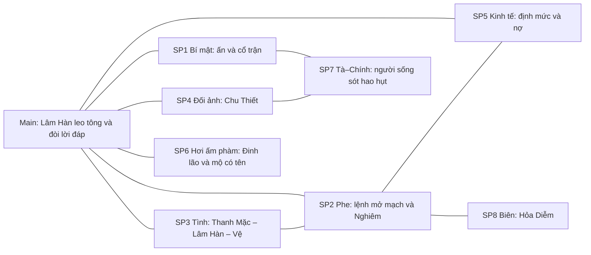

# Arc Master Outline — Khổ Hải Tiên Lộ (Tier 1 · Macro)

| Trường | Giá trị |
| --- | --- |
| **work_slug** | `kho-hai-tien-lo` |
| **Task** | `T-plot-project` · mode **Design Tier 1** · `plot-architect` |
| **Trạng thái** | **`approved`** — Phần I + §0b D-01→D-08 **LOCKED** (human 2026-10-23) |
| **Neo** | [`../../00-master-brief.md`](../../00-master-brief.md) v2 §3–§5, §8 · [`../characters/01-project-roster.md`](../characters/01-project-roster.md) · [`../../interface/naming/registry.md`](../../interface/naming/registry.md) (`canon`) · `foundation/core/01` · `02` (Luật 3, 4, 6b, 9) · `03` §1.1b, §1.2, §2.1–2.2, §3.1b · atlas Càn Nguyên Tinh (`REG-TL-TAY-MACH`) |
| **Rút gọn** | [`../00-story-spine.md`](../00-story-spine.md) |
| **Phạm vi** | Bốn đại cục, chương 1 – 110+ *(band đại cục 2–4 là `[giả định]`)* |

> **Cách đọc:** Human duyệt **Phần I** trước. Agent sau (`foreshadowing-architect`, `character-architect`, `world-builder`, `pro-auditor`) đọc **Phần II**.

---

# PHẦN I — BẢN DUYỆT TÁC GIẢ (Human Story View) — Tier 1

## I.1 — Câu chuyện tổng thể (Executive Story Pitch)

Thạch Khê Thôn nằm dưới chân mạch Tây, nghèo đến mức mùa đông nào cũng phải đếm từng củ khoai. Lâm Hàn mười sáu tuổi, con trai một người thợ đẽo đá, biết đọc vân đá trước khi biết đọc chữ. Đêm cuối cùng của thôn, cha vẫn mài lại cây đục cũ, mẹ vẫn chia ba bát canh loãng, em gái vẫn hỏi chuyện tiên sư. Rồi người của Thái Nhạc Tông tới, đọc lệnh dời dân khai mạch bằng giọng lễ độ, và cả thôn biến mất trong một đêm. Cha mẹ giấu hắn xuống hố đựng khoai. Hắn sống vì họ chọn thế, và không ai đặt tên cho mạng ấy. Giữa tro và khí độc, tay hắn chạm một mảnh đá xám mẻ nằm ngay nơi mạch vừa mở; cơn ho dứt, ngực nặng thêm một chút, như có bàn tay vô hình đặt lên và chờ.

Sổ sách của tông ghi thôn ấy là *dời dân*. Trong sổ không ai chết. Lâm Hàn bị gom vào lô khổ dịch, đo ra ngũ linh căn tạp phẩm, và bị đẩy xuống Hắc Nham Khoáng Động, tầng đáy của một tông môn chính đạo chỉ biết nói bằng định mức. Dưới hầm, kẻ cầm sổ là Lương Khôn, người từng nằm đúng chỗ hắn nằm. Người cùng đói là Chu Thiết. Người dạy hắn nghe đá là Đinh lão, phàm nhân phổi đã hỏng. Người coi kho phế khoáng là Cố lão, mắt đục mà thấy rất rõ. Mảnh ấn hút cặn độc của phế khoáng và đan mốc, nhả ra linh dịch thuần; cặn thì ở lại. Hắn sống sót, tu lên, và học cách giấu, vì kẻ mang vật quá quý mà không đủ sức giữ chỉ là cái hòm đựng cho người khác. Định mức bị đẩy lên, người phản người vì một cục đá sáng, Đinh lão nhận tội thay hắn rồi chết không ai chôn. Hắn dựng cho ông một nấm mộ có tên. Hắn rời Hắc Nham với một cái tên trong sổ ngoại môn, và ở bậc ngọc trên cao, có người đọc cái tên ấy rồi dừng lại.

Đại cục thứ hai đưa Lâm Hàn từ cối xay thô sang cối xay tinh: nợ khế, ngạch đan, ân tình, hôn ước. Tần Thanh Mặc, nữ đệ tử khảo mạch bị gia tộc nợ trói, cùng hắn hiểu thế nào là bị dùng. Vệ Cảnh Hành, thiên tài sinh trên linh mạch, bị lễ nhốt trong lồng ngọc, mang hôn ước với nàng. Để chạm Trúc Cơ, Lâm Hàn phải gom vật liệu năm hệ từ năm bàn tay, và mỗi bàn tay là một món nợ. Hắn cùng Thanh Mặc vẽ bản đồ mạch để đổi công trạng, rồi nhận ra bản đồ ấy cũng dùng để chọn thôn tiếp theo. Lương Khôn, kẻ cầm roi vì sợ roi, bị chính sổ sách gạch tên. Chu Thiết trượt dần vào đan độc vì mẹ và hai em. Lâm Hàn thành Trúc Cơ, nhưng căn cơ khuyết một hệ.

Đại cục thứ ba mở ra bí cảnh cổ, nơi Thái Nhạc Tông, Viêm Thần Tông từ Hỏa Diễm, tán tu và người Tà đạo cùng đổ về. Nghiêm Hoằng Độ không cử người đi để tìm bảo vật; ông đi tìm một đường mạch sống mà không phải ký thêm lệnh. Chính trong bí cảnh, Lâm Hàn biết mảnh ấn là gì, và biết mạng cả thôn mình từng là một nét trong một phép tính cổ: *một mạch, một mạng*. Chu Thiết bán bí mật đổi mạng người nhà. Cố lão chết để mở cho hắn một lối đi. Vệ Cảnh Hành lần đầu chọn một người hơn môn quy. Nghiêm đưa ra một giao ước nhẹ như lễ: *ngươi làm cọc, ta thôi ký.*

Đại cục thứ tư là lần cuối cùng hắn đứng ở ngã ba mà Nghiêm đã đứng. Hắn đến Bạch Thổ Thôn trễ một canh giờ, và nghe lại tiếng ấn hỏi *còn nữa không?* như đêm đầu. Hắn kết Kim Đan giữa cơn tâm ma, bằng cách không để mình thôi đau. Dưới đáy Hắc Nham, nơi trận cổ đang nứt, hắn có quyền định đoạt: trở thành cọc để cả vùng yên, hoặc để Nghiêm ký tiếp. Hắn không chọn đường nào trong hai đường ấy. Hắn đọc to danh sách tất cả những người từng bị gọi là *hao hụt*, đặt ấn vào trận có kỳ hạn, và tự buộc mình vào mạch Tây bằng chính cái đau không chịu quên. Tông môn còn đó, cái ác nằm ở sổ sách còn đó, chỉ có chữ ký đã phải mang tên người.

## I.2 — Chuỗi Domino đại cục (Vì thế → Nhưng)

1. Mạch Tây cạn, biên Hỏa Diễm thúc sát, **vì thế** Nghiêm Hoằng Độ ký lệnh dời dân khai mạch Thạch Khê Thôn bằng chữ mềm mà nghĩa cứng. **Nhưng** cha mẹ Lâm Hàn đã kịp giấu con xuống hố khoai, và giữa tro, hắn nắm được mảnh ấn xám.
2. Sổ ghi *dời dân* nên không ai tìm người sống sót, **vì thế** Lâm Hàn lọt vào lô khổ dịch như một dân dời bình thường. **Nhưng** ngũ linh căn tạp phẩm đẩy hắn xuống đáy Hắc Nham Khoáng Động.
3. Dưới hầm chỉ có định mức quyết sống chết, **vì thế** hắn học nghe đá từ Đinh lão và lén dùng ấn biến phế khoáng, đan mốc thành linh dịch. **Nhưng** ấn giữ lại cặn, và phế khoáng bị rút sạch để lại dấu mà Cố lão nhìn ra.
4. Mảnh ấn đã rời chỗ nên mạch Thạch Khê mở thiếu *(độc giả chưa biết)*, **vì thế** bề trên đẩy định mức Bắc Tuyến lên hai thành. **Nhưng** càng ép, hầm càng nứt, và người phản người vì một cục đá sáng.
5. Quản sự cần kẻ giấu quặng, đầu mục mua Chu Thiết bằng chức tổ trưởng, **vì thế** Chu chỉ ra Đinh lão, người đã nhận che cho Lâm Hàn từ trước. **Nhưng** Lâm Hàn không chịu nhịn thay người khác, và Đinh lão vẫn chết dưới hầm tối.
6. Hắn dựng cho Đinh lão một nấm mộ có tên, **vì thế** công trạng cứu người ở hầm cộng với một lời bảo lãnh từ Tần Thanh Mặc đưa hắn vào sổ ngoại môn. **Nhưng** cái tên *Thạch Khê* trên tờ công trạng khiến Nghiêm Hoằng Độ dừng bút.
7. Ngoại môn đòi nợ khế và ngạch đan, **vì thế** Lâm Hàn cần Trúc Cơ, và Trúc Cơ cần vật liệu năm hệ từ năm bàn tay. **Nhưng** mỗi bàn tay là một món nợ, và người sướng như Vệ Cảnh Hành giữ đúng hệ hắn còn thiếu.
8. Hắn cùng Thanh Mặc vẽ bản đồ mạch để đổi công trạng, **vì thế** Chấp pháp đường có đủ chỗ khuyết để chọn thôn tiếp theo. **Nhưng** chính họ vẽ ra đường dẫn tới Bạch Thổ Thôn, nơi mẹ và hai em của Chu Thiết đang sống.
9. Chấp pháp cần một kẻ gánh tiếng xấu của định mức, **vì thế** Lương Khôn bị gạch tên bằng chính nét mực của ông. **Nhưng** mất chỗ dựa, Chu Thiết nuốt đan độc để giữ chỗ đứng, và Lâm Hàn thành Trúc Cơ với căn cơ khuyết.
10. Bí cảnh cổ hé mở, Nghiêm sai Trúc Cơ đi tìm một đường mạch sống không cần máu, **vì thế** Lâm Hàn thấy trận cổ và biết ấn là trấn ấn. **Nhưng** Chu Thiết bán bí mật về ấn để cứu người nhà, và Cố lão phải chết để Lâm Hàn thoát.
11. Nghiêm đã biết người mang ấn là ai, **vì thế** ông đưa giao ước: *ngươi làm cọc, ta thôi ký.* **Nhưng** Viêm Thần Tông ép biên, kỳ hạn bị rút ngắn, và Nghiêm ký lệnh Bạch Thổ Thôn trước khi Lâm Hàn trả lời.
12. Lâm Hàn đến trễ một canh giờ, Chu Thiết chết giữa hai lằn ranh, Thanh Mặc bị giữ làm con tin, **vì thế** hắn kết Kim Đan trong cơn tâm ma. **Nhưng** hắn thắng ấn bằng cách không để mình thôi đau.
13. Dưới đáy Hắc Nham, hắn có thể làm cọc hoặc để Nghiêm ký tiếp, **vì thế** hắn đọc to danh sách mọi người bị gọi là hao hụt và đặt ấn vào trận có kỳ hạn. **Nhưng** hắn tự buộc mình vào mạch Tây, và cái giá của tiên lộ vẫn chưa hết.

## I.3 — Giao thoa đa tuyến (Subplot & cast)

**Lâm Hàn và Tần Thanh Mặc** gặp nhau lần đầu bằng ba nét vạch trong bụi và một câu hỏi không ai trả lời: *ta chọn mạng nào trước?* Nàng là người duy nhất hiểu cái khổ của kẻ bị dùng mà không cần hắn kể. Hôn ước giữa nàng và Vệ Cảnh Hành là sợi dây gia tộc buộc nàng vào thế gia Vệ; nàng không coi hắn là cứu tinh, và hắn không dám coi nàng là phần thưởng. Hai người cùng vẽ bản đồ, cùng mang tội đồng lõa khi bản đồ ấy chọn thôn, và cùng phải chọn lúc nàng bị giữ làm con tin. Nàng là người chủ động nhất trong cả bộ: chính nàng đưa tấm bản đồ mà tông không cần nàng vẽ.

**Lâm Hàn và Vệ Cảnh Hành** là hai đầu của cùng một mạch. Vệ sinh trên linh mạch, thấy vết máu trên bậc ngọc nhưng chưa dám nhìn; năm xưa thị đồng phàm của hắn bị bỏ lại trong một vụ mạch động mà luật không cho cứu. Lâm Hàn là kẻ mà luật cũng không cho cứu, chỉ khác là hắn sống. Họ không thành bạn. Vệ chỉ làm một việc ở đại cục thứ ba: lần đầu chọn một người hơn môn quy, nhưng vì thị đồng xưa và vì Thanh Mặc, không vì Lâm Hàn. Cái giá hắn trả là danh Chân truyền. Ở đại cục thứ tư, hắn có thể đổi vai.

**Chu Thiết và Lương Khôn** là hai bài học về cái giá của cúi đầu. Chu cúi đầu vì mẹ và hai em, và mỗi lần cúi đều có lý do độc giả hiểu: tổ trưởng, đan độc, tà công, rồi bán bí mật. Lương Khôn cúi đầu vì sợ rớt xuống, nên cầm roi, và mất tất cả khi trên cần một kẻ gánh. Hai người không phải phản diện. Cái chết của Lương là cái chết mà cấu trúc dành cho chính tay sai của nó. Cái chết của Chu là cái chết giữa hai lằn ranh, trên đường cứu mẹ, và không được xóa nợ.

**Nghiêm Hoằng Độ, Cố lão và Đinh lão** là ba cách đối diện *hao hụt*. Nghiêm ký, thắp một nén hương trước bài vị không tên, và vẫn ký. Cố lão thấy, chọn giả mù, rồi trả bằng cái chết. Đinh lão thấy, chọn che cho đứa nhỏ, rồi trả bằng cái chết trước. Ba người không bao giờ đối thoại về triết lý; mỗi người là một câu trả lời cho hai câu hỏi lớn, và Lâm Hàn lớn lên bằng cách đứng ở giữa họ. Ở phía Tà đạo còn một người chưa có tên, kẻ sống sót của một lần mở mạch cũ, đã chọn con đường mà Lâm Hàn suýt chọn: hận thành máy, đau thành lệnh.

## I.4 — Cờ đồng bộ nhân vật

```markdown
character_sync_needed: true
Stubs:
- [Đại diện Tà đạo có Hữu tình] — cần cho đại cục 2 (đầu mối đan độc / tà công của Chu Thiết) → đại cục 3 (bí cảnh, đối chiếu Chính–Tà) → đại cục 4. Gợi ý: một người sống sót của lần mở mạch cũ, đối ảnh của Lâm Hàn (hận thành máy). Có thể là thị đồng cũ của Vệ Cảnh Hành — character-architect quyết.
- [Đối thủ đồng cấp ở ngoại môn] — cần cho đại cục 2 vì tranh ngạch Trúc Cơ Đan cần người có lợi ích riêng, không chỉ là cơ chế.
- [Sư phụ của Vệ Cảnh Hành / trưởng lão thế gia] — cần cho đại cục 2–3 vì hôn ước, mạch động cũ, và cái chọn của Vệ cần người ép từ phía thế gia.
```

*Orchestrator → `T-characters-project-sync` (conditional) trước `T-foreshadow-project` nếu human đồng ý ba stub trên. Phần II giữ nguyên ID/slot; stub thêm sau không phá spine.*

---

# PHẦN II — ĐẶC TẢ KỸ THUẬT (Machine Spec) — Tier 1

## §0 — Tóm tắt ràng buộc Core + world

- **Theme (Core `01` §1, §4):** Nghịch Thiên Nhi Hành; Hữu Tình ↔ Vô Tình; Chính–Tà theo ứng xử; Cường giả vi tôn ↔ Nhân–Quả. Epic bám hai câu hỏi brief §5.1.
- **Wound MC (Core `01` §3.1 + §3.5):** *không đủ quan trọng để được cứu* + *mạng ta mua bằng máu họ*; heal sai: Vô Tình hoặc máy báo thù.
- **Chính đạo xám (roster neo):** cái ác nằm ở sổ sách và chữ ký; không ai trên tin mình ác; không tiếng cười ác. Phu mỏ phàm nhận bạc phàm, tạp dịch nhận linh thạch vụn / đan mốc, hai tầng không quy đổi công khai (`03` §3.1b).
- **Luật then chốt:** Luật 3 (cường giả vi tôn), 4 (nhân–quả có sổ), 6b (phàm–tu chung thành mỏ), 9 (căn cơ không công bằng).
- **Mật độ sức mạnh mở đầu:** Tây Mạch biên Hỏa Diễm, linh khí `dày`; phàm đa số; tu sĩ Luyện Khí thiểu số; Nghiêm là Kim Đan trung kỳ duy nhất ở tầm nhìn đại cục 1.
- **Ấn (roster §2):** Bậc 0 và Bậc A ở đại cục 1; mầm A-cao / dấu hiệu C cuối đại cục 1; Bậc C-sơ không mở trọn trước đại cục 3; C-cao `(chưa lộ)` chỉ nhắc ở đại cục 4.
- **Thời gian `[giả định]`:** đại cục 1 ~2 năm (MC 16→18); 2 ~4–5 năm (→ ~23); 3 ~3–4 năm (→ ~27); 4 ~3 năm (→ ~30). Cố lão 138 → ~148 tuổi, chạm trần thọ nguyên Luyện Khí 120–150 (`03` §1.1b).
- **World handoff:** `foundation-fixed`; **không** rebuild atlas. Cần `world-builder` **delta** cho: cấu trúc Thái Nhạc Tông (tạp dịch → ngoại → nội → chân truyền), tầng Hắc Nham, bí cảnh cổ (neo giả định `REG-TL-PHUC-DIA`), trận nhãn đáy mỏ, vùng Bạch Thổ Thôn. Ghi `[cần world-builder: delta · …]` ở Tier 2 mỗi đại cục.

### §0b — Quyết định Logic Tier 1 *(**LOCKED / APPROVED** 2026-10-23 — human chấp nhận draft plot-architect)*

| Mã | Quyết định | Trạng thái |
| --- | --- | --- |
| **D-01** | **Nghiêm Hoằng Độ = phản diện chính Phase 1 (đại cục 1–4)** cấp tông môn; không phải kẻ «sửa luật thiên hạ» (Core `01` §3.4). Khung phản diện tối hậu epic mở ở Open | **LOCKED** |
| **D-02** | **Hôn ước Tần Thanh Mặc – Vệ Cảnh Hành: xác nhận** (gia tộc Tần nợ · thế gia Vệ chủ nợ + khảo mạch / Mộc căn). Không tam giác ghen; cả hai bị nhốt | **LOCKED** |
| **D-03** | **Bạch Thổ Thôn `[giả định]`** — quê mẹ và hai em Chu Thiết; làng lệnh thứ hai đại cục 4 *(tên làng có thể đổi, cấu trúc giữ)* | **LOCKED** *(giả định)* |
| **D-04** | **Chân tướng ấn = trấn ấn cổ trận** giữ cân mạch Tây; hiến tế có chủ đích; Thái Nhạc Tông trên trận; *huyết dẫn* phàm nhân thay chủ tự nguyện | **LOCKED** |
| **D-05** | Lâm Hàn nhặt ấn → mạch Thạch Khê mở thiếu → định mức Bắc Tuyến tăng → mở đường lệnh Bạch Thổ | **LOCKED** |
| **D-06** | Trúc Cơ cuối đại cục 2 thành công, căn cơ **khuyết Kim**; kiếp khó hơn một bậc; đủ năm hệ đại cục 3 | **LOCKED** |
| **D-07** | Đại kết Phase 1 (đại cục 4): không cọc vĩnh viễn; không để Nghiêm ký tiếp; danh sách hao hụt; ấn **có kỳ hạn**; giữ đau. Treo C-cao + phản diện epic | **LOCKED** |
| **D-08** | Cố lão chết A3 (~ch.66–70); Đinh lão A1 (~ch.15–16); Lương Khôn gạch tên A2 (~ch.37–39); Chu Thiết chết A4 (~ch.89–93) | **LOCKED** |

---

## §A1 — Master Story Grid (Macro)

### A1a — Chuỗi sự kiện (theo arc)

| Arc | Band chương *(ước)* | Mục tiêu MC (Logic) | Xung đột chính | Kết quả / trạng thái cuối arc |
| --- | --- | --- | --- | --- |
| **1 — Tạp Dịch Khu Mỏ** | **1–18** *(~15–20 ch, brief §8 #6)* | Sống sót; giấu ấn; có chỗ đứng trong tông | Định mức Bắc Tuyến · Lương Khôn · phản bội đồng cảnh · ấn lộ dấu | Phàm → Luyện Khí tầng 4–5 *(giả vờ tầng 2–3)*; Đinh lão chết; mộ có tên; ghi danh ngoại môn; Nghiêm biết còn người sống sót Thạch Khê |
| **2 — Ngoại Môn & Mạch Ngầm Tông Môn** | **19–45** `[giả định]` | Trúc Cơ mà không lộ ấn; trả nợ khế; hiểu vì sao mạch cạn | Ngạch Trúc Cơ Đan · thế gia Vệ · Chấp pháp đường · bản đồ chọn thôn · hôn ước | Trúc Cơ sơ kỳ khuyết Kim; Lương Khôn bị gạch; Chu rơi vào đan độc; biết tên người ký lệnh; mang tội đồng lõa |
| **3 — Trúc Cơ Phong Vân & Bí Cảnh Cổ** | **46–75** `[giả định]` | Đủ năm hệ; lấy được chân tướng trận cổ; bảo vệ người mình trân trọng | Bí cảnh liên phe · Tà đạo · Viêm Thần Tông · Chu bán bí mật · giao ước của Nghiêm | Trúc Cơ hậu kỳ, đủ năm hệ (C-sơ dùng thận trọng); Cố lão chết; Vệ chọn một lần; Nghiêm biết người mang ấn |
| **4 — Kim Đan Đại Cục & Chân Tướng Chí Bảo** | **76–112** *(`110+` giả định)* | Ngăn lệnh thứ hai; Kết Đan; quyết ở trận nhãn | Kỳ hạn giao ước · lệnh Bạch Thổ · Viêm Thần ép biên · tâm ma Vô Tình · Nghiêm | Kim Đan có vết nứt; Chu chết; danh sách công bố; ấn đặt có kỳ hạn; MC buộc vào mạch Tây; cửa mở đại cục sau `[giả định]` |

**A1a-2 — Leo thang ba trục** *(nguyên tắc 4; kiểm khi Audit)*

| Arc | Không gian & phe | Năng lực đối đầu / nguy cơ | Cảm xúc & stakes nội tâm |
| --- | --- | --- | --- |
| 1 | Một thôn · một khu mỏ (Bắc Tuyến) · ba tầng quản–đầu mục–tạp dịch | Đối thủ trực tiếp: Luyện Khí tầng 9; nguy: chết hầm, ấn lộ | Sống sót; mộ có tên |
| 2 | Cả tông (ngoại môn) + biên Tây Mạch · ba phe: Chấp pháp · thế gia Vệ · phòng khảo mạch | Trúc Cơ thế gia, chấp sự; nguy: soi linh thạch lộ ấn, kiếp Trúc Cơ khó | Tội đồng lõa (bản đồ chọn thôn); mất Lương, mất Chu một nửa |
| 3 | Tây Mạch + bí cảnh cổ + Viêm Thần Tông + Tà đạo · bốn phe | Nghiêm (Kim Đan) biết ấn; nguy: cưỡng thu, đánh đổi mạng | Hữu tình bị đòi (Cố lão, Thanh Mặc, Chu); niềm tin sai «mạnh mới yên» bị thử |
| 4 | Toàn biên Trung Linh – Hỏa Diễm + điều đình Tam Tông | Kim Đan trung kỳ + Hỏa Diễm; nguy: cả vùng phàm + bản ngã (Vô Tình) | Quyền định đoạt chính mình và kẻ khác; ấn hỏi *còn nữa không?* lần cuối |

**A1a-3 — Cầu nối giữa arc** *(nguyên tắc 5–7: nối chỉ · mang sang · hạ nhiệt)*

| Cầu | Nối chỉ (tuyến mở → đẩy sang) | Mang sang (vết sẹo / nợ có hệ quả hành vi) | Hạ nhiệt (band) |
| --- | --- | --- | --- |
| 1 → 2 | Lệnh mở mạch · sổ *dời dân* · ấn đòi hệ còn thiếu | MC: không nhịn thay người khác nhưng học giấu; mộ có tên của Đinh | **19–22** nhận ngoại môn, nhận nợ khế, tang Đinh lão, đổi nơi ở |
| 2 → 3 | Trúc Cơ khuyết Kim · bản đồ chọn thôn · Chu vào đan độc · tà đạo lò lậu | MC: biết mình đồng lõa; Thanh Mặc: hôn ước lộ rõ | **46–49** hậu Trúc Cơ, Cố lão những ngày cuối, nhận phận sự mới |
| 3 → 4 | Giao ước làm cọc · Chu bán bí mật · Vệ mất danh · Cố lão chết | MC: biết ấn là trấn ấn; chọn kỳ hạn | **76–79** an táng Cố lão, kỳ hạn bắt đầu, biên Hỏa Diễm nóng dần |
| 4 → mở | Ấn đặt có kỳ hạn · C-cao chưa dùng · phản diện epic mở | MC: buộc vào mạch Tây; giữ đau | **107–112** hậu cục, lễ cho người có tên, cửa mở `[giả định]` |

### A1b — Ma trận tuyến nhân vật (arc × nhân vật)

| Nhân vật | Arc 1 | Arc 2 | Arc 3 | Arc 4 | Ghi chú arc |
| --- | --- | --- | --- | --- | --- |
| **Lâm Hàn** | Sống sót, giấu ấn, mộ có tên | Trúc Cơ khuyết Kim, đồng lõa bản đồ | Đủ năm hệ, biết chân tướng, bị Nghiêm biết | Kết Đan, chọn ở trận nhãn | Từ «bị dùng» → «có quyền định đoạt»; giữ đau |
| **Trầm Quân Thạch Ấn** | Bậc 0 → A; cặn; dấu hiệu A-cao | A-cao; đòi hệ thiếu; điểm độc trên bản đồ | C-sơ dè dặt; lộ với Nghiêm | Trấn ấn; hỏi *còn nữa không?* lần cuối | Không tự thoại; mỗi lần dùng lộ thêm rủi ro |
| **Chu Thiết** | Bạn cùng đói; bị mua làm tổ trưởng; chỉ Đinh | Đầu mục; đan độc; lò lậu | Tà công; bán bí mật về ấn | Chết trên đường cứu mẹ | Đối ảnh cúi đầu; nhớ mẹ và em (neo hành vi) |
| **Lương Khôn** | Quản sự Bắc Tuyến; sổ định mức | Bị gạch tên bằng chính sổ | *(vắng — hệ quả)* | *(vắng)* | Hệ quả chính trị: quản sự mới, định mức vẫn tăng |
| **Tần Thanh Mặc** | Xuống khảo mạch; ba nét vạch; bảo lãnh | Hôn ước lộ; bản đồ; đồng lõa | Bí cảnh; bị giữ làm con tin cuối arc | Bị Chấp pháp giữ; tự quyết | Chủ động riêng: tấm bản đồ không ai bắt vẽ |
| **Vệ Cảnh Hành** | Lễ nhận đệ tử; đỡ hòm không đỡ người | Hôn ước; sư phụ ép; gặp Lâm Hàn | Chọn một lần; mất danh Chân truyền | Có thể đổi vai | Không thành bạn tức thì |
| **Cố Quy Trần** | Thấy phế khoáng rút; cháo trên bậc cửa | Giúp ngầm; trao Thủy hệ `[giả định]` | Chết; để lại lối xuống đáy mỏ | *(vắng — di sản)* | Chỉ cho mảnh; không truyền công |
| **Nghiêm Hoằng Độ** | Chỉ xuất hiện cuối arc: đọc tên | Ký lệnh hiện ra qua hồ sơ; bài vị | Biết ấn; giao ước *ngươi làm cọc, ta thôi ký* | Ký lệnh Bạch Thổ; đối mặt ở trận nhãn | Không hối cải nhanh; gánh nghiệp kiếp Nguyên Anh |
| **Đinh Thực** | Dạy nghe đá; che quặng; chết | *(di sản: mộ có tên)* | *(echo)* | Tên trong danh sách | Cái chết không vô nghĩa |
| **Gia đình phàm trần** | Mở màn ch.1–2; hy sinh | Echo: mộ không tên | Echo ở bí cảnh | Mộ Thạch Khê có tên | Không hồi sinh |
| *[stub] Đại diện Tà đạo* | — | Mầm: lò lậu | Bí cảnh: đối chiếu Chính–Tà | Đồng minh hoặc đối ảnh cuối | Chờ character-architect |
| *[stub] Đối thủ ngoại môn* | — | Tranh ngạch Trúc Cơ | Đại thí / bí cảnh | — | Chờ character-architect |
| *[stub] Sư phụ của Vệ* | Bóng (lễ) | Ép hôn ước | Ép chọn | — | Chờ character-architect |

### A1c — Pacing / Tension Chart (Macro)

| Arc | Tension 1–10 *(trung bình / đỉnh)* | Nhịp *(tích lũy / căng / hạ)* | Rủi ro pacing |
| --- | --- | --- | --- |
| 1 | 6 / **9** (ch.2) · 8 (ch.15) | Căng (1–2) → tích lũy (3–10) → căng (11–16) → hạ (17–18) | Hai chương phàm trần kéo dài; hầm mỏ lặp một nhịp |
| 2 | 6,5 / 8 (ch.37–39, 43–44) | Hạ (19–22) → tích lũy (23–32) → căng (33–40) → đỉnh Trúc Cơ (43–45) | **Giữa chùng** 27 chương chính trị; thiếu nhân vật phản diện hiện hữu |
| 3 | 7 / **9** (ch.58–64, 71–73) | Hạ (46–49) → tích lũy (50–57) → căng bí cảnh (58–70) → hạ ngắn → cliff (71–75) | Bí cảnh thành đoạn lore; Chu phản không thuyết phục |
| 4 | 8 / **10** (ch.89–93, 99–106) | Hạ (76–79) → tích lũy (80–88) → đáy (89–93) → Kết Đan (94–98) → đỉnh (99–106) → hạ (107–112) | Chồng climax Kết Đan và trận nhãn; kết quá đẹp |

```
Arc1  ▃▃▃▅▅▅▅▅▇▇▇▇▅▃     (đỉnh ch.2 ▇▇▇▇▇▇▇ rồi hạ)
Arc2  ▃▃▅▅▅▅▇▇▇▅▃
Arc3  ▃▃▅▅▇▇▇▇▇▇▅▇
Arc4  ▃▅▅▇▇▇▇▇▇▇▅▃
```

---

## §B1 — Plot Line & Foreshadow Tracker (Macro)

### B1a — Subplot Map



| Subplot ID | Loại | Mở (arc/ch) | Cao điểm | Đóng / treo | Giao với Main Plot tại |
| --- | --- | --- | --- | --- | --- |
| **SP1** Bí mật ấn · cổ trận | bí mật | A1 ch.2 | A3 ch.58–64 (trấn ấn); A4 ch.99–106 | Đóng A4 (kỳ hạn); treo C-cao | Mỗi lần dùng ấn lộ thêm một rủi ro; giao ước Nghiêm |
| **SP2** Lệnh mở mạch · Nghiêm | phe | A1 ch.2 *(lệnh)* → ch.18 *(đọc tên)* | A4 ch.89–93 (lệnh Bạch Thổ); ch.99–106 | Đóng A4; treo phản diện epic | Định mức → Đinh chết → Nghiêm biết MC |
| **SP3** Tình Mặc · Hàn · Vệ | tình | A1 ch.9–11 | A3 ch.71–75; A4 ch.89–106 | Treo mở (không giải bằng «tự ngộ») | Bản đồ chọn thôn; con tin |
| **SP4** Chu Thiết | tình / phe | A1 ch.3 | A3 bán bí mật; A4 ch.89–93 | Đóng A4 (chết) | Chỉ Đinh → mất chỗ dựa → bán ấn |
| **SP5** Định mức · nợ | kinh tế | A1 ch.9 | A2 ch.37–39 (Lương); A2 ch.43–45 (Trúc Cơ đan) | Đóng A4 (mỏ đóng có điều kiện) | Ngoại môn khế; năm bàn tay |
| **SP6** Đinh lão · mộ có tên | phàm | A1 ch.5 | A1 ch.15–16; A4 ch.107–112 (mộ Thạch Khê) | Đóng A4 | Mộ có tên → danh sách |
| **SP7** Tà–Chính xám | phe | A2 ch.40 | A3 ch.58–70 | Treo / đồng minh A4 | Chu; thị đồng Vệ `[giả định]` |
| **SP8** Biên Hỏa Diễm | phe | A1 ch.4 *(tin biên)* | A4 ch.80–93 | Treo (hậu cục) | Rút ngắn kỳ hạn Nghiêm |

### B1b — Foreshadow Matrix (tóm epic)

> **Slot ID:** `FS-001…` do plot-architect gán *sơ bộ*; `foreshadowing-architect` chuẩn hóa ở `T-foreshadow-project`. Giữ nguyên `FS-TBD-VILLAGE-TRUTH`. Cột «stub» map về roster.

| FS-ID | Manh mối (what) | Plant *(arc · ch)* | Payoff *(arc · ch)* | Trạng thái | Ghi chú Logic |
| --- | --- | --- | --- | --- | --- |
| **FS-TBD-VILLAGE-TRUTH** | Ai thi hành lệnh Thạch Khê; cơ chế huyết dẫn | A1 ch.2 *(lệnh đọc theo lễ)* | A4 ch.99–104 | open | Ký ≠ thi hành; D-04 |
| **FS-001** | Sổ ghi *dời dân* — không ghi chết | A1 ch.3 · echo ch.11 | A4 ch.104 (danh sách) | open | Chữ ký nhẹ |
| **FS-002** | Ấn là trấn ấn cổ trận *(stub ITEM-ORIGIN)* | A1 ch.2, ch.8 | A3 ch.58–64 (partial); A4 ch.99 | open | Mở khóa theo mảnh |
| **FS-003** | Rãnh ngón mòn trên ấn — nhiều chủ cũ *(stub ITEM-PREVIOUS-HOLDER)* | A1 ch.6 | A3 ch.60; A4 | open | «Mười hai» chưa lộ |
| **FS-004** | Cặn trong ấn; điểm độc trên bản đồ *(stub ITEM-RESIDUE)* | A1 ch.6–7 | A4 ch.99 | open | Cặn MC xả nuôi trận |
| **FS-005** | Ấn đòi hệ còn thiếu *(stub C-GATE)* | A1 ch.15–16 | A2 ch.43; A3 ch.50–57; A4 (C-cao nhắc) | open | Năm hệ = năm món nợ |
| **FS-006** | Ấn hứa *không còn đau* | A1 ch.2, ch.6 | A4 ch.94–98, ch.99–106 | open | Từ chối là hành vi |
| **FS-007** | Cố lão từng xuống đáy mỏ *(stub MAC-LAO-PAST)* | A1 ch.5, 8, 16 | A3 ch.66–70 | open | Chỉ cho mảnh |
| **FS-008** | Đáy mỏ / hầm tối / vết nứt *(stub MINE-DEEP)* | A1 ch.11, 15 | A4 ch.99 (trận nhãn) | open | Hầm tối nơi Đinh chết |
| **FS-009** | Định mức tăng vì mạch Thạch Khê thiếu *(stub MINE-QUOTA)* | A1 ch.9 | A4 ch.99 | open | D-05 |
| **FS-010** | Nợ tộc Tần + hôn ước *(stub TAN-DEBT)* | A1 ch.9–10, 17 | A2 ch.24 (lộ); A3 ch.71; A4 | open | D-02 |
| **FS-011** | Thị đồng phàm của Vệ *(stub VE-PROMISE)* | A1 ch.17 | A3 ch.65–75; A4 | open | Có thể nối stub Tà đạo |
| **FS-012** | Chu cúi đầu từng bước *(stub CHU-SHORTCUT)* | A1 ch.9, 14 | A2 đan độc; A3 bán; A4 chết | open | Mỗi bước có lý do mẹ và em |
| **FS-013** | Đinh lão che quặng *(stub DINH-FATE)* | A1 ch.5, 7 | A1 ch.15–16; A4 (tên trong danh sách) | open | Chết có hệ quả |
| **FS-014** | Bài vị không tên của Nghiêm | A2 ch.34 | A4 ch.104 (danh sách thay bài vị) | open | Hương mỗi năm |
| **FS-015** | Mộ có tên | A1 ch.2 *(mộ không tên)*; ch.16 (Đinh) | A4 ch.110 (Thạch Khê) | open | Vòng đóng đại cục 4 |
| **FS-016** | Bản đồ mạch khuyết của Thanh Mặc | A1 ch.9, 11 | A2 ch.33–35 (chọn thôn); A4 | open | Đồng lõa |
| **FS-017** | Hỏa Diễm thúc biên · Viêm Thần Tông | A1 ch.4–5 | A3 ch.58; A4 ch.80–93 | open | Rút ngắn kỳ hạn |
| **FS-018** | Nghiêm ký chậm một canh giờ; nghiệp kiếp Nguyên Anh | A1 ch.18 | A4 ch.99–106 | open | Không hối cải nhanh |
| **FS-019** | Người Tà đạo sống sót hao hụt cũ *(mới — stub character)* | A2 ch.40 | A3 ch.58–70; A4 | open | Chờ cast |
| **FS-020** | Cái giá Nhân–Quả của ấn lên kiếp Trúc Cơ / Kim Đan | A2 ch.43–45 | A4 ch.94–98 | open | Kiếp nặng hơn một bậc |

---

## §C1 — Causality & Relationship (Macro)

### C1a — Logic timeline (liên arc)

| Mốc | Arc | Nhân (A) → Hành (B) → Hậu quả (C) |
| --- | --- | --- |
| M1 | 1 | Mạch Tây cạn và Hỏa Diễm thúc biên → Nghiêm ký lệnh dời dân khai mạch Thạch Khê → thôn bị xóa, sổ ghi *dời dân*. |
| M2 | 1 | Cha mẹ giấu Lâm Hàn → hắn nhặt ấn ở mạch nhãn → mạch Thạch Khê mở thiếu (D-05). |
| M3 | 1 | Mạch thiếu, bề trên đòi bù → Lương Khôn đẩy định mức hai thành → hầm Bắc Tuyến nứt, người phản người. |
| M4 | 1 | Quản sự tìm kẻ giấu quặng → Chu Thiết bị mua, chỉ Đinh → Đinh lão chết dưới hầm tối; Lâm Hàn dựng mộ có tên. |
| M5 | 1 | Công trạng ở hầm + Tần Thanh Mặc bảo lãnh → Lâm Hàn ghi danh ngoại môn → Nghiêm đọc tên *Thạch Khê*. |
| M6 | 2 | Ngoại môn đòi nợ khế + Trúc Cơ cần năm hệ → Lâm Hàn gom từ năm bàn tay → mang năm món nợ. |
| M7 | 2 | Lâm Hàn và Thanh Mặc vẽ bản đồ đổi công trạng → Chấp pháp chọn thôn kế tiếp → Bạch Thổ Thôn vào tầm lệnh. |
| M8 | 2 | Chấp pháp cần kẻ gánh tiếng xấu định mức → Lương Khôn bị gạch tên → Chu mất chỗ dựa, nuốt đan độc. |
| M9 | 2 | Lâm Hàn Trúc Cơ bằng A-cao + bốn hệ → căn cơ khuyết Kim, kiếp nặng một bậc → nợ Nhân–Quả tích. |
| M10 | 3 | Nghiêm sai Trúc Cơ tìm đường mạch không cần máu → bí cảnh cổ lộ trận → Lâm Hàn biết ấn là trấn ấn. |
| M11 | 3 | Chu bán bí mật cứu người nhà → Nghiêm biết người mang ấn → giao ước *ngươi làm cọc, ta thôi ký*. |
| M12 | 3 | Cố lão chết mở lối; Vệ Cảnh Hành chọn một lần → Lâm Hàn thoát, Vệ mất danh Chân truyền. |
| M13 | 4 | Viêm Thần ép biên, kỳ hạn rút ngắn → Nghiêm ký lệnh Bạch Thổ → Lâm Hàn đến trễ; Chu chết; Thanh Mặc bị giữ. |
| M14 | 4 | Tâm ma Vô Tình tận cùng → Lâm Hàn giữ đau và kết Kim Đan → có sức đến đáy Hắc Nham. |
| M15 | 4 | Trận cổ nứt, hai lối sai (làm cọc / ký tiếp) → Lâm Hàn công bố danh sách, đặt ấn có kỳ hạn → mạch giữ, tông mất tính hợp pháp của huyết dẫn. |

### C1b — Conflict matrix (lớp × arc)

| Lớp xung đột | Arc 1 | Arc 2 | Arc 3 | Arc 4 |
| --- | --- | --- | --- | --- |
| **Nội tâm** | Tội sống sót; nhẫn vs không nhịn thay | Đồng lõa; muốn lên vs sợ thành Lương Khôn | Hữu tình vs mạnh mới yên; giao ước làm cọc | Vô Tình (không đau) vs giữ đau; định đoạt |
| **Phe / thế lực** | Lương Khôn – đầu mục – tạp dịch | Chấp pháp · thế gia Vệ · phòng khảo mạch | + Viêm Thần Tông · Tà đạo | + Tam Tông điều đình · Nghiêm tối hậu |
| **Môi trường / tu luyện** | Hầm Bắc Tuyến; sát khí; phế khoáng | Ngạch đan; kiếp Trúc Cơ; soi linh thạch | Bí cảnh cổ; đủ năm hệ; Kim Đan chiếu | Trận nhãn; kiếp Kim Đan; cặn trận |
| **Triết lý (câu hỏi 1 · 2)** | Q1: sổ sách có người ghi · Q2: bị khóa | Q1: ai hưởng, ai trả · Q2: khổ là nợ | Q1: Chính–Tà ở ứng xử · Q2: ai mua khổ của ai | Q1: bất công được thiết kế · Q2: ai đứng trên người dưới |
| **Kinh tế** | Định mức; bạc phàm vs đan mốc | Ngạch Trúc Cơ Đan; khế ngoại môn | Linh thạch bí cảnh; thuế biên | Đóng mỏ có điều kiện; giá hiến tế |

---

## §D1 — Beat Sheet (Epic milestones)

**Cấu trúc đã chọn:** *Ba hồi epic* (setup – đối đầu – quyết) kết hợp bảy mốc template; bốn đại cục chia hồi: Hồi 1 = Arc 1 + đầu Arc 2 · Hồi 2 = Arc 2 (giữa) → Arc 4 (giữa) · Hồi 3 = Arc 4 (cuối).

| Milestone | Arc / band ch | Logic (câu đầy đủ, không hàm ý) |
| --- | --- | --- |
| **Opening / Ordinary world** | A1 · ch.1 | Lâm Hàn sống đủ ăn qua mùa gặt ở Thạch Khê Thôn, quen đói, quen đọc vân đá, quen đoán chuyện chẳng lành từ điều nhỏ nhất. |
| **Inciting Incident (epic)** | A1 · ch.2 | Tông môn đọc lệnh dời dân, cả thôn biến mất, cha mẹ giấu hắn, hắn nhặt ấn và sống sót mà không ai đặt tên cho mạng ấy. |
| **Plot Point 1** *(vào hồi 2)* | A1 · ch.17–18 | Lâm Hàn ghi danh ngoại môn và rời Hắc Nham, vào thế giới có tên trong sổ, còn Nghiêm Hoằng Độ biết Thạch Khê vẫn còn một người sống. |
| **Midpoint (epic)** | A3 · ch.58–62 | Trong bí cảnh cổ, Lâm Hàn biết ấn là trấn ấn và thôn hắn bị tế theo phép tính *một mạch một mạng*; hắn đổi từ «nạn nhân may mắn» thành «người giữ phần còn lại của phép tính». |
| **Plot Point 2 / All is lost (epic)** | A4 · ch.89–93 | Lâm Hàn đến trễ ở Bạch Thổ Thôn, Chu Thiết chết, Thanh Mặc bị giữ, ấn hỏi *còn nữa không?* và lần đầu hắn muốn đáp *có*. |
| **Climax (epic)** | A4 · ch.99–106 | Ở trận nhãn Hắc Nham, hắn có sức đủ để làm cọc hoặc để Nghiêm ký tiếp, và chọn đường thứ ba: danh sách hao hụt công bố, ấn đặt có kỳ hạn, hắn giữ đau. |
| **Resolution / Denouement** | A4 · ch.107–112 | Mạch Tây giữ, chữ ký phải mang tên, mộ Thạch Khê có tên, Lâm Hàn buộc vào mạch Tây, Nghiêm treo, cửa mở sang đại cục sau `[giả định]`. |

---

## §E1 — Narrative Rules & Constraints (Macro)

| Rule ID | Nguồn | Nội dung | Phạm vi |
| --- | --- | --- | --- |
| **R-01** | Core `03` §2.2; brief §5.3 | Ấn không miễn phí: vật liệu, tinh huyết / thần thức, cặn, Nhân–Quả; mỗi lần dùng lộ thêm một rủi ro | Cả epic |
| **R-02** | Brief §8 #4 | Mở màn 1–2 chương phàm trần; không nhồi lore; gia đình hiện bằng chi tiết đời thường | Arc 1 ch.1–2 |
| **R-03** | Brief §8 #6 | Arc 1 ngắn ~15–20 chương; chốt band 1–18 | Arc 1 |
| **R-04** | Brief §8 #3; roster §2.2 | Arc 1 chỉ Bậc 0, A, dấu hiệu A-cao; **không** mở C-sơ trọn vẹn trước đại cục 3; C-cao chỉ nhắc ở đại cục 4 | Arc 1–4 |
| **R-05** | Core `01` §6.2; roster neo | Không phe thuần ác / thuần thiện; không tiếng cười ác; Chính đạo ác nằm ở sổ và chữ ký | Cả epic |
| **R-06** | Core `03` §2.1–2.2 | Không vượt cấp bằng ý chí; Luyện Khí / Trúc Cơ không giết Kim Đan ổn định bằng sức; kết cục với Nghiêm bằng lựa chọn + địa lợi + Nghiêm suy yếu | Arc 3–4 |
| **R-07** | Core `03` §3.1b | Bạc phàm và linh thạch vụn / đan mốc là hai tầng, không quy đổi công khai | Arc 1–2 |
| **R-08** | Roster cấm retcon | Gia đình chết, không hồi sinh; mạng của họ không có người đặt tên với thế gian, có tên với MC | Cả epic |
| **R-09** | Brief risk 2 | Triết lý qua tương phản cụ thể (bát cơm phàm vs đan mốc; một câu nhẹ nghìn mạng), không giảng | Cả epic |
| **R-10** | Brief §9 | Ngôi ba giới hạn bám Lâm Hàn; không Sub-POV trừ khi human duyệt; hậu trường lộ qua vật chứng, lời nghe được, hay cảnh MC chứng kiến | Cả epic |
| **R-11** | Roster §2.1 | Ấn không lời, không bảng chữ, không dẫn đường; chỉ nặng / lạnh / đói | Cả epic |
| **R-12** | Roster Cố lão | Cố lão không truyền công tức thì, không trả lời mọi câu, chết trước cuối epic | Arc 1–3 |
| **R-13** | Roster Thanh Mặc | Thanh Mặc không là phần thưởng; có chủ động riêng; hôn ước không giải bằng «tự ngộ» | Cả epic |
| **R-14** | Plot-architect nguyên tắc 7 | Mỗi chuyển arc có band hạ nhiệt (§A1a-3) | Cả epic |
| **R-15** | Plot-architect nguyên tắc 4–6 | Escalation ba trục + thread stitching + carry-over | Cả epic |
| **R-16** | Brief §7 risk 3 | Không dùng cốt, nhân vật, micro-setting của `ham-mo` | Cả epic |
| **R-17** | Quy ước repo | Tên mới → registry trước; không đưa tên mới vào Core lặng lẽ | Cả epic |
| **R-18** | Core `01` §6.1–6.2 | Đại kết không giải bằng «tự ngộ» không giá hay hy sinh vô giá | Arc 4 |

**Red Flags / Plot holes dự báo:**

| RF-ID | Mô tả rủi ro | Kích hoạt khi | Cách né / xử lý |
| --- | --- | --- | --- |
| **RF-01** | Ấn thành máy lên cấp, mất chất khổ hải | MC lên ≥2 tầng liên tiếp không thiếu vật liệu | Vật liệu phụ thuộc kho; thiếu vật liệu tốc độ chỉ bằng ngũ linh căn thường; cặn và rủi ro mỗi lần |
| **RF-02** | Mở màn phàm trần kéo lê hoặc quá vội | Ch.1–4 > 20% band hoặc ch.3 đã vào hầm | Ch.1–2 phàm trần; ch.3–4 khổ dịch; ch.5+ hầm |
| **RF-03** | Triết lý thành nghị luận | Nhân vật giảng *vì sao kẻ sướng người khổ* | Chỉ tương phản cảnh; đối thoại nói số, phần, định mức |
| **RF-04** | Nghiêm thành kẻ ác | Nghiêm cười, hả hê, đe dọa | Chỉ lễ, hương, bài vị, ký chậm; có lý do độc giả hiểu |
| **RF-05** | Chân tướng cổ trận thành bài giảng | Một chương lộ trọn trận | Rải ba mảnh A2 / A3 / A4; mỗi mảnh gắn vật chứng |
| **RF-06** | Hôn ước thành tam giác ghen tuông | MC «tranh nàng» | Cả hai bị nhốt; MC không tranh; Thanh Mặc quyết |
| **RF-07** | Chu sa ngã vì plot cần | Chu đổi đột ngột | Mỗi bước có lý do mẹ và em; Arc 1 có lần cúi đầu nhẹ trước |
| **RF-08** | Lương Khôn bị giải quyết «một nhát» | Lương chết không hệ quả | Bị sổ sách nuốt; quản sự mới; định mức vẫn tăng |
| **RF-09** | MC thắng Kim Đan bằng sức | Cảnh đấu quyết định ở A4 | Địa lợi trận + Nghiêm suy yếu + lựa chọn; không đánh bại bằng «một nhát» |
| **RF-10** | Đại kết «hy sinh đẹp» = Vô Tình | MC làm cọc vĩnh viễn, thôi đau | Kỳ hạn; giữ đau; danh sách; MC không biến thành đá |
| **RF-11** | Arc 2 giữa chùng | ≥6 chương liên tiếp không đổi stakes | Đan quest năm hệ + bản đồ chọn thôn + Lương Khôn + lò lậu |
| **RF-12** | Cố lão thành sư phụ trả lời mọi câu | Cố lão giải thích trận | Chỉ cho mảnh; chết ở A3 |
| **RF-13** | Cảm giác giống `ham-mo` | Mục tiêu chỉ «thoát hầm» | MC có tên, gia cảnh; mục tiêu leo và đòi lời đáp |
| **RF-14** | Mâu thuẫn tuổi / thọ nguyên | Dòng thời gian lệch | Bảng thời gian §0; Tier 2 kiểm lại |
| **RF-15** | Bạch Thổ Thôn không được xác nhận | World / human đổi tên | Đổi tên làng, giữ cấu trúc D-03 |
| **RF-16** | Cưỡng thu ấn thành lối thoát dễ | Nghiêm lấy ấn và xong | Ấn chỉ nhận chủ; cưỡng thu cần ép MC (roster §2.5) |
| **RF-17** | Vệ đổi vai quá nhanh | Vệ thành bạn của MC | Chỉ một hành vi trả giá; động cơ vì thị đồng và Thanh Mặc |
| **RF-18** | Arc 3 không lớn hơn Arc 2 | Tiêu chí §A1a-2 không đạt | Bí cảnh liên phe; Nghiêm biết ấn; Hữu tình bị đòi |
| **RF-19** | Echo mở mạch lặp lại cùng một cảm | Arc 4 giống ch.2 | Arc 1: bất lực vì nhỏ; Arc 4: bất lực vì đến trễ dù đã mạnh |

---

## Tier 2 — Con trỏ theo arc *(không sửa Tier 1 · D-01→D-08 giữ nguyên)*

### Arc 1 — Tạp Dịch Khu Mỏ *(ch.1–18)* — `approved` *(complete 2026-10-23)*

Beat sheet: [`01-arc1-beats.md`](01-arc1-beats.md) *(Phần I Human + Phần II §A2–E2)*.

| Hạng mục | Nội dung |
| --- | --- |
| **Arc goal** | Hàn sống sót đáy Bắc Tuyến, giấu ấn, học không nhịn thay người khác, và rời mỏ với một chỗ đứng trong sổ ngoại môn cùng một mộ có tên. |
| **Stakes** | Chết hầm hoặc ấn lộ; ràng buộc: Bậc 0–A, dấu hiệu A-cao, không C-sơ; Hàn kết LK4 *(sổ LK3)*. |
| **Inciting → Mid → Lost → Climax → Hệ quả** | Ch.2 hố khoai, nhặt ấn → ch.11 vách nứt, đá sáng, phản bội → ch.15 Đinh nhận tội thay, hầm tối sập → Đinh chết, mộ có tên → ch.17–18 tiến cử, quê thật, Nghiêm dừng bút. |
| **Cliff → Arc 2** | Bản chép hồ sơ «Thạch Khê» nằm trên bàn Nghiêm; ấn đói đúng một chỗ; ngoại môn đòi nợ khế *(FS-018, FS-005, FS-010)*. |
| **Cấm arc** | Không Nghiêm đối thoại với Hàn; không «trấn ấn» thành lời; không tên Đỗ Viễn / Tro Lão; Hàn không thắng Lương bằng sức; ấn không cứu Đinh. *(§E2a R-A1-01→14.)* |

**§Đại cục arc (world handoff):**

- **Bản đồ:** `REG-TL-TAY-MACH` · `MICRO-ARC01-TAY-MACH` / `TC-KHTL-A1`; `LOC-VIL-001` → `LOC-MINE-001` / `LOC-MINE-001-N` → `SECT-001`; Bạch Thổ `LOC-VIL-002` chỉ nhắc quê Chu.
- **Chính trị:** Nghiêm ký lệnh; nhóm khai mạch thi hành; Lương Khôn là kênh định mức; phòng khảo mạch có quyền ký sổ sự cố; rủi ro: ấn lộ, Lương muốn đẩy Hàn đi.
- **Kinh tế:** phàm nhận bạc, hữu căn nhận đan mốc; ch.9 tăng hai thành *«bổ khuyết Khê»*; ch.16 đóng đáy ba tháng, định mức vẫn không đổi.
- **Roadmap MC:** thành công = sống, LK4, mộ có tên, ghi quê thật; thất bại có chủ ý = không cứu được Đinh; phẩm chất lộ qua lựa chọn: *là ta*, từ chối phẳng lặng, ghi quê thật.
- **Neo:** `01-region-active.md` · `02-tieu-cuc-index.md`.

---

### Arc 2 — Ngoại Môn & Mạch Ngầm Tông Môn *(ch.19–45)* — `draft — awaiting human`

Beat sheet: [`02-arc2-beats.md`](02-arc2-beats.md) *(Phần I Human + Phần II §A2–E2)*.

| Hạng mục | Nội dung |
| --- | --- |
| **Arc goal** | Lâm Hàn trụ vững trong cối xay tinh của ngoại môn (khế nợ, sổ ngạch, thế gia), gom đủ dẫn chất để đột phá Trúc Cơ mà không lộ mảnh ấn, biết được tên người đã ký lệnh xóa Thạch Khê, nhưng phải trả giá bằng nỗi đau đồng lõa khi tấm bản đồ khảo mạch mình vẽ bị dùng để chọn Bạch Thổ Thôn. |
| **Stakes** | Nếu thất bại: bị soi linh lực lộ ấn (cưỡng thu / sát thân), hết hạn khế bị đẩy lại xuống đáy hầm, hoặc kẹt Luyện Khí nhìn người thân của bạn bị đưa vào sổ *dời dân*. Ràng buộc: ấn mở **Bậc A-cao** (hỗ trợ Tụ Khí / Tẩy Tủy và đòi hệ thiếu), **Trúc Cơ thành công cuối arc nhưng căn cơ khuyết Kim (`D-06`)**, lôi kiếp / nội kiếp nặng hơn một bậc (`FS-020`). |
| **Inciting → Mid → Lost → Climax → Hệ quả** | Ch.19–22 hạ nhiệt & nhận khế ngoại môn, thấy bảng ngạch 3 năm và Khương Minh Thư (`FS-021`); ch.24 lộ hôn ước & khế nợ Tần–Vệ (`FS-010`) → Ch.33–35 (Midpoint) Hàn & Thanh Mặc nộp bản đồ khảo mạch để gỡ nợ và tranh công tích, thấy bài vị không tên của Nghiêm (`FS-014`), nhận ra Chấp pháp đường dùng chính bản đồ ấy đóng dấu chọn **Bạch Thổ Thôn** (`FS-016`, `D-03`) → Ch.37–40 (Low point) Lương Khôn bị chính sổ sách gạch tên để gánh tiếng xấu định mức (`D-08`), Chu Thiết mất chỗ dựa lao vào đan độc của **Tro Lão (`CHAR-010`)** ở Cựu Mạch Hầm (`FS-012`, `FS-019`), Vệ Hoài Trà khóa chặt nguồn Kim hệ và ép Minh Thư sửa sổ (`FS-005`, `FS-021`) → Ch.43–45 (Climax & Hệ quả) Hàn từ chối cướp ngạch bẩn, dùng 4 hệ đã gom (Thổ, Hỏa, Mộc, Thủy do Cố lão trao) + ấn Bậc A-cao cưỡng ép Trúc Cơ giữa khe mạch phế; thành **Trúc Cơ sơ kỳ khuyết Kim (`D-06`)**, mang vết nứt kinh mạch và tội đồng lõa bước sang Arc 3. |
| **Cliff → Arc 3** | Đạo cơ Trúc Cơ khuyết Kim rỉ máu lạnh mỗi khi vận khí; lệnh chuẩn bị khảo sát mở mạch Bạch Thổ đã lên án thư; Nghiêm Hoằng Độ mở danh sách triệu tập đệ tử Trúc Cơ vào **bí cảnh cổ** tìm đường mạch sống (`FS-002`, `FS-005`, `FS-016`, `FS-020`). |
| **Cấm arc** | Không mở trọn **Bậc C-sơ** (vì thiếu Kim hệ, chỉ dùng A-cao ép khí hóa lỏng thành đạo cơ khuyết); không cho Hàn đánh thắng Vệ Cảnh Hành hay Vệ Hoài Trà bằng sức; không lộ danh tính thật **Đỗ Viễn** là thị đồng cũ của Vệ trước Arc 3 (Arc 2 chỉ lộ danh **Tro Lão / Giữ Lò**); Khương Minh Thư không biến thành phản diện đê tiện; không giảng triết lý suông. |

**§Đại cục arc (world handoff):**

- **Bản đồ:** `REG-TL-TAY-MACH` · `MICRO-ARC02-TAY-MACH` / `TC-KHTL-A2`; trục `SECT-001-OUTER` (Ngoại môn, Đan các, Phòng khảo mạch) ↔ `SECT-001-LAW` (Chấp pháp đường) ↔ `CLAN-VE-001` (Vệ Thủy Ngân phủ) ↔ `LOC-CITY-001` (Cạn Mạch Thành) ↔ `LOC-MINE-001` (Hắc Nham mở lại) ↔ `LOC-MINE-002` (Cựu Mạch Hầm — lò lậu Tro Lão).
- **Chính trị:** Ba thế lực giằng co trên lưng đệ tử ngoại môn: **Chấp pháp đường** (Nghiêm Hoằng Độ cần bản đồ khảo mạch để chọn thôn bù mạch Tây và cần một cái tên quản sự gánh tội sập hầm/thiếu quặng), **Vệ Thủy Ngân phủ** (Vệ Hoài Trà nắm khế nợ nhà Tần ép hôn ước lấy kỹ thuật khảo mạch Mộc căn, giữ độc quyền Kim hệ và bảo lãnh Khương Minh Thư), và **Mạch ngầm lò lậu** (Tro Lão ở Cựu Mạch Hầm cung cấp đan độc cho tầng đáy khi định mức siết).
- **Kinh tế:** Khế ngoại môn 36 tháng (đồng hồ đếm ngược hữu hình **PW-04**); kỳ xét 3 ngạch Trúc Cơ Đan ngoại môn; giá vật liệu ngũ hành tăng vọt do biên Hỏa Diễm căng thẳng; đan độc Cựu Mạch Hầm đổi bằng bạc, quặng lậu và tuổi thọ.
- **Roadmap MC:** Thành công = từ LK4 (sổ LK3) lên LK12 viên mãn → **Trúc Cơ sơ kỳ (khuyết Kim)**, giữ kín mảnh ấn trước mắt Khương Minh Thư và Chấp pháp đường, biết rõ Nghiêm Hoằng Độ là người ký lệnh Thạch Khê; Thất bại = vô tình tiếp tay vẽ đường tới Bạch Thổ Thôn (`FS-016`), không giữ được Chu Thiết khỏi đan độc, đạo cơ khuyết Kim.
- **Neo:** `01-region-active.md` §8 · `02-tieu-cuc-index.md` §5–§9.

---

## Open — chờ nhận

| # | Mục | Người nhận |
| --- | --- | --- |
| O-01 | **Bạch Thổ Thôn** — giữ `[giả định]` theo D-03 **LOCKED**; đặt tên canon khi `world-builder` delta | `world-builder` / naming |
| O-02 | **Phạm vi Phase 1 epic:** **đóng ở Kim Đan** (bốn đại cục, ch.~76–112). Phản diện tối hậu «sửa luật thiên hạ» + đại cục 5+ **treo Open** | human *(sau Phase 1)* |
| O-03 | **Ba stub cast** (Tà đạo; đối thủ ngoại môn; sư phụ của Vệ) | `character-architect` (`T-characters-project-sync`) |
| O-04 | **Bí cảnh cổ** neo `REG-TL-PHUC-DIA` (giả định); **trận nhãn** đáy Hắc Nham | `world-builder` delta |
| O-05 | Ngũ hệ vật liệu Trúc Cơ (Thổ · Hỏa · Mộc · Thủy · Kim) và kiếp Trúc Cơ «khó hơn một bậc» | `power-system-economy-architect` / Tier 2 |
| O-06 | **Tên mới** cần registry: đầu mục lán, chức danh phòng khảo mạch, thế gia Vệ, người Tà đạo, đối thủ ngoại môn | `xianxia-naming-specialist` |
| O-07 | Tên công pháp khuyết MC | naming sau Arc 1 beats |
| O-08 | Quan hệ Thái Nhạc Tông ↔ Tam Tông (chư hầu / thuế biên) | `world-builder` |

## Handoff

| Agent | Dùng |
| --- | --- |
| `foreshadowing-architect` | Chuẩn hóa §B1b → `00-foreshadow-ledger.md`; payoff A3–A4; **D-04–D-07 LOCKED** |
| `character-architect` | `T-characters-project-sync` nếu human đồng ý §I.4; Arc roster sau Tier 2 |
| `world-builder` | Delta Thái Nhạc Tông, Hắc Nham, bí cảnh, trận nhãn, Bạch Thổ |
| `pro-auditor` | Mode `plot-architecture` sau ledger |
| `plot-architect` | Tier 2 `01-arc1-beats.md` sau A1 approved |

---

## Changelog

| Version | Date | Thay đổi |
| --- | --- | --- |
| v1 | 2026-10-23 | `T-plot-project` · Tier 1 Dual-View · bốn đại cục · D-01–D-08 · FS slot sơ bộ · `character_sync_needed` |
| v1.1 | 2026-10-23 | Human **approve** Tier 1 · D-01→D-08 **LOCKED** · O-02 chốt Phase 1 đóng Kim Đan |
| v1.2 | 2026-10-23 | Thêm mục **Tier 2 — Con trỏ** Arc 1 (draft) → `01-arc1-beats.md`; không đổi Tier 1 |
| v1.3 | 2026-10-23 | Arc 1 `approved` (`complete`); thêm mục **Tier 2 — Con trỏ** Arc 2 (ch.19–45) → `02-arc2-beats.md` |
| v1.3 | 2026-10-23 | Arc 1 `approved` (`complete`); thêm mục **Tier 2 — Con trỏ** Arc 2 (ch.19–45) → `02-arc2-beats.md` |
