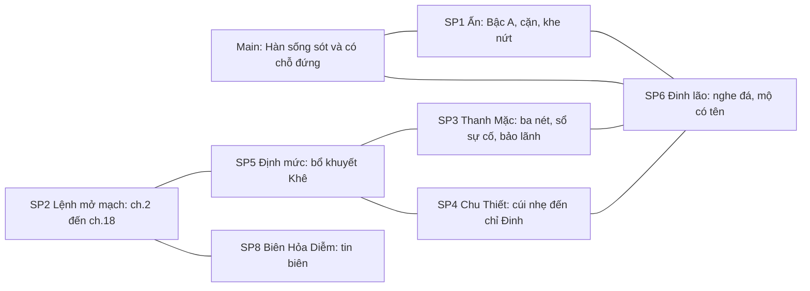

# Arc 1 Beat Sheet — Tạp Dịch Khu Mỏ (Tier 2 · Dual-View)

| Trường              | Giá trị                                                                                                                                                                                                                                                                                                                                                                                                         |
| ------------------- | --------------------------------------------------------------------------------------------------------------------------------------------------------------------------------------------------------------------------------------------------------------------------------------------------------------------------------------------------------------------------------------------------------------- |
| **work_slug**       | `kho-hai-tien-lo`                                                                                                                                                                                                                                                                                                                                                                                               |
| **Task**            | `T-plot-arc-1` · mode **Design Tier 2** · `plot-architect`                                                                                                                                                                                                                                                                                                                                                      |
| **Trạng thái**      | `approved` *(human* `approve T-plot-arc-1` *· 2026-10-23)*                                                                                                                                                                                                                                                                                                                                                      |
| **Band chương**     | **1–18** *(R-03 · brief §8 #6; ~15–20 chương)* · thời gian truyện `[giả định]` ~24 tháng (Lâm Hàn 16 → 18 tuổi)                                                                                                                                                                                                                                                                                                 |
| **Neo — Logic**     | [`00-arc-master-outline.md`](00-arc-master-outline.md) *(Tier 1 approved · D-01→D-08 LOCKED, không retcon)* · [`../00-story-spine.md`](../00-story-spine.md) §5 · [`../characters/01-project-roster.md`](../characters/01-project-roster.md) · [`../foreshadowing/00-foreshadow-ledger.md`](../foreshadowing/00-foreshadow-ledger.md) §5 · [`../audits/audit-plot-project.md`](../audits/audit-plot-project.md) |
| **Neo — World**     | [`../world/01-region-active.md`](../world/01-region-active.md) · [`../world/02-tieu-cuc-index.md`](../world/02-tieu-cuc-index.md) · [`../world/geo/micro/arc-01-kho-hai-tien-lo.geojson`](../world/geo/micro/arc-01-kho-hai-tien-lo.geojson) *(chỉ đọc)* · `MICRO-ARC01-TAY-MACH` / `TC-KHTL-A1`                                                                                                                |
| **Neo — Interface** | [`../../00-master-brief.md`](../../00-master-brief.md) v2.1 §8, §8b · [`../../interface/naming/registry.md`](../../interface/naming/registry.md) *(*`canon`*)*                                                                                                                                                                                                                                                  |
| **Đường dẫn**       | Thạch Khê Thôn → Hắc Nham Khoáng Động *(Bắc Tuyến, đáy hầm)* → Thái Nhạc Tông *(sơn môn / ngoại vi)*                                                                                                                                                                                                                                                                                                            |
| **Việc kế**         | `T-characters-arc-1` → `T-spine-arc-1` *(Tier 3)* → prose. **Không** viết chương trước khi spine được duyệt                                                                                                                                                                                                                                                                                                     |

> **Cách đọc:** Human duyệt **Phần I** trước. `character-architect`, `foreshadowing-architect`, `world-builder`, `pro-auditor`, `prose-writer` đọc **Phần II**. Nhãn `[đề xuất — …]` = quyết định Tier 2 mới, chờ human hoặc agent nhận; không đụng D-01→D-08.

---

# PHẦN I — BẢN DUYỆT TÁC GIẢ (Human Story View) — Tier 2 · Arc 1

## I.1 — Phim ngắn của arc (Arc Narrative Treatment)

**Hồi một — tro và sổ (chương 1–4).** Chương đầu chỉ là một ngày ấm. Lâm Hàn mười sáu tuổi bẻ củ khoai nướng làm ba phần, phần khét nhất giữ cho mình, vừa nhai vừa nghe tiếng búa của cha ngoài đầu thôn lệch đi một nhịp. Không ai nói gì. Sang chương hai, chấp sự Thái Nhạc Tông đọc lệnh *dời dân khai mạch* bằng giọng lễ độ, cả Thạch Khê Thôn điểm chỉ vì được hứa lương, và đêm ấy cha mẹ nhét hắn xuống hố khoai, dặn đừng ngoảnh lại. Khi hắn bò lên, thôn đã thành tro, mạch dưới chân vừa mở, và trong lòng bàn tay hắn là mảnh đá xám mẻ vừa dập tắt cơn ho độc. Hắn xếp ba hòn đá không tên lên đống đổ nát. Rồi toán áo xám tới, đếm hắn như đếm một món thừa. Sổ ghi hắn là dân dời. Trong sổ không ai chết.

**Hồi hai — học sống (chương 5–10).** Hắn bị đẩy theo lô khổ dịch, gặp Chu Thiết trên đường, bị đá thử gọi là ngũ linh căn tạp phẩm, rồi xuống đáy Bắc Tuyến của Hắc Nham Khoáng Động, nơi Lương Khôn cầm sổ định mức. Người phàm nhận bạc, kẻ có căn nhận đan mốc, hai bên không bao giờ đổi được cho nhau. Đinh lão dạy hắn nghe đá. Cố lão ngồi coi kho phế khoáng và giả mù. Hắn khám ra mảnh ấn hút cặn độc của phế khoáng và nhả lại một ngụm nước sạch, còn cặn thì ở lại, nặng dần. Hắn tu chậm, từng giọt, có lần ngất vì quá đà, và học cách giấu. Rồi trên truyền xuống lệnh tăng định mức hai thành, ghi là bù cho một chỗ mang chữ Khê, và một nữ đệ tử ngoại môn xuống khảo mạch, vạch ba nét trong bụi cho người ta tránh chỗ sắp sập, rồi xóa đi. Nàng là người đầu tiên hắn gặp hiểu thế nào là bị dùng.

**Hồi ba — ép (chương 11–15).** Vách hầm nứt, một cục đá sáng lộ ra, người phản người vì nó, sổ ghi kẻ chết là tự sa. Kiểm khoáng tới. Sổ thiếu số, và sổ cần một cái tên để khép lại. Đầu mục mua Chu Thiết bằng chức tổ trưởng; Chu chỉ ra Đinh lão, người đã nhận che cho Hàn từ trước. Hàn không chịu nhịn thay. Hắn đứng ra nói *là ta*, và nghe lại một câu rất nhẹ: sổ không ghi hai lần. Đinh lão bị giam hầm tối. Đêm thứ hai, vòm đá kêu trước khi nó rơi.

**Hồi bốn — mộ có tên (chương 16–18).** Hàn kéo được ba người, không kéo được Đinh lão. Tần Thanh Mặc đến miệng hầm quá muộn, và nàng trả giá cho những ngày im lặng bằng cách ký sổ sự cố với tên thật, dù nhà nàng nợ thêm. Hàn dựng cho Đinh lão một nấm mộ có tên, từ chối cái phẳng lặng mà mảnh ấn hứa cho kẻ đang đau, và rời Hắc Nham với một tờ công trạng ghi quê Thạch Khê, vì hắn muốn có ngày biết ai đã hạ bút. Ở Chấp pháp đường, người ký danh sách ngoại môn dừng bút rất lâu trên hai chữ ấy, rồi ký, rồi sai gửi bản chép lên phòng mình.

## I.2 — Ba nút giao & điểm bùng nổ (Highlight Clash Nodes)

### Nút 1 — Hố khoai đêm Thạch Khê (chương 2)

- **Cảnh / tình huống:** Lệnh được đọc theo lễ giữa sân thôn, cả thôn điểm chỉ, rồi đêm xuống, cha mẹ thả Hàn vào hố khoai và đậy nắp. Hắn nằm nghe tiếng chân, tiếng người đọc, rồi im.
- **Ai muốn gì (mục tiêu trái ngược):** Chấp sự muốn việc êm, đúng trình tự, không ai kêu. Dân thôn muốn tin lời hứa lương. Cha mẹ muốn con sống mà không để ai nghi. Hàn muốn ở lại với họ.
- **Vì sao độc giả căng:** Chương một đã dựng hơi ấm bằng bát canh loãng và củ khoai chia ba, nên độc giả đọc chương hai với nỗi dự cảm mà nhân vật cố tin ngược lại. Cái ác nói bằng giọng lễ độ, không ai quát, và đó là thứ rợn nhất.

### Nút 2 — Ba người, một cái tên (chương 13–15)

- **Cảnh / tình huống:** Sau kiểm khoáng, sổ thiếu số. Ở lán Bắc Tuyến, đầu mục lần lượt hỏi Hàn, rồi hỏi Chu Thiết, rồi Đinh lão tự bước ra trước hàng. Cuối cùng là hầm tối.
- **Ai muốn gì (mục tiêu trái ngược):** Lương Khôn muốn một cái tên để khép sổ và khỏi rớt xuống làm đầu mục. Chu Thiết muốn không đói tới lúc chết và chuộc được mẹ. Đinh lão muốn đứa nhỏ sống. Hàn muốn không để ai gánh thay mình, và cũng không muốn lộ mảnh ấn.
- **Vì sao độc giả căng:** Không ai trong cảnh là kẻ ác, và mỗi người đều có lý. Độc giả muốn Chu khác đi nhưng hiểu vì sao hắn không khác được. Cảnh kết ở chỗ sổ không ghi hai lần: Hàn muốn nhận tội nhưng bị bác, vì sổ chỉ cần một cái tên và đã có.

### Nút 3 — Cây bút dừng trên hai chữ Thạch Khê (chương 17–18)

- **Cảnh / tình huống:** Tờ công trạng đã đủ chữ ký của quản sự và nữ đệ tử bảo lãnh, chỉ còn ô quê quán. Tại Chấp pháp đường, người chủ trì ký danh sách ngoại môn dừng bút trên ô ấy.
- **Ai muốn gì (mục tiêu trái ngược):** Hàn cố ý giữ quê thật, vì muốn biết ai đã hạ bút ký lệnh và hiểu rằng xóa tên quê là xóa luôn đường tìm. Thanh Mặc muốn hắn sống và không dám giữ hắn bằng lời nói dối. Lương Khôn chỉ muốn đẩy kẻ có điểm lạ ra khỏi sổ của mình. Nghiêm Hoằng Độ muốn giữ biên Tây yên và đang đối diện một cái tên đáng ra đã bị xóa.
- **Vì sao độc giả căng:** Độc giả đã thấy chữ ký mực đỏ ở chương hai, còn Hàn chỉ thấy một người áo xám dừng bút. Cái ác trong truyện không có mặt hung dữ: nó chỉ có một ngón tay dừng lại một lúc lâu, rồi vẫn ký.

## I.3 — Chuỗi Nhân–Quả arc (Vì thế → Nhưng)

1. Lệnh dời dân được đọc theo lễ, cả thôn điểm chỉ, **vì thế** đêm ấy không ai chống. **Nhưng** cha mẹ đã giấu Hàn xuống hố khoai, và giữa tro hắn nắm được mảnh ấn xám.
2. Sổ ghi *dời dân* nên không ai đi tìm người sống, **vì thế** Hàn lọt vào lô khổ dịch như một dân dời bình thường. **Nhưng** đá thử gọi hắn là tạp phẩm và đẩy hắn xuống đáy Bắc Tuyến.
3. Dưới hầm sống chết bằng định mức, **vì thế** Hàn học nghe đá và lén dùng ấn biến phế khoáng thành nước sạch. **Nhưng** ấn giữ lại cặn, và phế khoáng bị rút trống để lại dấu mà Cố lão nhìn ra.
4. Mạch Thạch Khê mở thiếu và tông bù bằng linh thạch Hắc Nham *(độc giả chưa biết)*, **vì thế** Lương Khôn đọc lệnh tăng định mức hai thành. **Nhưng** càng ép, hầm càng nứt, và Thanh Mặc phải chọn giữa im lặng và nói thật.
5. Nàng chọn im lặng cứu thầm, **vì thế** hầm chưa bị đóng và nợ nhà nàng chưa chồng. **Nhưng** vách vẫn nứt, một cục đá sáng lộ ra, và người phản người vì nó.
6. Sổ thiếu số sau kiểm khoáng, **vì thế** Lương Khôn cần một cái tên. **Nhưng** Hàn từ chối nhịn thay, và đầu mục quay sang mua Chu Thiết bằng chức tổ trưởng.
7. Chu Thiết không muốn đói tới lúc chết, **vì thế** hắn chỉ ra Đinh lão. **Nhưng** Đinh lão đã tự bước ra nhận tội trước, và lời *là ta* của Hàn không được ghi.
8. Đinh lão bị giam hầm tối, **vì thế** Hàn chạy xuống theo tiếng gõ vách. **Nhưng** đá kêu trước khi rơi: hắn kéo được ba người và mất người đã dạy hắn nghe đá.
9. Hầm đã có người chết thật, **vì thế** Thanh Mặc ký sổ sự cố bằng tên mình dù nhà nàng nợ thêm. **Nhưng** tên Đinh Thực vào sổ chỉ vì một người chịu trả giá, không vì sổ có lòng.
10. Hàn dựng mộ có tên và từ chối cái phẳng lặng, **vì thế** hắn sống tiếp bằng cái đau. **Nhưng** ấn vẫn đói đúng một chỗ, như còn thiếu một vế.
11. Lương Khôn muốn đẩy kẻ có điểm lạ ra khỏi sổ mình, **vì thế** ông tiến cử Hàn, và công trạng cứu người cộng lời bảo lãnh của Thanh Mặc đưa hắn vào sổ ngoại môn. **Nhưng** hắn ghi quê thật, và cái tên Thạch Khê khiến Nghiêm Hoằng Độ dừng bút.

## I.4 — Điểm xin human duyệt

- **Đinh lão chết cuối chương 15**, tang và mộ ở chương 16 *(band D-08 giữ nguyên)*.
- **Lương Khôn chưa bị gạch tên ở arc này**: ông bị phạt đan, run tay hơn, rồi tiến cử Hàn để đẩy hắn đi. Gạch tên vẫn ở arc 2 *(D-08)*.
- **Hàn tự ý ghi quê Thạch Khê** trên công trạng. Đây là rủi ro có chủ ý, đổi lấy một mũi chỉ nối sang arc 2.
- **Đầu mục lán, chấp sự khai mạch, chấp sự ngoại môn** chưa có tên *(naming O-06)*; Phần II dùng danh xưng chức việc.
- Tên **Xích Thạch Lĩnh** chưa vào registry; prose arc 1 chỉ gọi *dãy núi bọc mỏ*.

---

# PHẦN II — ĐẶC TẢ KỸ THUẬT (Machine Spec) — Tier 2 · Arc 1

## §0 — Ràng buộc khóa cho Arc 1

- **D-01→D-08 giữ nguyên.** Arc 1 chạm: D-02 *(gieo nợ tộc Tần)*, D-03 *(Bạch Thổ chỉ nhắc quê Chu)*, D-04 *(trận chưa lộ)*, D-05 *(chuỗi mạch → định mức, xem §C2a-2)*, D-08 *(Đinh chết ch.15–16)*.
- **R-02:** ch.1–2 phàm trần, không nhồi lore. **R-03:** band 1–18. **R-04:** chỉ Bậc 0, Bậc A và dấu hiệu A-cao *(ấn đòi hệ thiếu)*; không mở C-sơ; không nêu C-cao.
- **R-01, R-05, R-07, R-09, R-10, R-11, R-12, R-13, R-16:** áp dụng nguyên văn.
- **Mật độ sức mạnh:** Lương Khôn Luyện Khí tầng 9 là đối thủ trực tiếp cao nhất; Nghiêm Kim Đan chỉ lộ cuối arc; không cảnh Hàn thắng ai trên cấp bằng ấn.
- **World:** `foundation-fixed`; micro Arc 1 đã approved. Các điểm con chưa có trong index *(hầm tối, kho phế, khe nứt, phòng khảo mạch, sảnh lễ)* ghi `[đề xuất — world-builder delta]` ở Logic keeper.
- **Nhân vật ngoài tầm Arc 1:** `CHAR-010` (Đỗ Viễn / Tro Lão), `CHAR-011` (Khương Minh Thư) không xuất hiện; `CHAR-012` (Vệ Hoài Trà) chỉ là bóng ở ch.17.

### §0b — Quyết định Logic Tier 2 mới *(đề xuất — chờ human; không phá D-01→D-08)*

| Mã | Quyết định | Lý do / nối |
| --- | --- | --- |
| **T2-01** | **Chuỗi mạch → định mức** khóa theo §C2a-2: ấn nằm ở rìa mạch nhãn Thạch Khê; ấn rời nhãn *sau* huyết dẫn, nên mạch mở mà không khớp; tông đo thấy thiếu nhưng quy cho nhãn vỡ vì sạt và vật cổ bị chôn; bù bằng linh thạch Hắc Nham | PW-03 · D-05 · FS-009 |
| **T2-02** | **Vật chứng chuỗi:** thẻ gỗ *«bổ khuyết Khê»* trên xe quặng cờ đỏ; chữ **Khê** là một trong hai chữ Hàn biết đọc *(chữ kia: Thạch, từ bia đầu thôn cha đẽo)* | PW-03 · FM-014 · motif tên |
| **T2-03** | **Khe nứt sau lán** thông xuống **hầm tối**; đá ở đó hút cặn khi Hàn áp ấn: ấn không tự nhả, chính Hàn đưa cặn vào đá cổ mà hắn chưa hiểu | PW-06 · FS-004, FS-008 |
| **T2-04** | **Nguồn Kim thiếu có lý do tự nhiên:** phế khoáng Hắc Nham thiên Hỏa–Thổ; Mộc–Thủy lấy từ nấm mốc và nước ngầm; Kim hiếm. Cuối arc ấn «đói đúng một chỗ» | PW-02 · FS-005 · D-06 |
| **T2-05** | **Đinh nhận tội thay** *trước* khi Hàn bị hỏi; thiếu số thật gồm phế vụn Hàn lén lấy *và* cục đá sáng mà đầu mục tự bỏ túi; Lương chỉ cần một cái tên | RF-03, R-05 · FS-013 |
| **T2-06** | **Thanh Mặc im lặng cứu thầm ở ch.9–11, báo thật ở ch.16** và trả giá *(đóng đáy ba tháng, nợ tộc chồng thêm ba tháng)*; chữ ký khảo mạch đưa tên Đinh vào **sổ sự cố** gắn khế đồng bộ với đại sổ chấp sự | PW-01, PW-07, PW-08 · FS-010 |
| **T2-07** | **Lương Khôn không bị gạch ở A1**; ông tiến cử Hàn để đẩy kẻ có điểm lạ ra khỏi sổ mình | D-08 · RF-08 |
| **T2-08** | **Hàn ghi quê Thạch Khê** có chủ ý | FS-018 · mũi chỉ sang A2 |
| **T2-09** | **Ngân sách ấn** theo §A2a-2: hai lần dừng bắt buộc, vật liệu hợp lệ chỉ có ở cuối arc, điểm nghẽn tầng 3→4 giải bằng ngộ tính | PW-05 · RF-01 |

---

## §A2 — Master Story Grid (Arc 1)

### A2a — Chuỗi sự kiện (beat / chương)

| Beat # | Band ch | Mục tiêu nhân vật (chính) | Xung đột | Kết quả beat |
| --- | --- | --- | --- | --- |
| **B01** | 1 | Hàn: qua một ngày thường, giữ phần mình ít nhất | Điềm lạ nhỏ: tiếng búa lệch nhịp, toán áo xám quanh mạch nhãn | Hơi ấm và nỗi sợ cùng dựng; Hàn quen đoán chuyện chẳng lành |
| **B02** | 2a | Chấp sự: dời dân êm. Dân: tin lời hứa lương. Cha mẹ: giấu con | Lệnh đọc theo lễ; điểm chỉ; cha mẹ quyết trong vài hơi thở | Cả thôn điểm chỉ; Hàn xuống hố khoai |
| **B03** | 2b | Hàn: sống | Đêm huyết dẫn; mạch mở; khí độc; thấy mảnh ấn ở rìa nhãn vừa vỡ | Hàn nhặt ấn, cơn ho dứt; xếp ba hòn đá; toán áo xám cắm cọc đo và gom hắn |
| **B04** | 3 | Hàn: im và sống; Chu: không chết đói | Sổ ghi *dời*; đoàn khổ dịch; Hàn không dám nói mình là kẻ sống sót duy nhất | Gặp Chu Thiết; đi ngang rìa Bạch Thổ; Hàn biết sổ có thể xóa người |
| **B05** | 4 | Hàn: qua đá thử; vào mỏ | Đá thử gọi tạp phẩm; bạc phàm vs đan mốc; tin biên nóng; Lương Khôn đọc tên | Xuống Bắc Tuyến; ấn nặng thêm ở vách phế khoáng |
| **B06** | 5 | Hàn: học cách sống ở lán | Đinh lão dạy nghe đá; Cố lão giả không thấy; đầu mục chia việc | Có ba người đầu tiên đáng tin (Đinh, Chu, một bát cháo) |
| **B07** | 6 | Hàn: khai kinh mạch | Công pháp khuyết, ngũ linh căn lệch; đêm đói | Lần lọc đầu có chủ ý; khai kinh mạch; Luyện Khí tầng 1; ấn hứa «không còn đau» |
| **B08** | 7 | Hàn: giữ ấn kín, lọc đều mà không lộ | Quá đà; Chu che; Lương gạch tên một phu ngất | Ngất một ngày; Đinh nhận giữ bí mật vụn; Hàn học hạn lượt |
| **B09** | 8 | Hàn: nộp đủ phế, giữ phần vụn; Cố lão: chọn nói hay im | Phế khoáng bị rút trống; Cố lão thấy; Lương để ý tổ ít ốm | Cố lão giả mù; «đeo cho kín»; một bát cháo trên bậc cửa |
| **B10** | 9 | Lương: đủ mức mới; Thanh Mặc: không để hầm sập | Lệnh tăng hai thành *«bổ khuyết Khê»*; Chu cúi nhẹ; ba nét vạch trong bụi | Hàn thấy ba nét và hiểu; thẻ gỗ chữ Khê; gieo nợ tộc Tần |
| **B11** | 10 | Thanh Mặc: chọn mạng nào trước; Hàn: không trả lời thay nàng | Nói thật thì đóng mỏ, nợ tộc chồng; im thì hầm có thể sập | Nàng im thêm một lần; Hàn nghe một câu «mạch chảy ngược» |
| **B12** | 11 | Đinh: cứu hai đứa nhỏ; tạp dịch: giành đá sáng | Vách nứt; cục đá sáng lộ; người phản người; sổ ghi *tự sa* | Midpoint: Hàn nhìn thấy mỏ đang bị ép tới vết nứt; thấy bản đồ khuyết của Thanh Mặc |
| **B13** | 12 | Hàn: qua nghẽn tầng 3; xả cặn mà không lộ | Ấn lạnh, cặn đầy; khe nứt sau lán | Luyện Khí tầng 3; khám ra khe nứt hút cặn; lộ lối xuống hầm tối |
| **B14** | 13 | Lương: khép sổ; Cố lão: bảo vệ đứa nhỏ mà không nói | Kiểm khoáng; sổ thiếu số; đầu mục thử Hàn | Hàn từ chối nhịn thay; Cố lão giả mù lần hai; ngừng ấn |
| **B15** | 14 | Chu: không đói tới chết; Hàn: không chen vào | Đầu mục mua Chu bằng chức tổ trưởng và đan lạ | Chu chỉ Đinh; nói với Hàn một câu; Hàn cúi, im |
| **B16** | 15a | Đinh: nhận tội trước; Hàn: nhận thay | Đinh bước ra trước hàng; Hàn nói *là ta*; Lương «sổ không ghi hai lần» | Đinh bị giam hầm tối; Hàn bị giữ lại phía sau |
| **B17** | 15b | Hàn: cứu Đinh | Đêm thứ hai, tiếng gõ vách; hầm tối sập | Cứu ba người, Đinh chết; Thanh Mặc đến miệng hầm quá muộn |
| **B18** | 16 | Thanh Mặc: ký sổ thật; Hàn: dựng mộ | Lương muốn ghi *tự sa*; ấn hứa phẳng lặng; Chu đứng ngoài mộ | Sổ sự cố có tên Đinh; đóng đáy ba tháng; mộ có tên; Hàn từ chối phẳng lặng; ấn đói một chỗ |
| **B19** | 17 | Lương: đẩy Hàn đi; Thanh Mặc: bảo lãnh; Hàn: giữ quê thật | Công trạng cần quê; Chu đứng xa; lên sơn môn; lễ nhận đệ tử | Tên vào danh sách chờ ký; Vệ đỡ hòm không đỡ người; bóng Vệ Hoài Trà |
| **B20** | 18 | Nghiêm: ký danh sách ngoại môn; Hàn: có chỗ đứng | Ô quê quán «Thạch Khê» | Nghiêm dừng bút rồi ký, sai gửi bản chép lên phòng mình; Hàn có tên trong sổ ngoại môn; cliff sang arc 2 |

**Mỗi chương một việc dẫn:** ch.5 sinh hoạt · ch.6 nội tâm khám phá · ch.7 nguy thân thể · ch.8 bị người thấy · ch.9 kinh tế · ch.10 quan hệ · ch.11 thiên tai và phản bội · ch.12 giải nghẽn · ch.13 điều tra · ch.14 mua chuộc · ch.15 tai họa · ch.16 tang · ch.17 rời mỏ · ch.18 lễ ký. *(Chống hầm mỏ lặp một nhịp, RF-A1-01.)*

### A2a-2 — Đồng hồ & ngân sách ấn *(PW-05, RF-01)*

> **Đơn vị** `[ước — power-system chốt]`**:** một lượt = một nắm tay phế vụn → một hớp linh dịch (tỉ lệ 10 : 1 theo roster §2.2). Ấn cần nghỉ ≥ 5 ngày giữa hai lượt (xả cặn). Hàn tu bằng ấn ≈ tốc độ tam–tứ linh căn thường; không ấn ≈ ngũ linh căn thường.

| Mốc | Ch | Tháng *(từ đêm Thạch Khê)* | Cảnh giới thật | Sổ ghi | Lượt ấn / tháng | Vật liệu & nguồn | Dừng bắt buộc | Rủi ro lộ thêm |
| --- | --- | --- | --- | --- | --- | --- | --- | --- |
| P0 | 1–5 | 0–2 | Phàm hữu căn chưa khai | tạp dịch ký danh | 0 | — | — | — |
| P1 | 6–7 | 2–3 | **Luyện Khí 1** | LK1 | ≈ 5 | Phế vụn ở vách «đá chết» do Đinh chỉ; lén | **Ngất một ngày (ch.7)** | Đinh và Chu thấy có điều lạ, chưa biết là gì |
| P2 | 8–12 | 3–14 | LK2 *(≈ tháng 8)* → **LK3** *(≈ tháng 14)* | LK1 → LK2 *(giả chậm một tầng)* | ≈ 4–5 | Phế vụn; đan mốc nhỏ đổi điểm | — | Cố lão thấy phế rút (ch.8); Lương để ý tổ ít ốm (ch.8); ấn lạnh vì cặn (ch.12) |
| P3 | 13–14 | 15–16 | LK3 | LK2 | **0** | — | **Dừng hai tháng (kiểm khoáng)** | Không tiến; nghẽn |
| P4 | 15–16 | 17–20 | LK3 → **LK4 sơ** *(≈ tháng 20)* | LK2 → LK3 | ≈ 6–8 *(sau ba tuần không dùng vì chấn thương và tang)* | Đáy đóng ba tháng → kho thanh lý phế khoáng; Cố lão đổi điểm **hợp lệ** | Ba tuần không dùng sau ch.15 | **Điểm nghẽn tầng 3→4 giải bằng ngộ tính** (nhịp gõ của Đinh), không bằng ấn |
| P5 | 17–18 | 21–24 | LK4 vững, chạm ngưỡng 5 | **LK3** *(sổ ngoại môn)* | ≈ 4 | — | — | Nghiêm biết còn một người Thạch Khê |

*Chu Thiết (đối chiếu, Tứ linh căn): LK1 ≈ tháng 3; LK2 ≈ tháng 9; LK3 ≈ tháng 15 (nhận tổ trưởng). Nhanh hơn Hàn một tầng cho tới ch.16, nên Hàn có lớp ngụy trang «chậm hơn bạn».*

### A2b — Ma trận cast arc

| Nhân vật | Vào arc | Trong arc | Ra arc |
| --- | --- | --- | --- |
| **Lâm Hàn** | Phàm, gia đình đủ, chưa biết sổ | Sống sót; học nghe đá; lọc ấn; không nhịn thay; mất Đinh | LK4 *(sổ LK3)*; mộ có tên; quê thật trên sổ; không nhịn thay nhưng học giấu |
| **Trầm Quân Thạch Ấn** | Bậc 0 | Bậc A; cặn; ấn hứa «không đau»; hỏi *còn nữa không?* | Bậc A vững; đói đúng một chỗ *(dấu hiệu A-cao)* |
| **Chu Thiết** | Phàm hữu căn, từ Bạch Thổ; nhớ mẹ và hai em | Bạn đầu; cúi nhẹ; bị mua; chỉ Đinh; nửa viên đan | LK3, tổ trưởng; mang tội; đứng xa |
| **Lương Khôn** | Quản sự Bắc Tuyến, LK9 | Đọc lệnh tăng; gạch tên; «sổ cần một cái tên»; tiến cử | Bị phạt đan, run tay hơn; sổ không đổi |
| **Đinh Thực** | Phu phàm, phổi hỏng | Dạy nghe đá; che vụn; nhận tội thay; chết ở hầm tối | Mộ có tên |
| **Cố Quy Trần** | Coi kho phế, giả mù | Thấy phế rút; «đeo cho kín»; giả mù hai lần; bãi đá, «nhà nó ở dưới» | Vẫn ở kho; còn nợ giải thích |
| **Tần Thanh Mặc** | Đệ tử ngoại môn LK5, xuống khảo mạch | Ba nét vạch; bản đồ khuyết; im rồi báo thật; ký sổ sự cố; bảo lãnh | Nợ tộc chồng; biết Hàn giữ quê thật; giữ bản đồ riêng |
| **Vệ Cảnh Hành** | — | Ch.17: đỡ hòm không đỡ người | Bóng lễ; Hàn nhớ chiếc áo không một hạt bụi |
| **Vệ Hoài Trà** | — | Ch.17: bóng, chén trà nóng | Bóng |
| **Nghiêm Hoằng Độ** | — *(chỉ qua lệnh ch.2)* | Ch.18: dừng bút, ký, sai gửi bản chép | Biết còn một người Thạch Khê; chưa biết ấn |
| **Gia đình phàm trần** | Bình thường, đủ ăn | Hy sinh; ba hòn đá | Echo mộ không tên |
| *Đầu mục lán* `[chưa tên — O-06]` | — | Chia việc; bỏ túi cục đá sáng; thử Hàn; mua Chu | Nằm yên |
| *Chấp sự khai mạch · chấp sự ngoại môn* `[chưa tên]` | — | Đọc lệnh; ghi sổ; đọc danh sách | Nằm yên |

### A2c — Tension Chart (Arc 1)

| Ch | Tension 1–10 | Ghi chú |
| --- | --- | --- |
| 1 | 3 | Ấm, có điềm |
| 2 | **9** | Đỉnh arc: hố khoai, huyết dẫn, nhặt ấn |
| 3 | 5 | Hạ: đoàn khổ dịch, sổ |
| 4 | 5 | Đá thử, xuống mỏ |
| 5 | 4 | Sinh hoạt, học sống |
| 6 | 5 | Khám phá ấn |
| 7 | 6 | Ngất, bị gạch tên |
| 8 | 5 | Cố lão thấy |
| 9 | 6 | Lệnh tăng hai thành |
| 10 | 6 | Thanh Mặc: chọn mạng nào |
| 11 | 7 | Midpoint: nứt, đá sáng, phản bội |
| 12 | 6 | Giải nghẽn, khe nứt |
| 13 | 7 | Kiểm khoáng, thử Hàn |
| 14 | 7 | Chu bị mua |
| 15 | **8** | Đinh nhận tội; hầm tối sập |
| 16 | 6 | Tang, sổ, mộ |
| 17 | 4 | Hạ: rời mỏ, lễ |
| 18 | 5 | Cliff: Nghiêm dừng bút |

```
Ch   1 2 3 4 5 6 7 8 9 10 11 12 13 14 15 16 17 18
     ▃ █ ▅ ▅ ▄ ▅ ▆ ▅ ▆ ▆  ▇  ▆  ▇  ▇  ▉  ▆  ▄  ▅
```

*Không flat > 3 beat ở band cao: ch.11–15 gồm 7, 6, 7, 7, 8 với việc dẫn khác nhau mỗi chương.*

---

## §B2 — Plot & Foreshadow (Arc 1)

### B2a — Subplot giao nhau trong arc



| Giao điểm | Ch | Ý nghĩa |
| --- | --- | --- |
| SP5 × SP3 | 9–11 | Định mức tăng ép hầm nứt; nàng phải chọn nói hay im |
| SP5 × SP4 | 9, 14 | Định mức dồn Chu từ cúi nhẹ tới bị mua |
| SP4 × SP6 | 14–15 | Chu chỉ Đinh |
| SP3 × SP6 | 15–16 | Sổ sự cố đưa tên Đinh vào sổ |
| SP1 × SP6 | 12, 15 | Khe nứt xả cặn là đường xuống hầm tối nơi Đinh chết |
| SP2 × SP5 | 2, 9, 18 | Lệnh đọc theo lễ → lệnh tăng → người ký dừng bút |

### B2b — Foreshadow Matrix (arc) — mọi ID theo ledger `canon`

> **Nguyên tắc nổi/chìm (PW-09):** mỗi chương tối đa **một** plant nổi; các plant khác chìm trong cùng vật hoặc cảnh. ID mới đề xuất ở cuối bảng, chờ `foreshadowing-architect` chuẩn hóa.

| FS-ID | Manh mối trong Arc 1 | Plant | Nurture | Payoff trong arc | Carry-over → A2+ |
| --- | --- | --- | --- | --- | --- |
| **FS-TBD-VILLAGE-TRUTH** | Lệnh đọc theo lễ; mực đỏ, đuôi nét ký kéo dài; người điểm huyết là toán áo xám *khác* người ký | B02 *(nổi)* | B04 sổ; B20 mực đỏ, ký chậm | — | Treo tới A4 *(không gán Nghiêm = thi hành)* |
| **FS-001** | Sổ ghi *dời*, không ghi chết | B04 *(nổi)* | B12 *tự sa*; B16 sổ sự cố ≠ sổ định mức | — | A4 danh sách |
| **FS-002** | Ấn nặng, lạnh, ở rìa nhãn vừa vỡ; Cố lão nhìn dây gai | B03, B09 *(chìm)* | B07, B13 | — | A3 partial |
| **FS-003** | Rãnh ngón mòn trên ấn *(không đếm số)* | B07 *(chìm)* | — | — | A3 ch.60 |
| **FS-004** | Cặn ở lại; Hàn xả cặn vào đá khe nứt, thấy nhẹ người | B07–B08 *(chìm)* | B13 | — | A4 «cặn nuôi trận» |
| **FS-005** | Ấn đói đúng một chỗ *(thiếu một vế)* | B18 *(nổi)* | — | — | A2 ch.43 |
| **FS-006** | Ấn hứa *không còn đau* | B03, B07 | B18 hắn từ chối | — | A4 ch.94–106 |
| **FS-007** | Cố lão: kho phế, cháo, «đeo cho kín», giả mù, bãi đá, «nhà nó ở dưới» | B06, B09 | B14, B18 | — | A3 ch.66–70 |
| **FS-008** | Vết nứt, khe, hầm tối | B12 *(nổi)* | B13, B17 | — | A4 trận nhãn |
| **FS-009** | Định mức tăng *«bổ khuyết Khê»* | B10 *(nổi)* | B13 xe quặng; B19 mức vẫn không đổi | — | A4 |
| **FS-010** | Nợ tộc Tần; Thanh Mặc quay mặt khi Vệ qua | B11 *(nổi)* | B18 nợ chồng ba tháng; B19 | — | A2 ch.24 lộ hôn ước |
| **FS-011** | Vệ đỡ hòm không đỡ người; bóng Vệ Hoài Trà | B19 *(nổi)* | — | — | A3 ch.65–75 |
| **FS-012** | Chu cúi nhẹ; chỉ Đinh; nửa viên đan | B10 *(chìm)* | B15 *(nổi)*; B18, B19 | — | A2 đan độc |
| **FS-013** | Đinh che vụn; nhận tội thay; chết | B06, B08 *(nổi)* | B15–B16 | **B17 · B18** | A4 tên trong danh sách |
| **FS-015** | Ba hòn đá không tên → mộ Đinh có tên *(cha mẹ chưa có: «đến khi có»)* | B03 *(chìm)* | B18 *(nổi)* | **B18** *(một nửa vòng)* | A4 ch.110 |
| **FS-016** | Bản đồ khuyết của Thanh Mặc *(không nêu hướng ở A1)*; nàng không đem lên sơn môn | B10 *(chìm)*, B12 | B19 | — | A2 ch.33–35 |
| **FS-017** | Tin biên Hỏa Diễm: hơi nóng, xe lò, lính gác than | B05 *(chìm)* | B06 | — | A3 ch.58 |
| **FS-018** | Nghiêm ký chậm: dừng bút, chấp sự toát mồ hôi, rồi ký | B20 *(nổi)* | — | — | A4 ch.99–106 |
| **FM-001** | Bạc phàm vs đan mốc | B04–B05 | B06 | B06 | — |
| **FM-002** | Bát canh, củ khoai chia ba | B01 | B03 | — | A1–A4 «hơi ấm» |
| **FM-003** | Đinh nghe đá | B06 | B12 | B17 | — |
| **FM-004** | Phế khoáng trống | B09 | B14 | B14 | — |
| **FM-005** | Ba nét vạch; không ai thấy nàng cứu | B10 | — | — | — |
| **FM-006** | Cục đá sáng | B12 | B14–B15 | B15 | — |
| **FM-007** | Vết máu trên bậc ngọc | B19 | — | — | A2 Vệ xử trộm |
| **FM-009** | Tin Hỏa Diễm | B05 | — | — | A4 thuế biên |
| **FM-010** | *(ẩn A1)* Lão Mạch / Cựu Mạch | — | — | — | Không đưa vào prose A1 |

**Đề xuất FM mới** *(*`[đề xuất — foreshadowing-architect chuẩn hóa]`*)*:

| FM-ID đề xuất | Manh mối | Plant | Mục đích |
| --- | --- | --- | --- |
| **FM-013** | Đan lạ: viên đan trung phẩm đầu mục dùng mua Chu, vỏ không dấu Đan các, vị đắng | B15 | Dấu vết gián tiếp đường lậu *(không nêu tên Tro Lão / Đỗ Viễn trước A2 ch.40)* |
| **FM-014** | Thẻ gỗ *«bổ khuyết Khê»* trên xe quặng cờ đỏ | B10 | PW-03 · FS-009 |
| **FM-015** | Sổ sự cố có chữ ký khảo mạch, gắn khế đồng bộ đại sổ chấp sự | B18 | PW-01, PW-07 *(quyền chứng thực danh sách)* |
| **FM-016** | Phế khoáng Hắc Nham thiên Hỏa–Thổ, Kim hiếm | B08, B13 | PW-02 |
| **FM-017** | Đá khe nứt hút cặn: Hàn thấy nhẹ người, không biết vì sao | B13 | PW-06 *(tách khỏi «ấn nhả cặn»)* |
| **FM-018** | Bia đầu thôn do cha đẽo; hai chữ **Thạch Khê** là chữ duy nhất Hàn biết đọc; chữ **Đinh Thực** do Thanh Mặc viết, Hàn khắc | B01, B18, B20 | Motif tên, mộ có tên, ô quê quán |

---

## §C2 — Causality & Relationship (Arc 1)

### C2a — Flowchart nhân–quả (arc)

```mermaid
flowchart LR
  A[Lệnh dời dân đọc theo lễ] --> B[Điểm huyết đêm Thạch Khê]
  B --> C[Hàn nhặt ấn ở rìa nhãn]
  C --> D[Mạch mở không khớp]
  D --> E[Tông đo thấy thiếu, quy cho nhãn vỡ]
  E --> F[Bù bằng linh thạch Hắc Nham]
  F --> G[Lương đọc lệnh tăng hai thành]
  G --> H[Hầm nứt, đá sáng, phản bội]
  C --> I[Hàn lọc phế khoáng]
  I --> J[Cố lão thấy phế rút]
  H --> K[Kiểm khoáng, sổ thiếu số]
  J --> K
  K --> L[Đầu mục mua Chu]
  L --> M[Chu chỉ Đinh]
  M --> N[Đinh nhận tội, vào hầm tối]
  N --> O[Hầm sập, Đinh chết]
  O --> P[Thanh Mặc ký sổ sự cố]
  O --> Q[Hàn dựng mộ có tên]
  P --> R[Công trạng cộng bảo lãnh]
  G --> S[Lương muốn đẩy Hàn khỏi sổ]
  S --> R
  R --> T[Quê Thạch Khê trên danh sách]
  T --> U[Nghiêm dừng bút, gửi bản chép]
```



### C2a-2 — Chuỗi mạch → định mức *(khóa PW-03 · D-04, D-05; lộ cho MC theo vật chứng)*

| Mắt xích | Nội dung Logic Arc 1 | Ai biết đến cuối A1 | Vật chứng MC thấy |
| --- | --- | --- | --- |
| 1 | Ấn là mảnh cổ nằm ở rìa mạch nhãn dưới Thạch Khê; huyết dẫn mở mạch, ấn khớp nhãn thì mạch mới đủ | Không ai trên trang | Mảnh đá xám ở rìa nhãn vỡ *(B03)* |
| 2 | Hàn nhặt ấn *sau* khi huyết dẫn xong và nhãn vỡ vì sạt; ấn rời nhãn nên mạch mở **không khớp** | Hàn biết mình lấy; không biết nó thuộc về đâu | — |
| 3 | Tông đo mạch sau mở và thấy khí ra thấp hơn phép tính | Nhóm khai mạch, Nghiêm | Cọc phù đo cắm ở nhãn *(B03)* |
| 4 | Tông quy nguyên nhân: nhãn vỡ vì sạt, vật cổ bị chôn; đã đào ba ngày, không thấy | Nhóm khai mạch, Nghiêm | Toán áo xám đào, rồi dọn *(B03 cuối)* |
| 5 | **Vì sao không truy ấn:** (a) tin ấn bị chôn; (b) sổ ghi cả thôn dời, không ai còn sống; (c) Hỏa Diễm ép biên, không đủ người đào tiếp; (d) bù bằng linh thạch Hắc Nham rẻ hơn truy tìm | Nghiêm; quản lý cấp trên | — |
| 6 | Lệnh *bổ khuyết Khê*: Bắc Tuyến nộp thêm hai thành linh thạch để nạp mạch mới | Lương Khôn *(chỉ biết lệnh)*, đầu mục | Thẻ gỗ trên xe quặng cờ đỏ; Hàn đọc được chữ **Khê** *(B10)* |
| 7 | Thanh Mặc nghe mạch ở Bắc Tuyến chảy ngược, như nơi khác đang thiếu | Thanh Mặc *(không biết nơi nào)* | Câu nói *(B11)*; bản đồ khuyết *(B12)* |
| 8 | Mạch thiếu kéo dài → Tông tính chọn thôn kế *(A2–A4, D-05)* | Nghiêm | *(ngoài Arc 1)* |

*Prose không nêu «trấn ấn», «một mạch một mạng», «ấn rời nhãn» trong A1; chỉ vật chứng.*

### C2b — Ma trận quan hệ (đầu → cuối arc)

| Cặp / phe | Đầu arc | Biến cố then chốt | Cuối arc |
| --- | --- | --- | --- |
| Hàn ↔ Chu Thiết | Hai kẻ lạ, cùng đói | Chu cúi nhẹ; bị mua; chỉ Đinh | Chu đứng xa; nửa viên đan; chưa tha thứ, chưa đoạn |
| Hàn ↔ Đinh lão | Không quen | Dạy nghe đá; che vụn; nhận tội thay | Mộ có tên; nhịp gõ còn trong tai Hàn |
| Hàn ↔ Cố lão | Không biết | Thấy phế rút; «đeo cho kín»; bãi đá | Cố lão nợ một lời giải thích; Hàn nợ ông một chữ cảm ơn |
| Hàn ↔ Lương Khôn | Kẻ bị gom ↔ quản sự | Gạch tên phu; «sổ không ghi hai lần»; tiến cử | Lương đẩy Hàn khỏi sổ; không hết nợ |
| Hàn ↔ Thanh Mặc | Không quen | Ba nét; «chọn mạng nào trước»; sổ sự cố; bảo lãnh | Tri kỷ bị-dùng; nàng biết hắn giữ quê thật |
| Hàn ↔ Vệ Cảnh Hành | Không biết | Hòm đan trượt, Vệ đỡ hòm | Hàn nhớ chiếc áo trắng; chưa nói một lời |
| Hàn ↔ Nghiêm | Không biết *(chỉ lệnh)* | Dừng bút, ký | Nghiêm biết còn một người Thạch Khê; Hàn chưa biết Nghiêm là ai |
| Thanh Mặc ↔ Lương | Đệ tử ↔ quản sự | Im rồi báo thật | Lương mất đáy ba tháng; nàng nợ chồng |

---

## §D2 — Beat Sheet (Arc 1)

| Mốc 3-act | Beat # / band ch | Nội dung Logic |
| --- | --- | --- |
| **Inciting (arc)** | B02–B03 · ch.2 | Cả thôn bị dời bằng một tờ lệnh đọc theo lễ; Hàn được giấu, nhặt ấn, và trở thành kẻ duy nhất sống sót mà sổ ghi là dân dời. |
| **Rising / complications** | B04–B11 · ch.3–10 | Hàn bị đẩy vào đáy Bắc Tuyến, học nghe đá, khám ra ấn, học giấu, rồi định mức tăng hai thành ép hầm tới giới hạn và đặt Thanh Mặc vào thế chọn mạng. |
| **Midpoint / low point** | B12 · ch.11 | Vách nứt, đá sáng lộ, người phản người; Hàn thấy mỏ đang bị ép tới vết nứt và thấy bản đồ khuyết của Thanh Mặc, lần đầu hiểu rằng nơi này không chỉ bóc lột mà còn bị bù đắp cho một nơi khác. |
| **Climax (arc)** | B16–B17 · ch.15 | Đinh nhận tội thay Hàn trước hàng, Hàn nói *là ta* và bị bác, Đinh bị giam hầm tối và chết khi vòm sập, Hàn kéo được ba người. |
| **Resolution → hook arc sau** | B18–B20 · ch.16–18 | Thanh Mặc ký sổ sự cố, Hàn dựng mộ có tên và từ chối phẳng lặng, được tiến cử vào ngoại môn với quê thật; Nghiêm dừng bút trên hai chữ Thạch Khê, ký, và sai gửi bản chép lên phòng mình. |

**Hook arc 2:** hồ sơ có chữ «Thạch Khê» đã nằm trên bàn Nghiêm; ngoại môn đòi nợ khế và ngạch đan; ấn đói đúng một chỗ. *(FS-018, FS-005, FS-010.)*

### Beat timeline

| # | Beat | Ch band | Vai trò 3-act | FS | World ID | Cast |
| --- | --- | --- | --- | --- | --- | --- |
| B01 | Một ngày thường ở Thạch Khê | 1 | Setup | FM-002, FM-018 | `LOC-VIL-001` | Hàn, Lâm Trọng, Lâm Thị, A Thảo |
| B02 | Lệnh đọc theo lễ; điểm chỉ; hố khoai | 2a | **Inciting** | FS-TBD-VILLAGE-TRUTH | `LOC-VIL-001` | Hàn, gia đình, chấp sự khai mạch |
| B03 | Đêm huyết dẫn; nhặt ấn; ba hòn đá | 2b | Inciting *(đỉnh)* | FS-002, FS-006, FS-015, FS-004 *(mầm)* | `LOC-VIL-001` | Hàn, toán áo xám |
| B04 | Lô khổ dịch; sổ *dời*; gặp Chu | 3 | Act 1 | FS-001 | `ROUTE-ARC01-VIL-VIL`, rìa `LOC-VIL-002`, `ROUTE-ARC01-VIL-MINE` | Hàn, Chu |
| B05 | Đá thử; xuống Bắc Tuyến; Lương đọc tên | 4 | Act 1 *(vào hầm)* | FM-001, FS-017, FM-009 | `LOC-MINE-001`, `LOC-MINE-001-N` | Hàn, Chu, Lương, đầu mục |
| B06 | Lán Bắc Tuyến: Đinh, Cố lão, cháo | 5 | Act 2A | FS-013, FS-007, FM-003, FM-001 | `LOC-MINE-001-N`, kho phế `[đề xuất]` | Đinh, Cố lão, Chu |
| B07 | Khai kinh mạch; lần lọc đầu | 6 | Act 2A | FS-003, FS-004, FS-006 | `LOC-MINE-001-N` | Hàn |
| B08 | Quá đà ngất; Đinh nhận giữ vụn | 7 | Act 2A | FS-004, FS-013, FM-016 | `LOC-MINE-001-N` | Hàn, Đinh, Chu, Lương |
| B09 | Cố lão thấy phế rút | 8 | Act 2A | FS-007, FS-002, FM-004 | kho phế `[đề xuất]` | Hàn, Cố lão, Lương |
| B10 | Lệnh tăng hai thành; ba nét vạch | 9 | Act 2A | FS-009, FM-014, FS-012, FS-010, FS-016, FM-005 | `LOC-MINE-001-N` | Lương, Thanh Mặc, Chu, Hàn |
| B11 | Thanh Mặc: chọn mạng nào trước | 10 | Act 2A | FS-010, FS-016 | `LOC-MINE-001-N` | Thanh Mặc, Hàn |
| B12 | Vách nứt; đá sáng; phản bội | 11 | **Midpoint** | FS-008, FM-006, FM-003, FS-001 *(echo)*, FS-016 | `LOC-MINE-001-N` | Đinh, Hàn, tạp dịch, đầu mục |
| B13 | Giải nghẽn; khe nứt hút cặn | 12 | Act 2B | FS-004, FS-008, FM-016, FM-017 | khe nứt `[đề xuất]`, hầm tối `[đề xuất]` | Hàn, Đinh |
| B14 | Kiểm khoáng; thử Hàn | 13 | Act 2B | FM-004, FS-007 | `LOC-MINE-001-N` | Lương, Cố lão, đầu mục, chấp sự ngoại môn |
| B15 | Chu bị mua | 14 | Act 2B | FS-012, FM-013 | `LOC-MINE-001-N` | Chu, đầu mục, Hàn |
| B16 | Đinh nhận tội; Hàn «là ta» | 15a | **Low point** | FS-013, FM-006 | `LOC-MINE-001-N` | Đinh, Hàn, Lương, đầu mục |
| B17 | Hầm tối sập; Đinh chết | 15b | **Climax** | FS-013, FS-008, FM-003 | hầm tối `[đề xuất]` | Hàn, Đinh, Thanh Mặc |
| B18 | Sổ sự cố; mộ có tên; phẳng lặng | 16 | Resolution | FS-015, FS-013, FS-006, FS-005, FS-007, FS-010, FS-012, FM-015, FM-018 | kho phế, bãi đá `[đề xuất]` | Thanh Mặc, Lương, Cố lão, Chu, Hàn |
| B19 | Tiến cử; quê; lên sơn môn; lễ | 17 | Resolution *(PP1)* | FS-011, FS-016, FS-009, FM-007 | `LOC-MINE-001`, `ROUTE-ARC01-MINE-SECT`, `SECT-001` | Lương, Thanh Mặc, Chu, Vệ Cảnh Hành, Vệ Hoài Trà |
| B20 | Nghiêm dừng bút; ghi danh | 18 | Hook | FS-018, FS-TBD-VILLAGE-TRUTH *(echo)*, FM-018 | `SECT-001` *(Chấp pháp đường)* | Nghiêm, chấp sự ngoại môn, Hàn |

### Logic keeper — tiểu cục

#### Tiểu cục — Thạch Khê Thôn · `TC-KHTL-A1-VIL`

- **Không gian:** `LOC-VIL-001`, tây nam thung lũng, dưới chân nhánh mạch Tây; bia đầu thôn; hố khoai sau nhà; nhãn mạch ở rìa phía trên.
- **Phe & âm mưu:** Nhóm khai mạch Thái Nhạc *(chấp sự đọc lệnh, toán áo xám làm việc)*; dân thôn bị hứa lương.
- **Kinh tế cục:** Đủ ăn qua mùa gặt, thiếu qua đông *(brief)*.
- **Mục tiêu MC cục:** Sống qua đêm, giữ ấn kín.
- **Thành công = … / Thất bại = …:** Sống sót, nhặt ấn / chết cùng thôn.
- **Ràng buộc Power/world:** Phàm nhân hết; ấn ở Bậc 0; không nêu cơ chế mạch.

##### `TC-KHTL-A1-VIL` — Thực tế đêm Thạch Khê vs sổ · động cơ MC *(human theme lock 2026-10-23 · **`CP-A1-FAMILY-REUNION` partial approved** — Thảo sống · payoff hoãn)*

| Lớp | Nội dung Logic |
| --- | --- |
| **Cha mẹ — dự báo** | Từ cọc, trống, xe xẻng, lời chấp sự *(B01–B02)*: **Lâm Trọng & Lâm Thị** đoán đêm sẽ có **lộn xộn có lệnh** (không biết thuật ngữ tu; hiểu: *dân bị đẩy lên núi, sổ đã khóa tên*). |
| **Kế hoạch trốn** | **Hàn** → hố khoai (đã dọn). **A Thảo** → **hide #2** *(mặc định Logic: hầm cất củ / nhà thầy lang gần thôn — có thể đổi khi world delta)* do **mẹ** sắp trước. **Lâm Trọng** + **Lâm Thị** đi lên *(bắt buộc điểm danh / không để thôn thiếu người trên sổ)*; tin lộn xộn cho **trượt khỏi đếm** hoặc **lui về hide #2** — **mẹ không kịp**. Sau khi đậy hố Hàn, mẹ **đưa Thảo vào hide #2** *(Hàn không thấy / không biết)*. |
| **Kết quả thực tế** | **Lâm Trọng:** chết dốc / tro. **Lâm Thị:** **chết dốc** *(locked)*. **A Thảo:** **sống** hide #2; **máu đã chấm sáng** → sổ ghi *dời* như cả nhà. **Hàn:** tin cha mẹ (và **em**) chết vì tro + dấu chân; **không biết** Thảo còn sống tới payoff **FS-A1-FAMILY-REUNION**. |
| **Sổ vs đoàn** | Thạch Khê trên sổ: **đủ tên · *dời*** (FS-001); **chỉ Hàn** đi chân trong lô này. Phụ nữ/trẻ trong lô = **thôn khác** dời thật. **Không** có dân Thạch Khê khác đi bộ trong hàng. |
| **Toán xám vs đoàn phu** *(CP prose 2026-10-23)* | **Toán đêm** cắm cọc / đo xong → **rời thôn**, nhập **đoàn dẫn phu** (không gom Hàn tại vạt đá). **Hàn** lần theo vết xe **tìm người** → lọt đuôi đoàn → **bắt**, đối sổ *Lâm Hàn · dời* → gia nhập hàng *(FS-001)* — độc giả: lễ khép, phu là **ống khác**, sót là **lọt lưới sổ**, không «cùng toán đẩy thừa». |
| **Nhận thức Hàn (B04→)** | **Biết:** tro, dấu chân một chiều → **cả nhà (kể cả em) bị tông giết** — không cần biết tên lễ. **Không biết:** cơ chế đêm; **Thảo sống** *(Logic only)*. **Với Chu / lính:** **mặt nạ** *tin dời* để đi tiếp — **không** tự lừa mình. |
| **Động cơ Arc 1 (band ch.3–18)** | **Sinh tồn** + **Trả thù tông** (toán áo xám, sổ, kẻ ký). **Không** quest «về Thạch Khê»; đoàn tụ **chỉ payoff FS** — tới lúc đó Hàn vẫn sống vì **nợ máu**, không vì hy vọng em còn. |
| **Foreshadow đoàn tụ** | **FS-A1-FAMILY-REUNION:** **chỉ gài mầm Arc 1** *(human: payoff **hoãn**, chưa chốt chương)* — khoai vùi thêm, bia dở, dây rơm; có thể **mẹ thì thầm** một câu Hàn không hiểu *(revise ch.2)*. Payoff = **happy-trung** (còn em, không còn cha mẹ). |
| **Revise prose đã approved** | **O-S1-09:** ch.2 — Thảo **không** ở miệng hố khi đậy ván; bước chân trẻ lên dốc **không khẳng định** Thảo; ba hòn đá = **Hàn tin cả nhà mất**. ch.3 — bỏ bà lão Thạch Khê trong hàng; **mặt nạ *dời*** + **nội tâm trả thù**. |
| **Ba hòn đá ch.2** | Khăn / búa / dây rơm = **vật Hàn đặt cho ba người thân** dưới đống đá; **Logic:** Thảo có thể sống off-page — độc giả biết sau payoff, Hàn không. |

#### Tiểu cục — Cửa mỏ & đường lên · `TC-KHTL-A1-MOUTH`

- **Không gian:** `LOC-MINE-001` hub, vách hắc nham, khói địa nhiệt, tu sĩ gác Luyện Khí; `ROUTE-ARC01-VIL-MINE`, `ROUTE-ARC01-MINE-SECT` ~2 ngày đi bộ.
- **Phe & âm mưu:** Gác mỏ; xe quặng cờ đỏ về sơn môn.
- **Kinh tế cục:** Đá thử linh căn; phát công pháp khuyết cho hữu căn chưa khai; phân luồng bạc phàm / đan mốc.
- **Mục tiêu MC cục:** Qua đá thử mà không lộ.
- **Thành công = … / Thất bại = …:** Ghi tạp phẩm, vào Bắc Tuyến / bị dồn về phu phàm.
- **Ràng buộc Power/world:** Thần thức gác LK không thấy ấn.

#### Tiểu cục — Bắc Tuyến · `TC-KHTL-A1-BAC`

- **Không gian:** `LOC-MINE-001-N`, sâu bắc cửa mỏ, ~2–3 canh xuống lán; lán quản sự, lán tổ, kho phế khoáng `[đề xuất — world-builder: LOC-MINE-001-N-KHO]`, vách đá chết, khe nứt sau lán `[đề xuất — …-KHE]`.
- **Phe & âm mưu:** Lương Khôn sổ định mức → đầu mục → tổ trưởng → phu / tạp dịch; Cố lão kho phế; Thanh Mặc khảo mạch xuống định kỳ.
- **Kinh tế cục:** Định mức hằng kỳ; ch.9 tăng hai thành; phàm nhận bạc, hữu căn nhận đan mốc; điểm đổi đan nhỏ.
- **Mục tiêu MC cục:** Đủ mức, giấu ấn, không nhịn thay người khác.
- **Thành công = … / Thất bại = …:** Sống và có công trạng / chết hầm hoặc ấn lộ.
- **Ràng buộc Power/world:** Sát khí; phế khoáng Hắc Nham thiên Hỏa–Thổ; Lương LK9.

#### Tiểu cục — Hầm tối · `TC-KHTL-A1-HAM-TOI` `[đề xuất — world-builder delta]`

- **Không gian:** Tầng đáy dưới khe nứt sau lán; nơi giam phạt theo khế; vòm đá cũ; sát khí đặc.
- **Phe & âm mưu:** Lương Khôn giam; Thanh Mặc biết vòm nguy từ ch.9.
- **Kinh tế cục:** Giam ba ngày = trừ đan; phàm không tu vi che thân chịu nặng nhất.
- **Mục tiêu MC cục:** Kéo Đinh ra.
- **Thành công = … / Thất bại = …:** Cứu được người / không cứu hết *(Arc 1: không cứu được Đinh)*.
- **Ràng buộc Power/world:** Cuối arc đóng ba tháng *(sổ sự cố)*; trận nhãn chưa có hình học ở A1.

#### Tiểu cục — Sơn môn / ngoại vi · `TC-KHTL-A1-SECT`

- **Không gian:** `SECT-001` đông bắc sườn Thái Nhạc, ngoại môn cao hơn thung lũng ~400 m; sảnh lễ `[đề xuất]`; Chấp pháp đường `[đề xuất — theo 02-tieu-cuc-index §4]`.
- **Phe & âm mưu:** Nghiêm; chấp sự; phòng khảo mạch của Thanh Mặc.
- **Kinh tế cục:** Khế ngoại môn; hòm đan nhập môn do tạp dịch bưng.
- **Mục tiêu MC cục:** Được ghi vào sổ ngoại môn.
- **Thành công = … / Thất bại = …:** Có tên trong sổ / bị trả về mỏ.
- **Ràng buộc Power/world:** Sổ ghi **LK3** *(ngụy trang)*; Nghiêm Kim Đan, không đối thoại với Hàn.

---

## §E2 — Narrative Rules (Arc 1)

### E2a — Cấm / ranh giới arc

| Mã | Cấm / ranh giới | Lý do (Logic / world) |
| --- | --- | --- |
| **R-A1-01** | Nghiêm không đối thoại trực tiếp với Hàn; chỉ ch.18 và Hàn thấy từ xa | Tier 1 §A1b · R-10 |
| **R-A1-02** | Không tên **Đỗ Viễn** hay **Tro Lão** trong A1; chỉ đan lạ | Ledger §8 · registry |
| **R-A1-03** | Không nhân vật nào nói «trấn ấn», «một mạch một mạng», «ấn rời nhãn»; huyết dẫn chỉ qua hành vi điểm huyết | RF-05 · FS-002 |
| **R-A1-04** | Ấn không tự thoại; không dùng ấn cứu Đinh hay giải vách sập; ấn chỉ nặng, lạnh, đói | R-11 · R-01 |
| **R-A1-05** | Hàn không thắng Lương Khôn bằng sức; không có cảnh Hàn đối đầu bằng pháp | R-06 |
| **R-A1-06** | Mỗi lần dùng ấn thêm một rủi ro trên trang | R-01 |
| **R-A1-07** | Thanh Mặc không là tuyến tình trong A1; chủ động riêng; không phần thưởng | R-13 · RF-06 |
| **R-A1-08** | Bạch Thổ chỉ nhắc quê Chu và rìa đường; không cảnh sống tại thôn | D-03 · brief §8 |
| **R-A1-09** | Đinh không thốt lời triết lý; lời cuối thực dụng *(«nhịp thứ ba»)* | RF-03 |
| **R-A1-10** | Không Sub-POV; Lương–đầu mục, lệnh Nghiêm lộ qua nghe được hoặc vật chứng | R-10 |
| **R-A1-11** | Cố lão tối đa ba câu giải thích; không truyền công | R-12 · RF-12 |
| **R-A1-12** | **Lâm Trọng, Lâm Thị** không hồi sinh. **A Thảo** sống theo **FS-A1-FAMILY-REUNION** *(CP partial 2026-10-23)* — đoàn tụ happy-trung, **không** xóa nợ tông; **không** nhiệm vụ «cứu cả thôn» / «về Thạch Khê cứu em» trước payoff | R-08 · **amended 2026-10-23** |
| **R-A1-13** | Không đếm số rãnh ngón; không nêu «mười hai» | PW-06 · FS-003 |
| **R-A1-14** | Không nêu hướng tây nam của chỗ khuyết trong bản đồ Thanh Mặc | FS-016 · fair play |

### E2b — Red Flags riêng arc

| RF-ID | Rủi ro | Kích hoạt khi | Cách né / xử lý |
| --- | --- | --- | --- |
| **RF-A1-01** | Hầm mỏ lặp một nhịp | ≥ 3 chương liền cùng kiểu cảnh | Mỗi chương một việc dẫn riêng *(§A2a)* |
| **RF-A1-02** | Ch.1 quá ấm, kéo lê | Ch.1 > ~3.500 chữ hoặc không có điềm | Ch.1 có tiếng búa lệch nhịp và toán áo xám; ch.2 vào lệnh ngay |
| **RF-A1-03** | Đinh chết «vì plot cần» | Chết không hệ quả | Nurture B06–B08; hệ quả: sổ sự cố, đóng đáy, mộ, Hàn mang tội |
| **RF-A1-04** | Lương Khôn thành ác | Lương cười, thích hành hạ | Ch.7 tay run; ch.15 lý do sợ rớt; chỉ sổ và câu «sổ cần một cái tên» |
| **RF-A1-05** | Chu sa ngã đột ngột | Chu chỉ Đinh mà thiếu bước | B10 cúi nhẹ; B15 lý do mẹ và em; B18 nửa viên đan |
| **RF-A1-06** | Hàn tăng cấp quá nhanh | ≥ 2 tầng liền không thiếu vật liệu | §A2a-2: hai lần dừng, vật liệu hợp lệ chỉ ở P4, nghẽn giải bằng ngộ tính |
| **RF-A1-07** | Hàn thành «thánh nhân» | Hàn luôn đúng, cứu hết | Hàn **thất bại** cứu Đinh; lời *là ta* bị bác; Hàn mang tội |
| **RF-A1-08** | Thanh Mặc thành giải pháp cho mọi thứ | Nàng xuất hiện cứu | Cứu có giá *(nợ chồng, đóng đáy)*; nàng chỉ bảo lãnh, không giải quyết gốc |
| **RF-A1-09** | Nghiêm lộ sớm hoặc ác | Nghiêm cười, đe dọa | R-A1-01; ch.18 chỉ lễ, mực đỏ, dừng bút |
| **RF-A1-10** | Tông không truy ấn là lỗ hổng | Độc giả hỏi «sao không tìm?» | §C2a-2 mắt xích 5 (bốn lý do) |
| **RF-A1-11** | Hàn ghi quê thật vô lý | Không có động cơ | Động cơ độc lập: tìm người hạ bút; xóa quê = xóa đường tìm; ch.17 lời hỏi của Thanh Mặc |
| **RF-A1-12** | Foreshadow dày như đặt đạo cụ | > 1 plant nổi mỗi chương | §B2b nổi/chìm; hợp nhất cụm sổ–định mức–tin biên và ấn–cặn–khe |
| **RF-A1-13** | Khe nứt hút cặn lộ chân tướng A4 sớm | Nhân vật giải thích vì sao đá hút | Chỉ cảm giác «nhẹ người»; không giải thích |
| **RF-A1-14** | Ch.16 và ch.17 quá tải | > 4 cảnh lớn mỗi chương | Ch.16 tang *(4 cảnh ngắn)*; ch.17 tóm hành trình, giữ 3 cảnh |

### E2c — Đồng bộ PW-01→PW-09 trong phạm vi Arc 1

| PW | Trạng thái | Xử lý Arc 1 |
| --- | --- | --- |
| **PW-01** *(waived A2)* | **seed** | Gieo mắt xích «quyền chứng thực danh sách»: sổ sự cố khảo mạch ký, khế đồng bộ đại sổ *(B18, FM-015)*. Năm mắt xích còn lại *(nhân chứng, lỗ hổng cổ trận, người trả, Nghiêm bị khóa, phe nhận lợi ích)* thuộc A2–A4 |
| **PW-02** *(waived A2)* | **seed** | Nguồn Kim thiếu tự nhiên *(FM-016)* và ấn «đói một chỗ» *(B18)*; định nghĩa «khuyết Kim» kỹ thuật `[chờ power-system / Tier 2 arc 2]` |
| **PW-03** *(waived A2)* | **khóa** | §C2a-2: trình tự đêm Thạch Khê, ai biết phần nào, lý do hành chính, vật chứng FM-014 gắn FS-009 |
| **PW-04** | không thuộc A1 | Ghi cho A2: chia ba động cơ cảnh khác nhau; đồng hồ đếm ngược trước ch.33 |
| **PW-05** | **khóa** | §A2a-2: ngân sách vật liệu, hai dừng bắt buộc, nghe-đá/ngộ tính giải nghẽn 3→4 |
| **PW-06** | **xử lý một phần** | Khe nứt hút cặn là đá cổ, không phải ấn nhả; FS-003 không nêu số rãnh; ledger FS-004 cần đồng bộ ngôn ngữ |
| **PW-07** | **seed** | Phòng khảo mạch thành thiết chế có quyền ký sổ sự cố; A2 mở rộng phe nhận lợi ích |
| **PW-08** | **seed** | Thanh Mặc có hành động không thay bằng MC: im / báo thật / ký / bảo lãnh / giữ bản đồ riêng |
| **PW-09** | **áp dụng** | §B2b nổi/chìm |

---

## Open — chờ nhận

| # | Mục | Người nhận |
| --- | --- | --- |
| O-A1-01 | **Đề xuất FM-013→FM-018** và đồng bộ FS-004 (ngôn ngữ «xả cặn»), FS-001 echo ch.16 | `foreshadowing-architect` |
| O-A1-02 | Điểm con **kho phế, khe nứt, hầm tối, sảnh lễ, Chấp pháp đường** chưa có ID index; cấu trúc sổ ghi danh «ký danh / ngoại môn hạng dưới» | `world-builder` delta |
| O-A1-03 | Tên đầu mục lán, chấp sự khai mạch, chấp sự ngoại môn; tên lễ điểm huyết *(giọng lễ độ)*; **Xích Thạch Lĩnh** | `xianxia-naming-specialist` *(O-06)* |
| O-A1-04 | **Khuyết Kim** và tỉ lệ 10 : 1 / hạn lượt ấn | `power-system-economy-architect` / Tier 2 arc 2 |
| O-A1-05 | Arc roster cast mới: đầu mục lán, tổ trưởng phụ, tạp dịch bị phế ch.11, ba người được cứu ch.15 | `character-architect` · `T-characters-arc-1` |
| O-A1-06 | OP-MAP-HANDOFF *(một phần)*: bản đồ ở tay Thanh Mặc, chưa nộp ai; nhận ở A2 | `plot-architect` A2 |
| O-A1-07 | OP-CHU-SELL-SEAL: A1 không đụng; đan lạ chỉ ghi dấu | `plot-architect` A2 |

## Handoff

| Agent | Dùng |
| --- | --- |
| `character-architect` | Arc roster A1: nối B06–B19; không đổi cấm retcon `CHAR-001`→`CHAR-009` |
| `foreshadowing-architect` | §B2b; chuẩn hóa FM mới; kiểm FS-005 *(ch.16, ledger ghi ch.15–16)* |
| `world-builder` | Điểm con §Logic keeper; không sửa geojson |
| `plot-architect` | `T-spine-arc-1` Tier 3 sau khi human approve Phần I |
| `pro-auditor` | Đối chiếu Phần I ↔ Phần II; PW seed |
| `xianxia-prose-writer` | Chưa mở; chỉ sau spine approved |

---

## Changelog

| Version | Date | Thay đổi |
| --- | --- | --- |
| v0.1 draft | 2026-10-23 | `T-plot-arc-1` · Tier 2 Dual-View · 20 beat · band 1–18 · seed PW-01/02/03/05/06/07/08/09 · đề xuất FM-013→018 |
